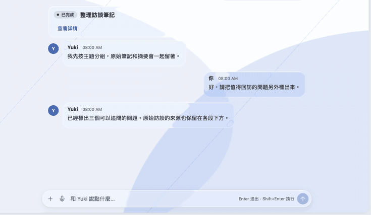
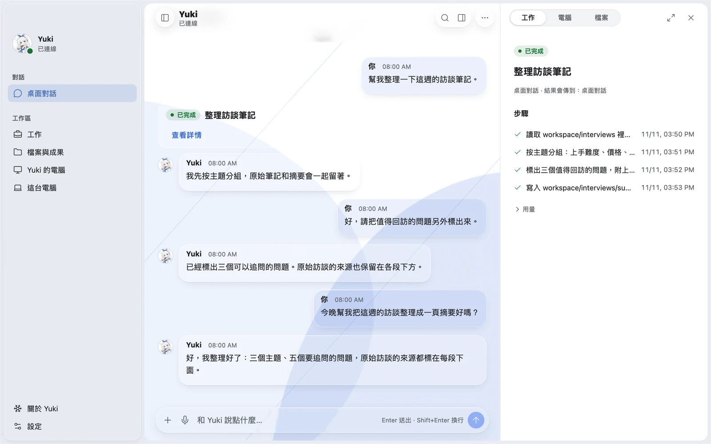
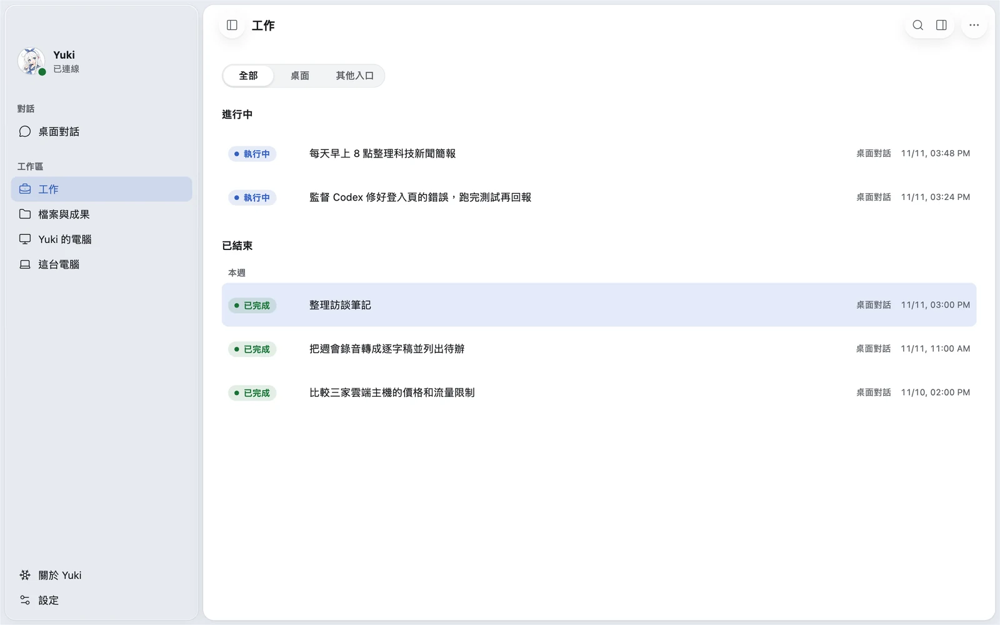

<!-- release-baseline: version=4.0.2 schema=0156 -->

中文（默认） · [English](README.en.md)

<div align="center">

<p></p>

<h1>Yuki</h1>

<p>一个在真实对话中持续存在的社会化 AI Agent</p>

<p>
  <a href="https://github.com/YuanYeYouTao/Yuki/releases/tag/v4.0.2"></a>
  
  <a href="https://github.com/YuanYeYouTao/Yuki/actions/workflows/quality.yml"></a>
  <a href="LICENSE"></a>
</p>

[4.0.0 更新说明](docs/releases/v4.0.0.md) · [升级到 4.0](docs/upgrade-4.0.2.md) · [Benchmark 报告](docs/benchmarks/2026-10-20-yuki-flash-1017/README.md) · [桌面客户端](https://github.com/Institute-of-Agent-Life/Yuki-Desktop) · [使用帮助](docs/help.md)

</div>

Yuki 是一个开源、自托管的 AI Agent。她在 QQ、Telegram、飞书、Lark 和个人客户端里参与对话，记得人、偏好和一起经历过的事；她还有一台自己的 Linux 电脑，可以写代码、运行程序、用浏览器、按时做事。经你授权，她也能操作你自己的电脑。

人物、记忆和任务都保存在你自己的部署里。换模型、换账号或换聊天平台，Yuki 还是同一个 Yuki。

<p align="center"></p>

<table>
  <tr>
    <td width="50%"></td>
    <td width="50%"></td>
  </tr>
  <tr>
    <td align="center">对话旁打开工作详情，一步步看她做了什么</td>
    <td align="center">进行中和已完成的工作，定时任务和她监督的编码 Agent 也在这里</td>
  </tr>
</table>

<p align="center">桌面端：<a href="https://github.com/Institute-of-Agent-Life/Yuki-Desktop">Yuki Desktop</a> · <a href="img/showcase/yuki-desktop-tour.mp4">▶ 17 秒演示视频</a></p>

## 能做什么

| 能力 | 具体是什么 |
| --- | --- |
| 长期聊天与记忆 | 在群聊和私聊里持续交流，查旧事；可以让她记住、纠正或删除某件事。同一个人的多个平台账号归到同一个人物 |
| 文件与媒体 | 看图片、视频、语音和文档，接着追问；发送文字、图片、文件和表情 |
| 搜索与网页 | 使用模型自带的搜索或单独配置的搜索连接，读取网页正文 |
| 自己的电脑 | 一个常驻的 Linux 环境：终端、Python、Node.js、Git、装软件、跑后台服务；按安装档位附带浏览器，或一个你能观看、随时接管的桌面 |
| 你的电脑 | 通过 [Yuki Desktop](https://github.com/Institute-of-Agent-Life/Yuki-Desktop) 和本机连接器，在你明确开启后运行命令、读写文件、截屏并操作窗口、使用一个专用 Chrome；也能调用你电脑上的 Codex、Claude Code 或其他 ACP Agent |
| 文件往返 | 在聊天附件、她的环境和你的电脑之间复制文件 |
| 长任务与定时任务 | 任务重启后接着做，可以中途插话、查进度、拆子任务、按时间或事件执行 |
| 插件 | 通过 [Plugin API 9.0](docs/plugin-development/index.md) 扩展 |

模型支持 Chat Completions、Responses、Claude Messages 和 Gemini 四种协议。聊天、记忆整理、视觉、语音转写和搜索可以分别选择模型。

## 聊天之外，做事的能力如何

我们在本地外部任务容器中，给 Yuki 的原生 Main／Work 执行链跑了两套完整评测。使用 **DeepSeek V4.1 Flash 1017**，沿用 Yuki 的工具和执行记录。

| Benchmark | 通过 | 任务解决率 | 输入缓存命中率 |
| --- | ---: | ---: | ---: |
| SWE-bench Lite，300 题 | 216 / 300 | **72.00%** | **97.47%**，全量计量完整 |
| Terminal-Bench 2.0，89 题 | 66 / 89 | **74.16%** | **98.32%**，已记录用量 |

SWE Lite 覆盖真实仓库的 issue 修复；Terminal-Bench 涵盖编译、系统配置、数据处理等终端任务。SWE 累计输入约 4.63 亿 token，其中约 4.52 亿命中缓存；多轮任务中的重复上下文得到了大量复用。

评测于 2026-10-20 开始，固定源码为 `313b6b9b`，早于 4.0.0 正式版。TB 的 84 题计量完整，5 题保留待核标记；只取完整 84 题，缓存命中率为 **98.26%**。6 题同时记录超时与验证通过，按原 Harbor reward 计入通过数。配置、逐题结果、token、耗时和失败分析都在[报告目录](docs/benchmarks/2026-10-20-yuki-flash-1017/README.md)。

## 安装

先选一种方式：

| 我想… | 怎么装 |
| --- | --- |
| 在自己电脑上用，最简单 | 装 Docker，再用 [Yuki Desktop](https://github.com/Institute-of-Agent-Life/Yuki-Desktop) 的「在本機部署 Yuki」 |
| 放在服务器上 24 小时在线，接 QQ、飞书或 Telegram | 在服务器上运行安装器，再用它给出的绑定码连接 Yuki Desktop |

不熟悉命令行，也可以[让 AI 帮你装](#让-ai-帮你安装)。

### 方式一：在自己电脑上

1. 安装 Docker：macOS 用 [Docker Desktop](https://docs.docker.com/desktop/)、[OrbStack](https://orbstack.dev/) 或 [Colima](https://github.com/abiosoft/colima)；Windows 用 Docker Desktop（WSL 2）；Linux 用 Docker Engine。
2. 下载并打开 [Yuki Desktop](https://github.com/Institute-of-Agent-Life/Yuki-Desktop)，选「在本機部署 Yuki」。
3. 选一个存放数据的目录，填 Yuki 的名字、你的名字和模型服务（可从「服務預設」里选），再选「Yuki 的電腦」的大小，点「開始部署」。

部署完成后桌面端会自动连上，直接开始对话。

### 方式二：在服务器上

服务器只需要 Docker 和 Compose 插件（Linux 容器，amd64 或 arm64）。

```sh
curl -fsSLO https://github.com/YuanYeYouTao/Yuki/releases/download/v4.0.2/install.sh
sh install.sh
```

Windows 用 PowerShell：

```powershell
Invoke-WebRequest https://github.com/YuanYeYouTao/Yuki/releases/download/v4.0.2/install.ps1 -OutFile install.ps1
powershell -ExecutionPolicy Bypass -File .\install.ps1
```

安装器会依次问你：Yuki 的名字、你的名字、模型连接（以及要接哪些聊天平台，QQ 默认不装）、Yuki 的电脑要多大。然后它启动全部服务，等环境就绪，最后显示：

```text
Connect Yuki Desktop (https://github.com/Institute-of-Agent-Life/Yuki-Desktop):
  Pairing code: XXXXXXXXXXXXXXXXXXXXXXXXXXXXXXXX
  No public address (CLIENT_PUBLIC_URL) is set, ...
  One-time, valid for 24 hours; a new one: sh deploy/pair.sh
```

服务器在 `.env` 配置了其他电脑可达的地址 `CLIENT_PUBLIC_URL` 时，这里给出完整的 `yuki://pair?server=…&code=…` 链接，在装有 Yuki Desktop 的电脑上打开或粘贴即可连上。没有公共地址时只给出配对码：在 Yuki Desktop 用「部署到我的服务器 / 通过 SSH 连接」连到这台服务器，并使用这个码。连上后你就是这个 Yuki 的管理员。配对码一次性、24 小时内有效，过期了在部署目录运行 `sh deploy/pair.sh` 再取一个。

Yuki 只在服务器本机的 `127.0.0.1:8080` 上监听，不暴露到公网。从自己的电脑连接服务器，推荐用 [Tailscale](docs/operations/tailscale-connection.zh-CN.md)；有域名也可以配 [HTTPS](docs/operations/desktop-local-deployment.zh-CN.md)。

### Yuki 的电脑选多大

| 大小 | 内容 | 内存约 |
| --- | --- | --- |
| `lite` | 终端和文件 | 512 MiB |
| `headless` | 再加一个无头浏览器 | 1 GiB |
| `desktop` | 再加一个可观看、可接管的桌面 | 3 GiB |

安装器按机器内存给出推荐，你可以改选。之后要换，改部署目录 `.env` 里的 `YUKI_SANDBOX_PROFILE`，再执行 `docker compose up -d`；换大会在原环境里补装软件，已有文件都保留。Docker 已注册 gVisor（`runsc`，带 `--overlay2=none`）时用它隔离，否则用默认的 `runc`。

无人值守安装（适合脚本或 AI 代为执行）：

```sh
sh install.sh --yes --profile lite --owner-name "你的名字" --answers model.json
```

`model.json` 写模型连接：`{"protocol": "chat_completions", "base_url": "...", "api_key": "...", "model": "..."}`，`protocol` 取 `chat_completions`、`responses`、`anthropic_messages` 或 `gemini`。装完删除这个文件。

### 让 AI 帮你安装

把[安装提示词](docs/install-with-ai.md)整段复制给能操作终端的 AI 助手（如 Claude Code、Codex），它会检查环境、带你装 Docker、运行安装器并核对结果。密钥由你自己在终端里输入，不要贴进对话。

### 装好之后

- **人格**：编辑部署目录里的 `character/SOUL.md`。
- **聊天平台**：Telegram 见[接入说明](docs/operations/telegram.zh-CN.md)，飞书和 Lark 见[接入说明](docs/operations/feishu.zh-CN.md)，凭据在 Yuki Desktop「设置 → 平台」中填写。QQ 不默认安装；需要时自备 [SnowLuma](docs/deployment/snowluma.md) 镜像，在部署目录运行 `sh deploy/snowluma.sh <镜像>`，再在 Desktop 的电脑窗口扫码登录。
- **连接你自己的电脑**：在 Yuki Desktop 的「設定 → 這台電腦」里连接，见[本机连接器](docs/operations/local-agent-connector.zh-CN.md)。

## 升级

在原安装目录重新运行同一个安装器即可升级：它替换发布文件，保留 `.env`、`data/`、`docker-compose.override.yml` 和全部数据卷，数据库在启动时自动迁移。升级前请备份。从 3.9.0 升级还要处理数据库文件名、人格文件、管理员资格、插件，以及把宿主机上的沙箱 Manager 迁进 Compose，请按 [4.0 升级指南](docs/upgrade-4.0.2.md)逐步操作。

## 文档

| 文档 | 内容 |
| --- | --- |
| [使用帮助](docs/help.md) | 聊天命令、模型配置和日常管理 |
| [4.0.0 更新说明](docs/releases/v4.0.0.md) | 这一版的全部变化 |
| [让 AI 帮你安装](docs/install-with-ai.md) | 复制给能操作终端的 AI 助手的安装提示词 |
| [4.0 升级指南](docs/upgrade-4.0.2.md) | 从 3.9.0 或 4.0 开发版升级 |
| [持久工作环境](docs/operations/persistent-environment.zh-CN.md) | 沙箱档位、资源、网络和迁移 |
| [桌面电脑与有头环境](docs/operations/desktop-computer.zh-CN.md) | Yuki 自己电脑上的截屏、点击和浏览器 |
| [本机连接器](docs/operations/local-agent-connector.zh-CN.md) | 连接你的电脑、完整访问、屏幕与浏览器、原生编码 Agent |
| [Telegram 接入](docs/operations/telegram.zh-CN.md) | BotFather、群消息隐私模式与 webhook |
| [飞书与 Lark 接入](docs/operations/feishu.zh-CN.md) | 自建应用、权限、长连接和媒体 |
| [SnowLuma（QQ）](docs/deployment/snowluma.md) | 自备镜像、QQ 网关部署与登录 |
| [Plugin API 9.0](docs/plugin-development/index.md) | 插件开发与 SDK |
| [架构索引](docs/architecture/README.md) | 现行架构文档入口 |
| [CHANGELOG](CHANGELOG.md) | 历史版本变化 |

## 客户端与生态

| 项目 | 用途 |
| --- | --- |
| [Yuki Desktop](https://github.com/Institute-of-Agent-Life/Yuki-Desktop) | Windows、macOS、Linux 桌面客户端：聊天、任务、文件、记忆、电脑、模型与用量；也能在本机部署 Yuki。单独发版 |
| [个人 API 与 ACP](docs/architecture/client-api.md) | 设备配对、消息、附件、事件流、任务查询与接续，外部 ACP 客户端接入 |
| [Yuki-Semantic-Participation](https://github.com/Institute-of-Agent-Life/Yuki-Semantic-Participation) | 可选的语义参与控制器 |
| [Yuki-Kun-Game](https://github.com/Institute-of-Agent-Life/Yuki-Kun-Game) | 独立养鲲游戏插件 |
| [Yuki-GitHub-Monitor](https://github.com/Institute-of-Agent-Life/Yuki-GitHub-Monitor) | 独立 GitHub 仓库监控插件 |

## 参与开发

需要 Python 3.12、[uv](https://docs.astral.sh/uv/) 和 C 编译器（随包构建 SQLite 向量扩展；Linux 用 GCC/Clang，macOS 用 Xcode Command Line Tools，Windows 用 MSVC 开发者终端）。使用发布镜像时不需要编译器。

```bash
git clone https://github.com/YuanYeYouTao/Yuki.git
cd Yuki
uv sync --all-extras --managed-python
uv run ruff check .
uv run mypy --platform linux src
uv run pytest tests/unit -q -m "not native_worker"
```

管理命令是 `yuki`，服务入口是 `yuki-bot`。改动架构、运行时、工具或持久化之前，先读[共同架构约束](docs/architecture/development-contract.md)和[架构索引](docs/architecture/README.md)。

## License

当前源码采用 [AGPL-3.0-only](LICENSE)。历史版本以随包许可证为准。
