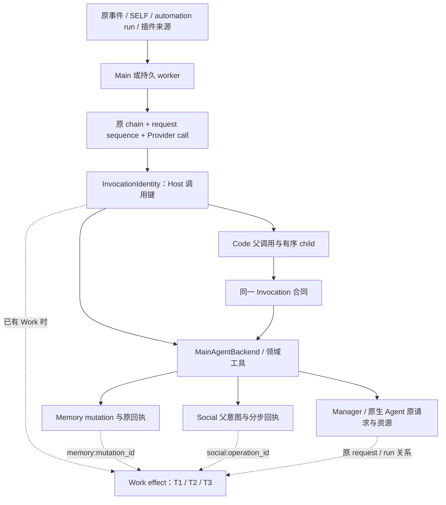

# #501 操作身份统一：必要性、收益、代价与最小方向

日期：2026-10-23。状态：**调研证据已归档，用户已授权升级为[删减修复任务书](Yuki-501原调用身份与回执恢复删减修复任务书-2026-10-23.md)；运行时尚未实施。** 本文保留调查基线、复现与估算，不维护第二份施工待办。

## 1. 结论先行

建议选择**局部收敛：澄清调用键的名称，修复原回执的读取与投影断点，保留领域独立 ID**。不建议把所有 `operation_id` 换成同一个 ID，也不建议增加全局操作账本。

[Issue #501](https://github.com/YuanYeYouTao/Yuki/issues/501)提出的是必要性评估，并没有决定扩大重构。本轮以合并 [PR #500](https://github.com/YuanYeYouTao/Yuki/pull/500) 后的 main 为基线。#500 已修复插件 Memory 用事件级键覆盖逐调用身份的问题；不能把已修问题重新算作本次重构收益。

调查结果支持以下判断：

- Main、Code Mode、Work 和持久 worker 已经共用 `InvocationIdentity`。目前没有发现这条主链需要重新设计身份体系才能解决的丢 ID 问题。
- 存在明确命名歧义：`ToolInvocationContext.call_id` 实际承载 Host 的完整调用键，并非 Provider 返回的裸 `call_id`。
- **发现并隔离复现三处真实缺口**：插件 Memory 已成功修改的回执被后续版本状态否定；Memory 已提交而 Work 汇总未保存时不能读回领域结果；原生 Agent 控制操作有领域回执时，Work 恢复仍可能返回无原操作 ID 的未知结果。
- 这三处主要是**原回执消费不完整**，不是“所有 ID 不同”造成的。局部删除错误判断、补齐既有领域 reader 可以解决；不需要批量改旧 ID、增加统一状态机或让普通聊天强制登记 Work。
- **可维护性有望增强，但不应承诺总代码明显变少。** 单纯命名改造净行数接近零；插件二次投影预计可净减约 20–45 行；补齐恢复读取又会增加必要代码。完整局部方案更可能是小幅净增，远低于大重构成本。

后续施工已集中到“原调用身份与回执恢复删减修复任务书”，按删除错误判定和复用原查询推进，不以“统一”诱导实现去合并不同实体。

## 2. 基线、范围与证据等级

### 2.1 固定源码基线

本轮 `git fetch origin main` 后，main 为：

```text
8aef3f0bb2969856e014e052717ef742b1c91461
2026-10-23T18:12:54+08:00
Merge pull request #500 from YuanYeYouTao/codex/code-deletion-b1-20261023
```

用户工作目录仍在 `25cd6083`，并有既有未提交材料。因此源码调查、测试使用独立只读工作树 `D:/Code/My_Github_Repo/Yuki-issue-501-research`，报告交付到用户原目录的架构文档中。本文源码定位均指上述固定提交，**不是旧工作目录中同名文件的行号**。

Issue 读取时为 OPEN、无评论，最后更新时间为 `2026-10-23T10:19:34Z`。GitHub 连接器返回空内容/分页错误后，改用 `gh issue view` 和 `gh pr view` 核实。没有写 Issue 评论、创建 PR 或操作生产。

先阅读用户提供的 AGENTS.md，再阅读新基线的共同开发约束、架构索引、Main、Tool Kernel、Memory/变更、插件、worker、媒体和持久执行相关合同。三名子 Agent 分别跟踪主执行链、Memory/插件、Social/外部效果；主审交叉检查恢复 reader、实际调用者和估算口径。

### 2.2 本文如何使用证据

| 等级 | 本轮证据 | 能证明什么 |
| --- | --- | --- |
| 当前源码 | 固定提交下定义、真实调用点、数据库写入和恢复消费者 | 接线和持久关系现状 |
| 现有回归 | 相关测试实际执行 | 已有断言覆盖的行为；不能证明没有新缺口 |
| 新隔离探针 | 临时 SQLite、真实服务/仓库、重建领域提交后的中断边界 | 三处局部缺口可复现；不等于真实设备、真实模型或 OS kill 验收 |
| 理论判断 | 下文方案比较及增删行数 | 实施前的估算；不是已经实现的 diff 或性能结果 |

本轮没有读取生产数据库，没有调用真实模型、连接用户原生 Agent 或发送 QQ 消息。没有测量线上发生频率、延迟、缓存、Token 节省；不会把局部回归当成这些指标的验收。

## 3. 当前实际上有哪些身份

### 3.1 身份不是一个等价集合

| 身份 | 指向什么 | 生命周期/关系 | 处理建议 |
| --- | --- | --- | --- |
| Person、Conversation、内部 `event_id` | 主体、场景、已入账来源 | 一条事件可引出多次独立调用；无事件工作也存在 | 保留原件，不能用事件替代调用键 |
| Work / execution / initiative / automation run | 工作或一次真实执行来源 | 一个 Work 跨多次请求和工具调用；run 也有各自 owner | 保留，不统一成一次工具调用 |
| `chain_id + request_sequence + provider_call_id` | 某次模型响应内的原协议调用 | Provider 可在不同响应中复用同名 call ID | 保留协议配对及请求范围 |
| `InvocationIdentity.operation_id` | Host 接纳的单次调用 | direct 为原链/序号/Provider ID 的稳定编码；Code 为父键加接纳序号 | 共同调用身份的现有中心 |
| `parent_operation_id`、child ordinal、engine/feed ID | Code 父子调用与 VM 暂停/喂入对应 | 一个父调用有多个 child，VM ID 不等于 Host ID | 保留明确关系，不按完成顺序生成 |
| Social `operation_id` | 一项发送意图及领域回执 | 原调用可能产生正文分段、文件、附言、异步配图等多项效果 | 保留领域主键与子步骤关系 |
| Memory 调用 `operation_id` | 变更请求的幂等身份输入 | Main 用 Host 键；插件用 callback+Memory 序号；后台有原 run/item 来源 | 应明确叫调用键，不能误认成 fact ID |
| Memory `mutation_id`、fact ID、Dream operation ID | 一笔领域变更、事实版本、Dream 整理操作 | 一次变更可产生/替代多个事实，Dream 来源/结果独立关联 | 保留；不是可互换字段 |
| Manager request/run、外部 Agent operation/session/execution | 外部请求与实际执行资源 | 控制操作不一定创建新 run；多个控制操作可作用于同一 execution | 保留请求与资源身份的区别 |
| SDK callback identity + ordinal | 插件本次调用顺序 | 有可信持久 callback 才能按原顺序跨重入认回执 | 不能声称任意插件回调都可跨重启 exactly-once |

**关联键回答“这次调用产生了什么”，领域键回答“这项效果是什么”。两者可以有稳定映射，没必要相等。**

### 3.2 真实调用链



图中的 Work 是已有执行的持久责任边界，不是新增普通调用的准入条件。SDK 直接 Memory/发送也有自己的可信 callback 和领域入口，不必虚构 Provider call 才能加入此图。

### 3.3 已经正确工作的部分

1. Main 从真实 transcript 传 chain 和请求序号；Work 优先采用已恢复的 WorkSession 身份。相同参数两次调用保持独立，不按正文去重。
2. `MainAgentBackend` 把 `InvocationIdentity.operation_id` 放入 `ToolInvocationContext.call_id`。Memory、Social、自动化创建和 workspace 接到的是 Host 键。
3. Work 的 T1 准备、T2 派发/计费、T3 结果记录区分未派发、未知和已确认。原调用改参数会冲突；未知不会自动重跑。
4. Code child 使用父操作和 Host 接纳序号，不由并发完成顺序、参数内容或 VM 的临时 ID 代替。worker 仍使用同一 Runner、WorkControl 和根预算。
5. Social 在同一领域事务关联原 Work effect；文本分段、文件与附言、异步配图各认原事实。长调用键的 hash 是存储表示，不是第二份业务身份。
6. PR #500 后插件 Memory 使用 `callback:memory:ordinal`，保留单独 Memory 序号。发送仍用独立 send 序号；混成一个总序号会使插入发送后旧 Memory 键发生变化。
7. 自动化创建键把来源与原调用键组合；到期发生由 automation 与 scheduled time 认原 run。管理命令按原 principal/request 恢复，这些非模型入口不应被迫制造 `InvocationIdentity` 的 Provider 字段。

后台 Memory 也不是遗漏的 Main 调用：自省按 `reflection:<run_id>:proposal/episode:<index>` 保原已付批次内的结果；自动提取的 `automatic_claim` 指纹含原 event、canonical target、完整 claim/evidence，用于同源抽取去重；Dream 保原 run、cluster、preview、operation 与 mutation 的事务关系。自动提取的内容指纹不是 Main 新调用按正文去重，不应套用后者规则删除。对应实现见 [自省](https://github.com/YuanYeYouTao/Yuki/blob/8aef3f0bb2969856e014e052717ef742b1c91461/src/yuki/memory/self_reflection/service.py#L433)、[自动提取](https://github.com/YuanYeYouTao/Yuki/blob/8aef3f0bb2969856e014e052717ef742b1c91461/src/yuki/memory/mutation/service.py#L1918)、[Dream](https://github.com/YuanYeYouTao/Yuki/blob/8aef3f0bb2969856e014e052717ef742b1c91461/src/yuki/memory/dream/service.py#L454)。

证据入口：[调用身份 S1](#s1)、[主后端 S2](#s2)、[Work 与恢复 S3](#s3)、[Code/worker S4](#s4)、[领域接线 S5](#s5)。

### 3.4 不应被误删的“重算”和特殊分支

- `WorkSession.call_key()` 从已恢复的原 chain/sequence/call 进行确定性编码。它不是从平台消息号或内容重建身份；删除三行 helper 却新增持久字段没有净收益。
- 来源/合同变化后的新链，先用旧 chain/sequence 读原效果，再带入已有证据；不能因此把新链和旧调用合成一个 ID。
- 首次 `accept` 在同一事务创建 Work，并把原 accept 调用的 owner 指向新接纳 Work，effect key 不变。这是首次建立 owner，不是改写已有执行。
- Code lifecycle 控制由 driver 完成 T2/T3。强制再套 InvocationService 可能重复准入和记账。
- 只读结果复用会验证工具及参数签名，但并不把写操作身份改成内容 hash。不能因“参数不应决定调用身份”删掉原只读回执的合法性验证。

## 4. 真实缺口：身份已经保留，回执没有被正确消费

### F1：插件 Memory 修正结果被后续状态否定

**已复现，优先修复。** 同一个可信 callback 执行：

```text
add(original) -> person:1
update(person:1, first correction) -> person:2，成功
update(person:2, second correction) -> person:3，成功
关闭数据库连接池，再按相同 callback 和调用顺序重入
原 update1 应认回 person:2；实际 memory.not_found，返回 person:1
随后 update2 也得到 memory.not_found
```

领域 mutation 已保存原操作和结果。问题出在 `MemoryAdmin.correct_fact()` 拿到原 `new_fact_id` 后，再调用 `_visible_person_correction()` 以**当前人物事实列表**核对；Host Facade 又调用 `_visible_person_projection_fact()` 做一次当前列表投影。`person:2` 已被下一次修改 superseded，旧成功因此变成失败。第二个失败还受到第一个错误返回旧 ID 的传播影响，不能视为第二个独立根因。

最小方向：原回执决定是否提交及原结果 ID，删除“当前 active 列表中还存在，才算上一次成功”的判定。当前人物授权、真实 owner、隐私删除与可展示正文仍分别处理；不能把删除 active 重判扩成越权读取历史正文。

对照探针 `add -> delete -> 同序重入` 通过，fact ID 与 delete 效果稳定。add 返回的事实状态由 active 变为 invalidated，说明当前 Facade 返回的是事实投影，并非整份 SDK JSON 的冻结快照。本任务应明确“原效果及结果 ID 稳定”与“当前对象展示”的区别，**不为了逐字重放再增加一套 SDK 结果账本**。

定位：[Memory 投影 S6](#s6)。完整复现见 [Memory 探针](research/issue-501/memory_recovery_probe.py)，本基线按正确行为断言会失败。

### F2：Memory 已提交，Work 的领域恢复 reader 不认 `memory:`

**已复现，属于恢复结果缺口。** 在隔离库真实执行 `prepare_effect -> admit_dispatch -> Memory mutate`，Memory 事实、mutation receipt 与 `invocation.original_domain_ref=memory:<mutation_id>` 已原子提交；故意不执行 Work T3，再关闭连接池并读取原 effect：

```text
Memory receipt.outcome = committed，new_fact_id = 1
Work invocation.dispatch_started = true，budget_admitted = true
Work invocation.original_domain_ref = memory:<原 mutation UUID>
WorkJournal.effect_result = execution_outcome_unknown
uncertain = true，replay_forbidden = true
```

`WorkJournal.effect_result()` 对 original_domain_ref 只调用 `inspect_social_operation()`，后者只识别 `social:` / `social-emoji:`；随后只查 SandboxTaskRun，最后返回 generic unknown。Memory 的原引用还在，但消费端没有恢复其领域结果。

正常返回后 `InvocationService` 的 typed outcome/fallback 能处理部分结果发布失败；**它不能覆盖进程在领域 commit 后、typed outcome/T3 保存前终止的窗口**。这里通过持久边界重建证明 reader 缺口，没有声称做过 OS 强杀测试。

最小方向：沿已保存的 `memory:` 引用，由 Memory 所属服务提供只读、类型化原回执结果，接入现有 RuntimeEffectQueries/Work reader。核原 Work/effect/ref 的实际归属及当前可披露范围。没有原回执时仍保持未知；读取不执行 mutation、不重置预算、不调用模型。

不要在 Runtime 中拼 Memory 内部表猜“某个事实存在，所以操作成功”，也不要为了修 reader 新建全局操作表。定位：[Memory 提交 S7](#s7)、[恢复读取 S8](#s8)。

### F3：原生 Agent 非 run 控制操作的领域回执没有进入 Work 恢复

**已隔离复现 steer，其他同分支动作属源码推断。** `AgentRepository.prepare()` 为所有获准操作保存 AgentOperation，但只有 `prompt/queue/watch` 同时登记 SandboxTaskRun；`steer/respond/cancel/detach` 不创建同类 run。

本轮用真实仓库保存 steer 的原操作及 succeeded 响应，再从原 ID 读取：外部 Agent 服务能读回原 succeeded，无需设备连接；同一个 Work effect 经 WorkJournal 却得到 generic unknown，且没有返回 `operation_id/request_id`。原因是 Work fallback 只查 `sha256(effect_key)` 对应的 SandboxTaskRun，没有读取已经存在的原生控制操作回执。

因此这里不是“确认丢失后必然重复 steer”，也不是领域回执丢失：`replay_forbidden` 仍在。实际后果是模型无法从原工具回执直接认回已知操作，人需要额外查原操作；不应把该未知错误地汇报成已失败或擅自重发。

最小方向：既有原生领域提供原操作只读投影，Work 通过已有确定性请求键或明确原引用调用该 reader，核 actor、Work、action 和来源。领域与 Work 仍各负责自己的事实；不调用可能派发新效果的写动作 `execute()` 来充当恢复 reader。控制操作成功也不代表被管理的原生执行成功或 Work 目标完成。

测试中 succeeded 是模拟连接器响应，**不代表任何真实设备执行成功**。定位：[外部操作 S9](#s9)、[恢复读取 S8](#s8)，见 [原生控制探针](research/issue-501/external_control_probe.py)。

### F4：内部字段命名歧义

这是维护问题，尚未据此发现新的 Main 跨调用碰撞。

`ToolInvocationContext.call_id` 建议改为 `invocation_key`，或至少在字段和合同中明确“Host 完整调用键”。机械改名约涉及 **7 个生产文件、20 行**：1 处定义、1 处构造和 18 行访问；测试有 18 处构造，约 14 处关键字需同步。

不能全文替换所有 `call_id/operation_id`。Provider ID、Social 的 callback 域内键、公开返回、数据库列和持久 JSON 都有自己的含义。内部改名不改 key 编码、不改旧 metadata 字段、不加长期双名 property。

## 5. 三种方案比较

| 方案 | 好结果 | 代价与后果 | 判断 |
| --- | --- | --- | --- |
| A 保持实现，仅补术语与透传合同 | 零运行风险；立即降低阅读混淆 | F1–F3 仍存在，不能宣称 issue 已彻底解决 | 可作为第一步，不是完整修复方向 |
| B 局部收敛：F1–F4 | 原成功不被当前状态推翻；领域已知结果可恢复；减少接线误读 | 需补 reader 及反例验证，代码可能略增；仍须准确保留 unknown/权限边界 | **推荐** |
| C 所有入口统一 ID/统一全局账本 | 理论上可提供统一查询入口和统一关联字段 | 改 public/持久合同；一对多仍需子表或命名空间；增加 writer 和故障窗；历史迁移与多进程配套成本高 | 本轮无必要性证据，不推荐 |

若 C 只是给现有字段增加一个共同接口名、不改持久语义，它实际属于 B；若 C 要删除领域主键、收归一个全局状态机，就必须承担下列具体后果。

### 5.1 大统一会碰到的真实后果

1. **一对多无法消失。** 一个 send 的两段文字、文件与附言、配图可能分别成功/未知；一个 Memory merge 有多个来源和结果；一次外部 prompt 后还有多个控制操作。用一个 ID/状态覆盖它们，会丢掉部分成功和未确认步骤。
2. **现存历史会失去直接寻址。** Social 唯一键、旧 Memory 幂等指纹、Manager 请求键、Code 父子键都在真实数据与回执里。改编码而不迁移会读不到原结果；迁移则要同步外键、JSON 引用、文件快照、连接器本地 journal 和历史 reader。
3. **哈希数量减少不等于身份复杂度减少。** hash 有的编码调用键，有的约束重复 payload，有的定位外部 request；都写 SHA256 不代表可合并。删除参数指纹反而会让同 ID 携不同参数误认成功。
4. **统一写账本会新增中断窗口。** 领域 commit 与全局 commit 分离时需要跨域协调；强行合并事务又会扩大 writer 持有和 owner 耦合。当前已有原子 domain ref，先修消费即可。
5. **外部协议与主库不属于同一事务。** Native Connector journal、Manager 的独立存储不能因 Bot 统一 ID 就得到跨进程 exactly-once；未知仍需原操作核对。
6. **无模型入口会被迫填假字段。** 后台 Dream、self-reflection、管理命令和 SDK callback 没有自然 Provider call ID。为统一 DTO 创建假的 chain/request 只会增加适配层。
7. **回退变困难。** 一旦改写已发生效果的键，旧版本未必能认新回执。恢复旧数据库会丢升级后的真实事实，不是正常代码回退方案。

### 5.2 局部方案能够带来的收益

最直接的收益是行为正确和排障简单：同一原调用可以从 Host 键追到领域效果，原回执已知时不再被包装成未知；后来状态变化不否定原提交。接新工具时，开发者只需选择原来源、稳定调用键和所属领域 reader，而不是理解另一套全局生命周期。

F1 删除两次当前列表投影还可能减少查询和扫描，但收益只存在于对应修改/重入路径。本轮未测延迟，不预测整体吞吐、模型成本或缓存命中率。F2/F3 会增加恢复时的领域只读查询，正常 T3 成功路径不必增加统一写入。

## 6. 代码量：能减多少，为什么不承诺大幅下降

### 6.1 实测规模不是可删规模

固定基线按 UTF-8 Python 文件物理行计数，含空行、注释、docstring，排除文档、前端与虚拟环境：

| 范围 | Python 文件数 | 物理行 | 含 `operation_id` 文件 | 字符串出现次数 |
| --- | ---: | ---: | ---: | ---: |
| `src/yuki` | 641 | 167,039 | 55 | 384 |
| `src/yuki_plugin_sdk` | 18 | 2,085 | 0 | 0 |
| `tests`（含 support） | 530 | 138,693 | 66 | 319 |
| `migrations` | 100 | 15,208 | 6 | 29 |
| `packages/yuki-agent-connector` | 21 | 5,207 | 9 | 41 |

出现次数采用 `text.count('operation_id')`，包括复合名字、注释和字符串，不是语义符号数；SDK 零命中不表示 SDK 没有 Host 代持的身份。该统计用于估计全文替换的波及面，**不能把 55 个文件都计为重复实现**。

现有核心文件：`invocation.py` 173 行、`invocation_service.py` 328 行、`work_session.py` 1,047 行、`codemode/driver.py` 1,223 行、`work_repository.py` 2,892 行。这些包含协议、预算、恢复和生命周期，不能按固定百分比宣称可删除几千行。

### 6.2 局部方案的底层估算

口径：只估运行源码，净变化 = 新增行 − 删除行；改名的等量替换不算净减。区间来自已定位函数与必要消费者，未实施，不是承诺。测试、文档、探针单列。

| 改动单元 | 理论删除 | 理论新增 | 理论净变化 | 估算依据 |
| --- | ---: | ---: | ---: | --- |
| F4 内部字段改名与必要说明 | 约 20 行替换 | 等量替换 + 0–4 | 0 至 +4 | 单定义/单构造及 18 行访问；不增加兼容属性 |
| F1 去掉原成功后的两层 active 投影 | 40–55 | 8–20 | **−47 至 −20** | 两个约 17/20 行 helper 与调用装配；保必要 owner/展示核验 |
| F2 Memory 原回执 reader 接入 | 0–10 | 40–85 | +30 至 +85 | 复用原 mutation receipt/ref；增加类型化领域读取和现有分派 |
| F3 原生控制原回执 reader 接入 | 0–15 | 40–100 | +25 至 +100 | 复用原 operation/request；范围含当前来源核对及投影 |
| **推荐组合，机械区间合计** | — | — | **+8 至 +169** | 不计尚未证明的共用代码删除 |

F1 的工程沟通值可取净减约 20–45 行；表格保留上下界算术值 −47。整体宜按**源码基本持平到增加约 170 行**规划，而不是“本次能减几千行”。最终可能通过复用现有 reader 再减少，但本轮没有 diff 可以证明。

测试需要把三处探针转成行为回归，并加入来源冲突、隐私与未知反例，理论新增约 150–350 行；通过复用 fixture/参数化可能减少。这里只是工作量估算，不要求把探针逐行搬进测试，也不以数量作验收门槛。文档和本报告可能让总仓库行数增加，不能与运行源码删减混算。

### 6.3 更大统一为什么无法得到可信删减承诺

现有 direct/child 编码两个函数本体合计约 22 行，`WorkSession.call_key` 仅约 3 行。即便都删掉，也远不足以抵消新增的跨领域 DTO、reader、迁移和兼容处理；其中多数还不应删。

大统一若保留领域 ID，只增加关联抽象，通常是增加代码；若删领域 ID，就必须证明所有一对多事实、外部协议和历史回执仍可表达。本轮没有这样的等价设计。因此对方案 C **不给貌似精确的净减百分比或工期**。源码涉及面至少已覆盖多领域、迁移与独立 Connector，风险明显超过局部方案。

## 7. 可维护性判断

| 评估项 | 保持现状 | 局部收敛后 | 全局统一的风险 |
| --- | --- | --- | --- |
| 名称是否能解释实体 | `call_id` 同时让人想到 Provider/Host | 内部名字明确，公开/持久字段有术语映射 | 同叫 operation 但仍有多种生命周期，可能更难辨认 |
| 已提交效果在哪里找 | 大多数路径可追，三处断点 | 沿原 effect/ref 读取领域事实 | 全局状态和领域事实可能不一致 |
| 新增工具的接入 | 需知道原调用与领域关系 | 复用 Invocation，提供领域原回执读取 | 所有领域都依赖中央账本协议 |
| 修改一个领域的波及面 | 相对局部 | 仍保持领域 owner 与窄 reader | 全局 DTO/迁移影响多个运行进程 |
| 删除代码的确定性 | 二次状态判断可删 | 删除错误判定，少量必要查询补齐 | 容易删掉表面重复但承担不同事实的状态 |

所以可维护性增强的依据不是“ID 数量更少”，而是**更少的隐含语义、更少的重复裁决、原回执能沿已有关系被读取**。若实现后产生通用注册中心、全量启动校验、统一重试器或新全局 revision，应重新证明必要性；本轮证据没有要求这些机制。

## 8. 兼容、边界与容易走偏的修法

- 保持原内部 event/Person/Conversation、Work、原调用编码、domain ID、原 JSON metadata 与预算。内部字段改名不等于修改持久字段名。
- Memory 的 `_fingerprint({"operation_id": key})` 中，字面字段名也是现存幂等编码的一部分。内部变量改成 `invocation_key` 时，不能一起替换该 JSON key，否则旧回执的 hash 会变化。
- F1 恢复的是原提交事实，不保证旧正文永远可见；真正遗忘或撤权不能因原回执存在而恢复被删资料。
- F2/F3 只补原结果读取。原 receipt 缺失、prepared/executing/unknown 时照实返回，不因能算出请求键就认定成功。
- 不能调用 `mutate/execute/send` 来“顺便查回执”；这些入口在未找到原记录时可能产生新效果。应使用已有 owner 的纯查询能力。
- 不把 unknown 的历史操作变成所有后续独立工作的禁令，也不把“领域成功”直接解释成 Work 目标完成。
- 新 reader 复用现有运行时依赖和领域查询入口，不增加服务注册中心；返回结果需正确进入 `historical_evidence`，保 `executed`、`mutation_committed`、pending/uncertain 等真实语义，不能只补一个 `ok=true` 的显示结果。
- 不统一 SDK 的 send 与 Memory 计数器；不按参数/正文/事件做跨调用去重。
- 保留 #500 的旧事件级 Memory 回执 reader：没有逐调用归属证据就不猜映射、不改键、不补跑。旧回执 reader 不是无人使用的防御性兼容代码。
- 冻结迁移保持原件。推荐方向目前没有新增 schema、模型工具声明、Plugin API 或 Connector 协议变更的必要；若实现证明需要，必须先列明具体新事实，不能靠“统一”二字解释。

## 9. 后续任务书

原候选工作单元与验证矩阵已收敛到[原调用身份与回执恢复删减修复任务书](Yuki-501原调用身份与回执恢复删减修复任务书-2026-10-23.md)。D01–D06 明确删除对象、现有查询复用、真实恢复消费者、必要保留项及交付状态；本报告其余章节继续作为固定基线证据。

## 10. 本轮验证记录与局限

| 组别 | 实际执行 | 结果 |
| --- | --- | --- |
| 主审 | `test_invocation_identity.py`、`test_memory_operation_identity.py`、`test_invocation_crash_windows.py`、`test_ingress_receipt_identity.py` | **23 passed**，9.40s |
| Memory 分审 | integration `test_plugin_memory_facade_contract.py`；unit `test_memory_operation_identity.py`、`test_memory_admin_formal_path.py` | **16 passed**，11.00s；与主审有重叠，不相加 |
| Social/native 分审 | unit `test_social_source_keys.py`、`test_social_prepared_delivery.py`、`test_external_agent_work.py`、`test_external_agent_repository.py` | **64 passed**，15.20s |
| 主执行分审 | invocation identity + crash windows | **15 passed**，4.10s；与主审重复，不计额外覆盖 |
| 新 Memory 探针 | 修正后重入、add/delete 对照、领域 commit 后 Work 恢复 | **2 failed / 1 passed**；失败用于暴露 F1/F2，尚未修复 |
| 新 native 探针 | 原领域 succeeded 与 Work unknown 对照 | **1 passed**；断言确认当前缺口存在，绝不是修复验收通过 |
| 附件归档复核 | 归档并格式化后的两份脚本联合执行 | **2 failed / 2 passed**，3.04s；与上述四个探针相同，不计额外覆盖 |

现有回归有 SQLAlchemy `canonical_conversations / conversation_legacy_aliases` 循环外键排序 warning；临时探针还有 pytest-asyncio 配置提示。本轮未把警告改掉。原生探针首次因临时目录收集配置扫描到受限系统目录而失败，显式指定 rootdir/confcutdir 后运行成功；该启动问题与业务缺口分开。

探针及独立运行说明放在 [research/issue-501](research/issue-501/README.md)，不加入默认 tests 收集。使用现有 Python 3.12 环境，显式 PYTHONPATH 指向固定研究树，已核 `yuki.__file__`；未安装或修改项目依赖。

局限：没有全量测试、真实 Code native worker 回放、真实设备或生产自然流量验证；没有量化事故发生率。Code/worker 额外路径以源码和已有测试阅读为证据。F2/F3 重建持久中断边界，不声称真实 OS kill、网络确认丢失或故障注入全链验收完成。三个缺口足以支持局部修复必要性，不足以支持全局身份重构。

## 11. 固定基线源码索引

以下链接均固定到 `8aef3f0b`，用于复核本文，不随分支漂移。

<a id="s1"></a>**S1：调用身份与 SDK 原序号**

- [InvocationIdentity、direct/child 编码与 ToolInvocationContext](https://github.com/YuanYeYouTao/Yuki/blob/8aef3f0bb2969856e014e052717ef742b1c91461/src/yuki/capabilities/invocation.py#L24)
- [插件 send/Memory 独立序号](https://github.com/YuanYeYouTao/Yuki/blob/8aef3f0bb2969856e014e052717ef742b1c91461/src/yuki/plugin_host/direct_delivery.py#L30)

<a id="s2"></a>**S2：Host 键进入领域**

- [Main 后端选用原 operation_id](https://github.com/YuanYeYouTao/Yuki/blob/8aef3f0bb2969856e014e052717ef742b1c91461/src/yuki/services/main_agent_backend.py#L262)
- [构造 ToolInvocationContext](https://github.com/YuanYeYouTao/Yuki/blob/8aef3f0bb2969856e014e052717ef742b1c91461/src/yuki/services/main_agent_backend.py#L422)

<a id="s3"></a>**S3：Work 原身份与回执**

- [InvocationService 的 prepare/admit/record](https://github.com/YuanYeYouTao/Yuki/blob/8aef3f0bb2969856e014e052717ef742b1c91461/src/yuki/services/invocation_service.py#L102)
- [WorkSession.call_key 与恢复别名](https://github.com/YuanYeYouTao/Yuki/blob/8aef3f0bb2969856e014e052717ef742b1c91461/src/yuki/runtime/work_session.py#L820)
- [原 domain ref 绑定](https://github.com/YuanYeYouTao/Yuki/blob/8aef3f0bb2969856e014e052717ef742b1c91461/src/yuki/runtime/work_repository.py#L2400)

<a id="s4"></a>**S4：Code 与 worker**

- [Code child 身份](https://github.com/YuanYeYouTao/Yuki/blob/8aef3f0bb2969856e014e052717ef742b1c91461/src/yuki/codemode/driver.py#L458)
- [Code lifecycle 独立结算边界](https://github.com/YuanYeYouTao/Yuki/blob/8aef3f0bb2969856e014e052717ef742b1c91461/src/yuki/codemode/driver.py#L712)
- [worker 原 child Work/source](https://github.com/YuanYeYouTao/Yuki/blob/8aef3f0bb2969856e014e052717ef742b1c91461/src/yuki/services/subagent_execution.py#L139)

<a id="s5"></a>**S5：领域接线**

- [SocialContext 透传](https://github.com/YuanYeYouTao/Yuki/blob/8aef3f0bb2969856e014e052717ef742b1c91461/src/yuki/social/agent_adapter.py#L18)
- [Social 原 tuple/UUID 与 sequence](https://github.com/YuanYeYouTao/Yuki/blob/8aef3f0bb2969856e014e052717ef742b1c91461/src/yuki/social/repository.py#L100)
- [插件 Memory 使用逐调用键](https://github.com/YuanYeYouTao/Yuki/blob/8aef3f0bb2969856e014e052717ef742b1c91461/src/yuki/plugin_host/facades.py#L2983)
- [自动化创建键](https://github.com/YuanYeYouTao/Yuki/blob/8aef3f0bb2969856e014e052717ef742b1c91461/src/yuki/automation/creation_key.py#L9)
- [管理命令原 principal/request](https://github.com/YuanYeYouTao/Yuki/blob/8aef3f0bb2969856e014e052717ef742b1c91461/src/yuki/admin/operations/identity.py#L79)

<a id="s6"></a>**S6：F1 的二次投影**

- [MemoryAdmin.correct_fact](https://github.com/YuanYeYouTao/Yuki/blob/8aef3f0bb2969856e014e052717ef742b1c91461/src/yuki/services/admin/memory_admin.py#L523)
- [MemoryAdmin 当前列表投影](https://github.com/YuanYeYouTao/Yuki/blob/8aef3f0bb2969856e014e052717ef742b1c91461/src/yuki/services/admin/memory_admin.py#L894)
- [Facade 再投影与 not_found](https://github.com/YuanYeYouTao/Yuki/blob/8aef3f0bb2969856e014e052717ef742b1c91461/src/yuki/plugin_host/facades.py#L1380)
- [Facade 当前列表 helper](https://github.com/YuanYeYouTao/Yuki/blob/8aef3f0bb2969856e014e052717ef742b1c91461/src/yuki/plugin_host/facades.py#L3023)

<a id="s7"></a>**S7：Memory 原子领域提交**

- [reserve、原 effect 绑定及 apply](https://github.com/YuanYeYouTao/Yuki/blob/8aef3f0bb2969856e014e052717ef742b1c91461/src/yuki/memory/mutation/service.py#L1598)
- [Memory 变更现行合同](https://github.com/YuanYeYouTao/Yuki/blob/8aef3f0bb2969856e014e052717ef742b1c91461/docs/architecture/memory-change.md#L53)

<a id="s8"></a>**S8：恢复消费断点**

- [WorkJournal.effect_result](https://github.com/YuanYeYouTao/Yuki/blob/8aef3f0bb2969856e014e052717ef742b1c91461/src/yuki/runtime/work_journal.py#L524)
- [仅识别 Social 的领域查询](https://github.com/YuanYeYouTao/Yuki/blob/8aef3f0bb2969856e014e052717ef742b1c91461/src/yuki/runtime/effect_queries.py#L25)

<a id="s9"></a>**S9：原生操作与 request**

- [AgentRepository.prepare，native_run 分支](https://github.com/YuanYeYouTao/Yuki/blob/8aef3f0bb2969856e014e052717ef742b1c91461/src/yuki/external_agents/repository.py#L205)
- [领域按原操作恢复，优先于连接派发](https://github.com/YuanYeYouTao/Yuki/blob/8aef3f0bb2969856e014e052717ef742b1c91461/src/yuki/external_agents/service.py#L337)
- [Host 请求键派生与原 Work 键](https://github.com/YuanYeYouTao/Yuki/blob/8aef3f0bb2969856e014e052717ef742b1c91461/src/yuki/services/agent_tools.py#L836)

## 12. 本轮交付状态

完成：Issue/PR 核实、现行合同与固定 main 源码调查、三个领域并行审查、局部动态复现、理论代码量估算、报告与架构入口。

后续已按用户要求编制任务书，并同步架构入口与研究附件导航。F1–F4 仍未实施；未提交、未推送、未创建 PR、未合并、未发布、未部署。开始实施时以届时 main 复核这些定位和探针，再按任务书处理真实缺口。
