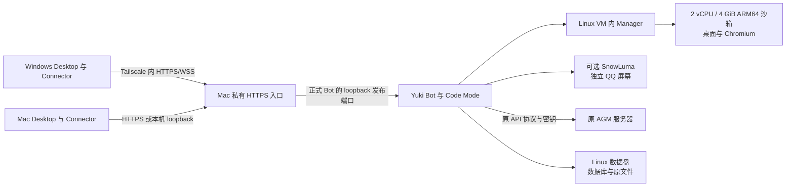

# Yuki Mac 本地迁移与 ARM64 完整运行环境任务书

日期：2026-11-07。状态：评估与待实施计划；本轮未连接云端执行部署、备份或停机，未修改 Clash、系统代理和现有服务。

目标是把云上**同一个 Yuki**迁到 Mac：保留身份、记忆、历史、配置、连接、沙箱文件和原执行回执，使用 ARM64 持久环境，沙箱配置为 2 vCPU / 4 GiB，开启 Code Mode、有头浏览器与桌面，并继续通过 Desktop Connector 使用 Mac 和 Windows。

推荐做法是：**新建 ARM64 运行环境，完整恢复旧实例，再做经过演练的版本升级和配置调整。** 不用新建人物、重新配对所有电脑或重新导入聊天来代替迁移；也不把旧 Docker 容器直接搬来就当作完成。AGM 第一阶段继续留在原服务器。

## 1. 当前准备到了哪里

本轮已 fetch 两仓远端，核对时本地 main 与 origin/main 一致：后端 `d6dd44b3e729e43b189e45e70047a69941160078`，Desktop `337aaacabddc4cf45b38f82f2fe7c9fee58600a7`。以下“已具备”指这些源码和本地实验；不代表云上已经运行这些版本。

| 项目 | 已确认事实 | 正式迁移还需完成 |
| --- | --- | --- |
| Mac 与远程维护 | Apple M6、16 GiB；Windows 已能经 Tailscale SSH 登录；接电自动睡眠关闭，来电自动启动已设置 | 核对长期节点认证、应用启停与备份恢复；SSH 可用不等于 Bot 已常驻 |
| Linux 宿主 | Colima ARM64，4 vCPU / 6 GiB；gVisor 可用；AppArmor 4.0.1 已安装且启用 | 正式服务与联调实例分开，配置启动顺序和生产数据位置 |
| 持久沙箱 | 当前实际容器为 runsc、2 vCPU / 3 GiB；HOME 8 GiB、运行记录卷 256 MiB | 升到 4 GiB，按原数据量选择持久容量；核对配置值与实际容器限额 |
| 桌面与浏览器 | ARM64 的 Chromium、中文页面、截图、键鼠输入、原生 Desktop 画面接管已有实测 | 使用恢复后的正式环境、真实模型再跑一条完整任务 |
| QQ 显示 | 同一个 Desktop 窗口可切换沙箱与 SnowLuma；QQ 二维码显示和解码已验证 | 原 QQ 登录资料迁移及实际平台连接仍需验证；实验账号未登录 |
| 本地 Bot | 当前运行 `tests.support.desktop_reference_server`，使用真实接口/数据库和测试模型 | 部署正式 Bot 与真实 Provider，不能把测试服务直接暴露为生产入口 |
| Code Mode | 已有 Monty 与可选 `codemode` 镜像；有历史 Linux/aarch64 原生验证 | 当前 Docker 附加 seccomp 规则只覆盖 AMD64；ARM64 正式镜像、隔离和恢复需适配验证 |
| 电脑连接器 | 已实现完整访问、Shell、文件、原生 Agent，以及保原设备改服务器地址 | 盘点两台电脑实际安装/配对状态；迁后逐台验证 |
| 云端数据 | 已有完整备份合同和引用文件校验器 | 尚未取得此次云端实际版本、架构、目录、数据量、活动任务和备份；不能给出确定停机时间 |

前次本地交叉测量中，Desktop 完整构建中位数从浏览器休眠时的 3.72 秒变为浏览器工作时的 3.92 秒，约增加 5%；六次交叉测量没有新增 swap-out，但出现过内存压力警告。这证明当前联调负载可用，不能推断正式数据库、Code Mode、多个编译和 4 GiB 沙箱同时工作也没有压力。

目前需要的主要是**迁移工程、ARM64 Code Mode 适配和正式部署验证**，不是重新开发整个桌面/浏览器系统。

## 2. computer use / browser use 的实际边界

| 场景 | 当前能力 | 本期处理 |
| --- | --- | --- |
| Yuki 自己的 Linux 沙箱浏览器 | `terminal_exec` 调用 `yuki-computer browser open/snapshot/click/type/press/scroll/close`，经 CDP 操作真实 Chromium | 复用现有实现，保浏览器 profile 和下载文件 |
| Yuki 自己的 Linux 沙箱桌面 | `yuki-computer screenshot --screen`、`input click/type/key`；Desktop 可接管/交还 | 复用现有 Xvnc、Openbox 和控制租约 |
| Windows / Mac 文件与程序 | Connector 完整访问下，`terminal_exec(device_id=...)`、文件读取/写入/发送，以及原生 Agent 委托 | 复用原 Connector、原 Person、原 device 和原操作回执 |
| Windows / Mac 自带浏览器与图形桌面 | 可从本机 Shell 调用用户安装的工具；Connector 没有内置通用的截图、坐标点击、窗口管理或浏览器驱动 | 统一的宿主 GUI/browser 能力作为后续开发，不能冒充本次已有能力 |

因此，“完全没有 computer use/browser use”不准确。沙箱已有操作原语，但当前不是供应商专用 Computer Use 协议或独立 browser-use 工具包。真实模型能否稳定完成某类网页工作，仍要用实际任务验证。

Code Mode 是同一工具合同的代码编排语法，不是另一台电脑，也不负责把宿主桌面授权给沙箱。它通过现有执行器调用持久终端及 Connector；Monty 自身不直接取得文件系统、网络或 Docker 权限。

## 3. 迁移后的部署与连接

Bot、Manager、沙箱和 SnowLuma 仍按原职责分开运行。2c4g 是**Yuki 的工作沙箱额度**，不把 Bot、QQ、Code Mode、Linux VM 和整台 Mac 全部塞进这一个额度。

初始资源建议：Linux VM 使用 4 vCPU / 8 GiB；沙箱 `YUKI_SANDBOX_CPUS=2`、`YUKI_SANDBOX_MEMORY_MIB=4096`、`YUKI_SANDBOX_BROWSER_MODE=headed`。8 GiB 是待测的分配方案，不是固定门槛；Mac 还要留给编辑器、Desktop、系统和编译。Code Mode 的 worker 限额独立配置，不能因沙箱增大而盲目放大。当前 guest 没有 swap，配置额外 swap 额度也不能代替实际可用的交换空间。

持久容量在盘点后确定。可从 HOME 32 GiB、运行记录 1 GiB 的候选方案开始评估，但必须容纳原有数据、安装和实际增长，配置可以继续调整。没有固定“剩余多少 GiB 才能做事”的新运行时检测。

### 3.1 磁盘布局先处理

本轮现场：Colima 系统分区约 19 GiB，空余约 8.3 GiB；现有 `/var/lib/yuki-sandbox` 位于这个系统分区。另一块 Colima 数据分区约 59 GiB，空余约 46 GiB，挂载于 `/mnt/lima-colima` 并承载 Docker 数据。Mac 数据卷当前约有 107 GiB 可用。

不能只看 `colima.yaml` 的 `disk: 60` 就认为沙箱目录有 60 GiB。正式方案应把 Bot 数据、HOME/runtime 卷和需要保留的 Manager 数据放在 Linux 数据盘，通过明确目录和挂载接回原路径，并配置真实挂载依赖；不要放进 Docker 私有内部目录。保留原容器内路径可减少绝对路径迁移。

数据库和沙箱活跃文件优先保留 Linux 文件系统语义。Mac 上的源码 checkout 继续用于写代码；备份导出到独立位置。不要把唯一备份留在同一个 VM 磁盘里，也不要让 Time Machine 对运行中的 VM 文件复制代替应用一致性备份。

### 3.2 网络入口

建议 Mac 使用 Tailscale Serve 为正式 Bot 提供私有 HTTPS，根路径代理同一 Bot 的 HTTP、SSE、RFB WebSocket 和 Connector WSS。当前 Mac 没有 Serve 映射；HTTPS 功能是否启用还需在配置时确认。采用 `--bg` 的 Serve 可在 Tailscale 重启后恢复，参见 [Serve 官方说明](https://tailscale.com/docs/reference/tailscale-cli/serve)。申请证书涉及 tailnet HTTPS 设置和域名的证书透明度记录，按[官方说明](https://tailscale.com/docs/how-to/set-up-https-certificates)处理。

远端 Connector 当前要求 HTTPS/WSS，不能把 `http://100.x.x.x:端口` 当作完成方案；已有 SSH 转发到本机 loopback 的 HTTP/WS 仍可使用。

两台电脑主动连向 Bot，Bot 经现有连接调度本机操作。无需为此给沙箱开放整个局域网、挂载 Mac 主目录或 Docker socket，也无需安装 UU 远程。Mac Connector 即使与 Bot 在同一物理机器，仍是宿主操作入口；沙箱和宿主继续是两个真实执行目标。

Mac 当前保留 `accept-dns=false` 以配合原代理。实施时分别验证 Mac、Windows、VM、Bot 的解析/路由；只补必要的域名解析、应用代理排除或明确目标转发，不重启 Clash、不关闭代理、不直接套用全局 DNS 更改。Mac 能访问 AGM，不自动证明 Bot 容器也能访问；容器的 localhost 不是 Mac 或 AGM。

如现有 TG/飞书/插件使用公网回调，Tailscale 私有入口不能接收平台公网流量。盘点后可保留原云端域名和反代，经私网转发到 Mac；QQ reverse WS、主动轮询和长连接则按实际协议迁接，不一概更换所有 URL。

## 4. 必须完整迁移的内容

以生产实际挂载、配置和自定义目录为准，以下是清单，不是按示例路径猜生产位置。

| 类别 | 迁移对象 | 保持的事实 |
| --- | --- | --- |
| 主数据库 | Bot SQLite 及 schema；Person、Account、Binding、Conversation、Memory、SELF、Work、automation、设备授权、模型请求与投递回执 | 原主键、Yuki 身份、原人物和历史归属、累计预算、去重及未决状态 |
| 其他持久库 | participation、web-search-bridge、插件库、workspace/artifact manifest 等实际启用的独立库 | 各自原 owner 和对应文件，不只复制 `yuki.db` |
| 原协议与产物 | `data/work-protocol`、`tool_artifacts`、媒体/头像/表情、已发布 artifact、workspace、social-transfer 和自定义证据目录 | 原文件、哈希、引用及原执行来源；已过期且被清理的缓存不能凭空恢复 |
| 人格与配置 | `character/SOUL.md`、`config/`、`webui-config/`、plugins、`.env`、实际环境变量来源、Compose overlays、systemd units/drop-ins | 原人格、模型/Profile ID、协议、参数、安排与插件批准 |
| 密钥 | 模型/API/平台凭据、operator 配置及 token 环境来源、`model_profiles.secrets.json`、部署实际使用的其他密钥 | 按原私有机制传输和保存，不写入任务书、日志或 Git；保持文件权限 |
| 沙箱 HOME | 整个 `/home/yuki`，包括隐藏文件、`workspace`、浏览器 profile、下载、用户安装、密钥和缓存 | 文件内容、符号链接、权限、UID/GID；不是只搬可见工作文件 |
| rootFS 与安装 | 原容器可写层、旧 checkpoint 镜像、自装程序/服务、系统级配置和软件包清单 | 保留原件归档；逐项区分用户资料与架构相关二进制 |
| Manager | 完整 root/runtime、`jobs.sqlite3`、请求/run、dispatch、completion outbox、服务登记、留存日志和实际相关卷 | 原执行及原回执；不清库、不换 ID、不重复执行已发生效果 |
| SnowLuma | 实际所有账号卷：常见为 `snowluma-data`、`snowluma-qq-config`、`snowluma-qq-data`、`snowluma-extra-accounts`，以及 token、映射和传输目录 | 原账号资料、网关设置、消息来源与配对；是否需重扫登录现场验证 |
| 两端 Desktop/Connector | 留在原电脑的登录凭据、配置、journal、原 device/instance 和原生 Agent profile | 原 Windows 凭据留在 Windows，Mac 留在 Mac；不互相复制设备身份 |
| 部署清单 | 源码 commit、镜像 digest/架构、迁移 head、挂载、实际路径、端口、域名、代理、DNS、网关与外部依赖 | 可复原的来源和新旧地址对应关系 |

Yuki 的模型密钥可能在 `.env` 或 Profile 的 secrets sidecar，不能只复制可读的 TOML。Desktop/Connector 的服务器 token 哈希随原数据库保留，客户端原 token 留在各自电脑；因此迁同一数据库通常可保配对，但要验证原 token、人物归属和设备状态，而不是承诺任何备份都能免配对。

### 4.1 一致性与跨架构

迁移不是在线 `cp yuki.db`：SQLite WAL、引用文件、Manager 库和 sandbox 写入需要属于同一停写边界。可以先预拷大文件，最终切换时停止实际生产写入、保存原回执，再做完整一致副本；每个独立 SQLite owner 都要处理。对 ext4 镜像使用停写后的完整副本或正确的文件系统快照，不把正在变化的 raw image 当作一致备份。

复用现有 [Work 备份流程](../operations/work-evidence-backup.md)和 `scripts/verify_work_backup.py` 核对备份副本；另外核 Manager、HOME、rootFS、QQ 和配置。该工具只核自己覆盖的引用，不能代替整次迁移验收。不新增常驻评分、经验阈值或“环境合格证”脚本。

先确认云端架构。若为 x86_64：SQLite、普通文件、配置和大部分用户资料可迁；ELF、Python venv/native wheels、Node native addons、系统包和原镜像需在 ARM64 重建。原 rootFS 必须完整留存作恢复来源，但不能把整套 x86 `/usr` 覆盖到新 ARM64 rootFS。

Manager 当前优先使用持久化的 `checkpoint_image`。导入旧 Manager 数据后必须显式核对并迁接到正确 ARM64 镜像，保留旧引用和原件作为迁移记录，不能只改启动参数就以为生效。镜像 checkpoint 也不等于可跨机器恢复的进程内存快照。

迁移后的容器是新代际。原终端进程无法承诺不断线搬家：已完成的读原回执，真实中断按原 run 记录，结果未知继续查证；服务按原登记策略恢复，不盲目重放旧命令。正在运行的本机 Connector Shell 也要单独安排切换。Code Mode 的旧 pending snapshot 需核 worker/API 兼容性，不能为恢复强行加载不兼容 dump 或重新执行其已完成子调用。

## 5. AGM 的安排

**第一阶段保留云上 AGM 和原上游网络出口。** Mac Bot 继续使用原模型 Profile、API key、模型映射和协议。先验证现有地址从真实 Bot 容器可用；需要私网接入时再为 AGM 宿主配置同一 tailnet 或复用原可达入口，不先假定 AGM 已加入。当前 Mac 可见节点中没有可明确识别为 AGM 的设备。

这能单独验证 Yuki 的数据、身份、ARM64 和本机交互，也保留其他客户端正在使用的 AGM。若 AGM 与 Yuki 原先靠云内网地址连接，搬到 Mac 后需要换成可达地址，不能机械复制旧内网 URL。若仍可用原 HTTPS 域名，第一阶段可不改 Profile 地址。

已找到用户 fork `YuanYeYouTao/Antigravity-Manager`，上游为 `lbjlaq/Antigravity-Manager`。其 [2026-10-21 交付记录](https://github.com/YuanYeYouTao/Antigravity-Manager/blob/beta/docs/operations/agm-beta2-sync-2026-10-21.md)记录过定制协议/签名/用量行为、5 个业务库和独立 Mihomo；这是历史记录，需以现役部署再核对，不能拿上游最新版替换原 fork。该 fork 的 [Docker 说明](https://github.com/YuanYeYouTao/Antigravity-Manager/blob/beta/README_ZH.md)声明支持 ARM64，但当前定制版本在本 Mac 的实际构建和恢复未验收。

第二阶段再用数据决定是否迁 AGM：测 Mac→AGM 的连接与完整响应耗时、流式/工具调用可靠性、AGM 的实际 CPU/RSS/I/O，以及本地部署后家庭网络和上游代理的表现。搬本地可能省掉一段网络和服务器费用，也会增加 Mac 负载，并把两者的可用性都交给家庭电源与网络；不预设会更快。

如决定迁 AGM，另立一次可回退切换：按现役 fork/digest 构建 ARM64、完整迁账号/配置/数据库/原签名和请求资料、核所有调用方，保原服务直到验证完成。AGM 内存缓存、上游缓存命中和第三方登录有效期不能由复制数据保证。此次 Yuki 迁移不顺便重置账号、迁 Mihomo 或改 Mac Clash。

## 6. 实施任务与交付顺序

| 任务 | 工作 | 可复核交付物 |
| --- | --- | --- |
| T01 云端只读盘点 | 核对真实 Yuki/AGM 主机、版本/架构、Compose、挂载、目录大小、活动工作、网关、模型和回调；两台电脑原 Connector 版本与配对 | 脱敏清单、实际数据量、地址映射、未决项与预估停写窗口；凭据另存私有位置 |
| T02 正式 ARM64 宿主 | 选择正式目录/VM profile；生产与联调不共享可写数据和身份；数据盘挂载、资源配置、runsc、DNS、Manager、正式 Bot 镜像及可选 QQ | 配置文件、镜像摘要、挂载与真实资源记录；无真实账号的启动验证 |
| T03 ARM64 Code Mode | 复现当前架构差异；适配 seccomp 的实际 ARM64 syscall/参数语义，核 AppArmor、worker/launcher/hash；沿原 codemode overlay 集成 | ARM64 镜像与真实隔离/有限执行/中断/原回执恢复证据；AMD64 相关回归；不以 privileged/unconfined 绕过 |
| T04 完整备份与恢复演练 | 先安排一次一致备份窗口；在不发送平台消息、不触发真实自动化/外部执行的副本上恢复；先核原版本，再按正常迁移升级至选定目标 | 备份清单/校验和、恢复日志、旧新 ID/引用对应、rootFS 迁移清单、剩余差异；镜像升级和数据搬家分开记账 |
| T05 入口与两端 Connector | 正式 Bot loopback→私有 HTTPS；两处独立地址配置；Windows/Mac 各自保原 device/token/journal；新 Mac 未配对则单独正常授权 | 同一 Yuki/Person/设备身份、HTTP/SSE/WSS、Shell/文件/原生 Agent 的实际结果；保原操作查询 |
| T06 最终切换 | 再次停旧写入，取最终一致副本/增量并复核；停旧网关消费者与调度，启动唯一正式本地实例，再接回真实平台和电脑 | 精确切换时刻、最终备份、实际生产版本/路径、真实平台与模型请求证据；旧云数据保留 |
| T07 稳态与恢复 | 本地全链工作同时编译；断网重连、Bot/Manager/VM 重启；安排整机启动验收；配置独立备份并实际恢复一次 | 性能对照、原回执无重复效果、启动顺序、恢复步骤和未验证边界；AGM 单独评估 |

T02/T03 使用临时测试数据可先做。T04 的一致备份可能需要短暂停写，不能把“演练”说成对生产完全无影响。副本中原身份和原凭据不能与生产同时对外运行；离线核对先于完整运行时启动，真实模型/平台/设备验收在明确的测试或切换窗口完成，不开发第二套调度体系。

建议代码交付按实际改动拆分：ARM64 Code Mode 支持；可复用的 Mac/Linux 部署与挂载配置；只有恢复演练发现真实缺口时才新增迁移适配。不要预先重写 Connector 或造通用“迁移管理器”。PR 合并、镜像构建、云端停止、本地上线分别记录。

## 7. 验收方法

1. **数据和身份**：完整清单逐项核对；数据库离线完整性/外键、原引用文件及哈希、关键原 ID 和累计预算一致。读取真实旧对话、记忆、SOUL、旧附件、沙箱文件和一个已完成任务。行数相等不能单独证明完整。
2. **真实模型与 Code Mode**：通过恢复的真实 Profile 发起明确测试请求，完成一次 Code Mode 编排和实际工具效果，保原请求/子调用回执；查实际 worker 与 ARM64 镜像，不用 healthz 代替。
3. **浏览器和显示**：真实 HTTPS 页面打开、中文输入、DOM 读取、屏幕截图；Desktop 看同一画面，接管后实际输入、交还后 Yuki 继续。QQ 单独画面可切换、扫码可读，登录是否仍有效单独记。
4. **Mac 与 Windows**：分别在明确测试目录创建、读取、修改并回传一个文件；原生 Agent 配置存在时用原会话/实例验证。确认目标 device 正确，不把沙箱文件操作当成宿主操作。
5. **原连接延续**：Desktop 客户端地址与 Connector 地址分别保存；改址后原 device、Person、conversation、journal 不变。旧 token 撤销、版本不符和真实断网分别报告，不清配置冒充修复。
6. **平台与调度**：在切换窗口验证实际启用的平台连接、安排和消息收发。旧云实例停止相关生产写入，避免两边同时收消息、刷新会话、发安排或领取任务。
7. **开发并行负载**：真实数据库、浏览器、QQ、Code Mode 与日常项目构建并行，记录构建时间、交互延迟、memory pressure、swap 增量、VM/容器 RSS、I/O、OOM 及剩余空间；同样负载对比，不凭空规定统一及格线。
8. **恢复与常驻**：Bot/Manager/VM 重启保原文件和回执；断网重连不生成新设备/重发旧操作；正式备份还原可用。整机重启另外安排，本轮不重启 Mac，避免违反保留 Clash 的要求。

当前实验服务并未配置为完整生产自启链。正式部署需要明确 Mac 启动→Colima→数据盘挂载→Manager/容器→Bot/QQ→HTTPS 的依赖。Desktop 管理的 Connector 退出 App 会停止；若要求退出 Desktop 后仍能执行，选择已支持的独立用户服务并保原安装，不能同时起两份。Windows 用户服务在登录后运行，Mac 图形桌面和相应 OS 授权也受用户会话影响；“SSH 能连”不能当作“登录前就能操作桌面”。

## 8. 切换与回退

切换前先预传大数据，演练得出真正的恢复耗时。最终停写后取得一致末版，核对后再让本地实例接管；原云端磁盘/配置和可运行镜像保留，原生产进程保持停止。不把旧云端删除作为迁移完成条件。

如果本地还没有接纳新输入、执行或外部效果，可以撤销新入口并恢复旧实例。**一旦本地产生新消息、文件或回执，就不能直接打开旧库当作回滚。** 应先停本地写入，保留这些新事实，使用兼容当前数据的修复版本，或经过验证地把最新完整状态迁回云端；不合并两份任意 SQLite，不回放已完成操作。

云端架构、现役版本、数据量和活动任务尚未核实，所以现在不承诺具体停机分钟数，也不承诺原浏览器/QQ 登录永远无需重新认证。可以承诺的实施原则是：原数据有完整副本、差异有记录、效果有原回执、切换后新事实不丢失。

## 9. 代码与合同依据

- [资源和有头环境](../operations/desktop-computer.zh-CN.md)、[持久环境](../operations/persistent-environment.zh-CN.md)、[沙箱配置示例](../../deploy/sandbox/profile.env.example)。
- [浏览器和桌面 CLI](../../src/yuki/sandbox/yuki_computer.py)、[Manager 恢复与镜像选择](../../src/yuki/sandbox/persistent.py)、[卷创建与增长](../../deploy/sandbox/environment-storage.sh)。
- [Code Mode 运维](../operations/pi-codemode-operations.md)、[当前 AMD64 seccomp 生成器](../../scripts/build_codemode_seccomp.py)、[隔离说明](../../deploy/security/README.md)、[codemode overlay](../../docker-compose.codemode.yml)。历史原生 ARM64 验收不代替当前 Colima Docker 组合验收。
- [完整备份](../operations/work-evidence-backup.md)、[模型 secrets sidecar](../../src/yuki/model_runtime/secrets.py)、[原部署挂载](../../docker-compose.yml)。
- [Connector 合同](../operations/local-agent-connector.zh-CN.md)、[Desktop 本地部署与远程入口](../operations/desktop-local-deployment.zh-CN.md)、[Tailscale 接入](../operations/tailscale-connection.zh-CN.md)。Desktop 的“本机部署”向导只做 App-only，未安装 Manager/QQ，不能直接代替此次完整恢复。
- 本轮源码 Client API revision 为 `10`，见 [version.py](../../src/yuki/client_api/version.py)；日期报告和索引中的旧版本号不能代替目标镜像的实际合同。

本任务书在本地落盘；代码实施、云端盘点、完整备份、PR、合并和正式切换均未由本文冒称完成。
