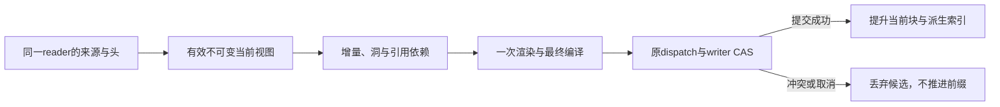

# Yuki 上下文装配增量化与时间复杂度优化任务书

日期：2026-10-18。源码基线：`main 815897032b4e77e6e7f11ea2d63d74a7fd4e674d`，迁移头 `0132`。

**当前状态：本地实现、交叉终审与受影响验证完成，用户已授权提交、合并与上线，正在交付。最终Linux受影响回归781通过、8项Monty跳过；Windows初次整库的快照及修正结果单列，不冒称最终整库绿色。** 已有调查、离线基线/原型与少量线上只读计时不是性能修复验收；上一轮 ACP 的部署记录也不属于本任务。PR、CI、合并与本轮部署分别记录在[当前记录](../operations/context-pipeline-implementation-20261018.md)。新增全链问题见 §11–§14，T01–T15 原装配任务继续保留。

## 0. 目标、范围与最高约束

用户要求在等价行为下采用时间最快的算法，不能只清理两次 `json.dumps`。本任务的最终目标是：**正常热路径只读取、准备、渲染和持久写入新增材料及真实依赖，旧公共片段共享；消除可避免的二次增长与全文重复处理。** 冷启动、真实失效、compact 换边界的重建，以及最终完整请求的输出成本单独计算。

遵守[开发约束](development-contract.md)、[主 Agent](main-agent-runtime.md)、[会话 Compact](conversation-compact.md)、[Canonical runtime](canonical-runtime.md)、[Tool Kernel](tool-kernel.md)、[执行过程](execution-trace.md)。禁止防御性编程优先：先删除重复准备、无消费者状态与冗余校验；必要的重构优先于只改几行。不能用截断历史、少读引用、降低上下文容量、额外压缩、放松授权或跳过原回执来制造速度提升。

T01–T15 范围是源数据读取至实际 Provider 请求准备：普通 QQ/TG/App/ACP A、SELF、自动化、插件 Main、外部事件/Work 续跑，共同的投影、渲染、编译、compact 候选和容量计量。子 Agent 只覆盖真正共享的静态提示/Runner/请求准备；ACP B 外部 peer 的内部上下文不在 Yuki 装配器内。根据追加要求，L01–L12 扩展调查入站、参与准备、排队、媒体、Provider 往返和统一 Social 出口。Memory 检索、网关与模型内部算法不重写；真实外部等待单独计量，不把它们伪装成装配器 CPU。

本轮新增的不可变表示、引用索引或分块存储必须替代现有重复工作，具有明确的 Conversation owner、来源、生命周期和回收路径。它们是现有公共 projection 的实现形式，不是第二份事件账本、权限缓存、执行状态机或业务完成条件。不开新常驻服务，不增加 TTL、等待任务、跨人物历史视图、Redis、内容路由或经验性消息上限。

## 1. 复杂度目标与不能消除的下界

符号：`N` 为本次获准的未覆盖事件数；`F/E` 为当前冻结片段/事件数；`S` 为历次 selection 数；`Δ` 为新增和真实补洞事件；`R` 为其引用、旧显示身份及本次 current 剔除引起的真实分组边界依赖；`B` 为完整公共请求表示字节，`b` 为新片段及依赖字节；`G` 为同组事件数；`K` 为合法 compact 切点数；`C` 为当前 projection 块数；`D` 为相关数据库表规模。不同字节口径不得混算。

| 阶段 | 当前反复发生的工作 | 最终目标 |
| --- | --- | --- |
| 热源读取 | 反复加载整个 raw 后缀，另扫旧范围补洞 | 一次一致读确定来源/头/高水位，索引读取 `Δ + R`；约 `O(log D + Δ + R log D + b)`；连续范围与批量主键的成本分别记实 |
| 冷恢复/真实失效 | 原文、投影、selection 多轮加载 | 一次重建当前真实视图及必要索引；读取/原文渲染主体为 `O(N + F + B)`，当前持久 AVL 成员索引冷建如实计 `O(E log E)`；legacy 前驱若用二分另计 `R log N`，乱序引用建索引还需排序。旧 selection 恢复按 T15 限定真实候选，不能假称热路径 |
| 渲染 | 全 raw 重渲染；同组字符串/tuple 累积复制；旧 mention 反复扫描 | 只渲染 `Δ` 及必要依赖；分组一次 join/tuple，legacy 显示查找用真实前驱索引；按实际算法计 `O(Δ + b + R log N)` 或顺序批处理成本 |
| 冻结视图 | 每次 loads/deepcopy/字典转换/全 ID 集合重建 | 持有不可变当前片段与索引；旧块结构共享；避免每轮复制全部前缀。索引用树则如实计 `O(Δ log N)`，不能标成 O(Δ) |
| 发布持久化 | 编码/比较/更新整份 `payload_json`，重查全部 source keys | 当前 epoch 新块追加与头 CAS，编码/写入随 `b` 增长；无新公共字节时不重写块 |
| 完整模型请求 | 拼完整 messages、容量扫描、协议序列化和 HTTP 输出 | 移除重复展开/估计/编码，达到必要的 `O(F + B)` 展开和 `Ω(B)` 输出；不承诺整条请求 O(Δ) |
| 多次连续激活 | 即使每次只加一条，也反复扫描所有旧材料 | 预处理及投影追加按累计真实新增量摊销；逐次完整 API 请求的累计输出仍须逐次计入，不能隐藏 |

一次 SQL 不等于 O(1)，减少 Python 往返不等于索引/正文零成本。最终选择以等价样本、处理量和分段实测共同判断，不预设“腰斩”、固定倍数或生产毫秒门槛。保持当前分组语义时，极端旧 trigger 排除可能影响 O(N) metadata，须实计入 R；不得把这类样本藏到“冷路径”或承诺所有激活严格只处理 Δ。应测真实受影响边界索引，不能用少看旧事件伪造该成本消失。

## 2. 已确认的问题和施工索引

下列路径相对 `src/yuki/`，行号指调查基线；本地实施进度按文首记录单独跟踪。

| 编号 | 现状与证据 | 应实施的改变 |
| --- | --- | --- |
| T01 | `conversation/scope_repository.py:101–156` 每轮读取 checkpoint 后全部 ChatEvent 正文并转 EventRecord；`services/history_projection.py:79–80` 再读完整投影，有摘要时 `155–181` 再扫范围/补正文/重渲染 | 公共准备统一为先读有效 projection/checkpoint，再按当前一致读里的真实高水位读取增量；冷恢复才完整核对 ID 与补洞 |
| T02 | `context_assembler.py:665–738` 先 render 全尾；`history_projection.py:191–201` 才丢弃旧渲染并采用 FrozenFragments | 在昂贵正文加载/渲染之前选定仍有效的冻结片段；同次持有一个准备结果，不能只移动一个函数却仍全尾读 |
| T03 | `event_prompt.py:418–432` 对每个旧 raw mention 扫整个引用表寻找原前驱；reply 又依赖完整获准引用表 `369–381` | 依原平台/Conversation/原 sender 构建按内部事件 ID 的显示前驱索引；reply 按原 event ID 查真实依赖，并保整个原引用表推导的历史 Yuki 账号集合。该索引仅解释旧显示，不重新绑定人物、不用今日昵称重建过去 |
| T04 | `event_prompt.py:184–193` 同组每加一条复制增长的 ID tuple/正文，最坏二次；`frozen_fragments.py:70–77` 每个部分重叠组扫描全部 individual | 分组内积累 ID/行，结束时一次 tuple/join；一次建立 individual 索引，按原顺序提取重叠组的 fresh 部分，删除重复扫描 |
| T05 | `FrozenFragments.load:55`、`append_current:93`、`messages:109` 重复遍历/复制可变对象图，`history_projection.py:195/197` 连续两次 messages | 外部输入/持久 reader 边界只校验并冻结一次；内部使用不可变片段/分块视图，单次展开。当前 dict/list 可变，不能机械删除 deepcopy 留别名污染。Python str 原本共享，不能夸大为每次 deepcopy 都复制 B 字节 |
| T06 | `conversation/projections.py:177–200` 全量复制、JSON、UTF-8；`514–558` 再编码旧前缀；`218–285` 重查所有 F 个 key；`431` 整 blob UPDATE | 采用本书 §4 的当前投影分块，append 接口只接原不可变快照和 delta，不再接收可重写整个旧前缀的 list；只查新 key，沿原头 CAS 发布 |
| T07 | 现 `payload_json` reader、source/reset/delete trigger、容量淘汰与 schema_guard 相互依赖 | 单后继迁移完整转换当前实际表示，同步全部 reader/失效/回收/检查；不得只切 writer 或靠旧 blob 双写长期过渡 |
| T08 | `main_agent_turns.py:123/157` 普通投影分支先后完整 compose，前份被覆盖；`history_projection.py:175–181` 补洞 grouped 后逐条重渲染；插件 `context_assembler.py:275/299–302` 也双 render | 先确定最终 context，再仅 compose 一次；两个历史视图统一使用已有 `main_agent_history_views` 一遍生成，保 recovery/no-projection 分支 |
| T09 | Assembler `371/391`、`497/512` 重复 dumps；`506/518` 重建相同 wakeup；view 的无人读取字符预计算、`412` debug-only tuple 统计及旧窗口残留 | 删除前次无消费者的结果与字段、无效自赋值/重复构造；保真实日志/指标消费者，只统计一次。不能把当前有用 fragments/来源字段一起删掉 |
| T10 | `_validate_history_source:596–628` 版本核验后又 get_event 比较，普通入口 `358` 已读同一 trigger；prepare、guard、publication 各层还有同次重复来源准备 | 一致读一次得到所需原事件；利用现有完整 source revision 与最终派发/发布核验收敛重复读取。旧快照不是当前授权证明，不能无条件删除来源复核；也不能因旧测试存在永久保留具体重复调用 |
| T11 | `context_compaction.py:403–414` execution 候选逐个 clone/估计最坏二次；public `243–276` 已二分，但每次仍加工整个候选 | 一次抽合法边界及可复用计量；可加区间用前缀和，已证明单调的区间才二分。opaque/checkpoint 切换分段处理，保同一最大合法切点及真实容量语义，见 §6 |
| T12 | `turn_execution.py:975` 与有物理容量时的 `model_runtime/executor.py:529` 重复估计同一归一化请求；Compiler/diagnostics/wire 各有完整扫描 | 同次 dispatch 的同一已冻结 normalized request 复用计量；最终 payload 编码产物在正确协议边界复用，删无消费者重复诊断。不同语义 hash/opaque/可变参数不误复用，见 §6 |
| T13 | 零正文查询的旧测试常只从已构造 AssembledContext 开始，漏掉前段全 raw load | 新增真实 assemble→compose→dispatch 的全链成本证据及等价回归，不以局部函数零 SQL 冒称全链增量 |
| T14 | 当前合同/缓存、测试、CI、迁移与升级文档分散 | 原模块文档随实现直接纠正；删冻结旧数据结构/固定重复次数的断言，完成必要质量检查，最后逐项终审。用户已授权PR/合并/上线，按原备份与Bot-only流程交付 |
| T15 | `projections.py:462–512` raw驱逐后的恢复先扫本view整代 S 条selection元数据，再按IDs取payload | 正常cold当前块读无需走selection；确需provenance恢复时，按原coverage/H/获准IDs限缩候选。为历史group记录可索引的最小/最大原event ID等派生范围需先测现查询，批量载当前相关原件并保first-admission顺序/完整去重；range只预筛，不能以min/max替代组内完整IDs核验，也不预占一个新索引 |

## 3. 数据流与最快热路径

### 3.1 一次真实准备

1. 完成原真实入口/来源解析。同一 reader `BEGIN` 内取得 canonical Conversation、generation、source revision、起点、当前 head/epoch/revision、有效公共 checkpoint、真实 `last_event_id = H` 和本次发布所需隐私事实。按现有身份/授权合同读取，不能用缓存代替这一步。
2. 用精确头与来源版本选择当前不可变视图。热命中只复用同一 Conversation 的有效当前表示；有效 current 的 cold 读其 epoch 块并核对来源/引用。raw 已驱逐或不存在有效 current 时，保 summary，按当前 eligible IDs 与原 selection provenance 约束、真实缺失原文建立新 epoch；这不等于把历次 selections 冒充仍有效 current。不是从“最近一次模型请求”或“最新 selection”猜历史。
3. 热读取限定在本次固定 H 内的新事件、真实旧洞与引用/cause/旧显示前驱的依赖。只在实际使用时加载其正文、segments、ASR等；只需要身份/引用关系时用窄列。后到事件留给下一合法边界，不要求聊天静止。
4. 旧冻结片段原样共享，新事件一遍产生 grouped/individual。renderer 的引用表与分组边界来自同一获准来源；跨旧冻结组的 fresh 部分沿现规则拆为原 individual，不能重新合并改掉消息边界。
5. 得到最终 context 后只编译一次；只在实际构造请求时展开公共序列。静态合同、动态 runtime_context/short_state、私有 Work/工具/opaque 继续沿各自原入口，不混入公共块。
6. 原 dispatch/业务接纳时，在原 writer 内复核 head、source、generation 和 privacy，追加新块及必要首次 selection 原件，更新头；Work journal/ordinary admission 仍在其原原子边界。准备或缓存命中不等于输入已被模型观察。
7. **只有真实 CAS 成功才提升 committed 视图。** 失败、取消、未派发或回滚只丢候选，不推进公共前缀，不改预算、不取得重跑资格。



### 3.2 高水位、洞与并发

`source_revision` 不随普通追加递增，因此 revision 相同仍须观察 H。`max(frozen IDs)` 也不是覆盖证明：已接纳 `{1..48,50..100}` 不能推出 49 已处理。

热视图需要区分：实际扫描界线、已接纳片段、扫描范围里尚未接纳的精确 IDs。冷恢复从真实范围和当前块核对一次差集；热阶段保留真实未覆盖项并按原序补齐。该集合只是当前视图的派生索引，不建持久 pending 任务/确认门槛。若准备失败，其扫描结果也不能被当成已接纳事实。

并发候选共享旧不可变块，各持自己的 delta。发布沿已有 Conversation/Work 围栏与数据库 CAS，不增加全局串行锁。旧候选读取的边界必须固定；后续缓存 append 不得让它看到 H 之后的引用或把后来才接纳的片段当成旧前缀。 **未接纳洞也要候选隔离**：A选中49后，B接纳49并删除当前pending项，不能改变A的已捕获选择；只冻结本次相关洞/delta或使用同一cutoff视图，不复制整个旧E集合。

### 3.3 内存表示及引用索引

现有 `PromptProjectionRepository` 持有当前视图的可回收内存表示；不另起独立缓存服务。片段内容为不可变的 IDs/role/content，公共正文不含 images、工具调用或 opaque。块序列和已冻结片段可以共享，调用方 DTO 的修改不能污染已提交表示。

引用/前驱索引、分组边界与精确 epoch/source 绑定，冷时构建一次，热时只更新增量。共享分组索引须基于完整获准 raw metadata（包含当时current），不能缓存“上一候选剔除current后的最后一组”直接续接；每个候选按本次排除项复算真实受影响边界，成本记入R。历史引用表推导的 Yuki账号集合与本次显式 yuki_account_ids 分开保存，按原调用参数合并；不能漏旧账号，也不能把上一入口显式集合永久混入公共cache。禁止每轮 `dict.copy`、`frozenset.union`、`tuple(prefix + delta)` 偷藏 O(N) 复制。同 epoch 的 event→首次admitted ordinal（当前epoch实际块序号/块内位置，不是历史selection ID或业务admission顺序）可用owner持有的append-only字典：不改旧值，旧快照按捕获的ordinal cutoff判成员，候选delta仅在CAS成功后promotion。逐项查找按哈希表平均成本记账，不声称最坏O(1)。失效/换epoch创建新view，旧捕获者的对象不原地改写。优先测同 epoch append-only 索引配合被捕获的序号/H 边界；旧快照须按其界线查询，pending 候选不能写进 committed 索引。 legacy 前驱必须按原event ID有序，不是admission ordinal；cold完整建立获准metadata索引，热正常只追加>H的metadata，晚补旧hole/旧trigger依赖留候选overlay或使用支持乱序插入的有序索引，不能向末尾硬append后继续bisect。若该实现不能证明旧快照隔离，采用结构共享索引并如实计 O(Δ log N)，不追求虚假的常数标签。

回收内存表示只触发冷恢复，不裁历史、不拒绝可执行请求、不启动另一套恢复器。按现有 projection 生命周期管理资源，记录实际对象/字节峰值；不为性能样本写死消息数/正文上限。已捕获快照不遍历或修改共享活字典，用捕获的界线查询。真实 source/reset/privacy 变更使相关表示失效，删除相关缓存引用，原在途请求继续受原来源/隐私围栏约束；不承诺 Python 字符串物理擦零。

## 4. 当前投影分块存储：本任务的最终方案

### 4.1 方案选择

| 候选 | 能省什么 | 仍有的成本/问题 | 决定 |
| --- | --- | --- | --- |
| 只删 dumps/统计 | 小常数 | 全 raw、全 render、全 blob 都在 | 必删，但不作为任务完成 |
| 只提前 FrozenFragments 复用 | 旧正文/渲染和部分对象转换 | 仍全 JSON/旧 prefix 比较/全 blob UPDATE | 中间实施步骤 |
| JSON 字符串追加或 SQLite concat | 部分 Python 编码 | SQLite 仍重写大 TEXT/WAL | 不作为最终存储优化 |
| 直接引用历次 `model_context_selections` | 看似避免重复正文 | 不是当前 epoch 的实际表示；会选错文本/顺序 | 不采用 |
| 当前实际 projection 分块＋原 head CAS | 热渲染/编码/存储按真实 delta，冷读有序 | 必须完整迁移 reader/trigger/回收 | **最终采用** |

### 4.2 最小数据形状

保留现 `prompt_projections` 的 Conversation、epoch/revision、source/generation/起点、摘要、失效与容量语义。将它的当前有序大 payload 规范化为该 projection 自己的不可变块：键形如 `(view_key, epoch_id, ordinal)`，按原片段顺序保存当前实际接纳的 IDs/role/content；头保存尾块序号和必要计量。具体 ORM 名称在实施时确定，不能另建业务“完成/已发送”表。

一块承载一次真实追加的片段批次，优先避免人为固定条数阈值。热追加只编码新块、INSERT 新块、条件更新原头；旧块不重新解码/哈希/写入。计量保原完整 JSON 表示的实际字节与片段含义，不能把分块压缩后的大小冒充 Provider 输入容量。

无新公共字节且无 checkpoint/epoch 变化时，不新建块或重写旧 body；业务接纳、原 journal 和真实来源核验仍照常，不以“以前已发布这些字节”替代本次真实接纳。

`model_context_selections` 继续保存原首次采用的表示。显式新 epoch 允许采用不同表示而保旧 selection 原件（现 `projections.py:252–269`），所以新块必须取**当前有效 payload 的实际字节**，不能指向同 source_key 的旧 selection 代替。新 key 的首次 selection 可增量准备，旧 key 不每轮全查。

### 4.3 换边界、回收和迁移

- compact/reset/source 改变允许重建保留部分，成本按实际变更的 N/B 记账。旧 current epoch 块及时清退，不为零拷贝 compact 保留钉住被丢弃正文的祖先链。
- 容量淘汰与 `invalidate_view` 清退 raw 块，但有效公共 summary 仍可读取；现 `current_checkpoint_query` 刻意不依赖 raw 的 invalidated_reason，不能破坏该语义。
- source/reset/delete/ASR/metadata/owner/隐私触发器、显式隐私删除和缓存回收必须按原相关 Conversation 清退旧 current 块。使用索引定位与集合变更，writer 不扫描/解析全部正文，不新增清退任务队列。
- 有效 current 的 cold 在一次一致快照中取得头和该 epoch 顺序块，热读从已持尾序号读取新增块；raw 被容量驱逐后没有块可读，须走上一项保 summary 的新 epoch 重建，沿真实获准范围/原 provenance 选择而非猜测当前表示。稳定排序由键保证，不按时间或“最新消息”重排。
- 从实施时最新迁移头生成单一后继，不在本书预占 `0133`。迁移逐份转换当前有效 payload 的原顺序、角色、正文和事件 IDs；失效 raw 不恢复，summary 保原事实。不得由历史 selections/账本重新渲染代替迁移原字节。
- 同次修改 `PromptProjectionModel`、所有 payload reader、`ProjectionSnapshot`、source/失效触发器、schema guard、淘汰/删除、compact 普通恢复与对应测试。旧 aggregate 字段和无用 reader 真正退出，不留长期双写或“出错就用旧 blob”的兜底。
- 已付原件不属于 projection cache：`CompactReceipt`、`model_context_observations`、Work journal/ProtocolStore 的原 request/public.items/response/opaque/工具配对/预算均保留，不将它们迁成新块或重新购买请求。

## 5. 渲染线性化与精确等价

1. 同组使用 ID/行缓冲，在结束分组时一次构造输出；首个 message 原 content 的空白/换行与后续行当前 strip/partition 行为保持，单条片段的原字段也保持。作者、角色、来源/cause、五分钟跨度、UTC 顺序与跨日仍按原规则。
2. grouped 与 individual 一次生成；插件和缺页补齐删除第二遍逐条渲染。
3. legacy mention 显示的查询是“同平台、同 Conversation、同外部 sender 且 ID ≤ 当前事件的最大原事件”，不是整个表里最后一条。建按该显示 key 的前驱序列，用 bisect 或按事件顺序批处理；现代 Person mention 原直达路径不额外做旧解析。
4. reply 按同一获准引用表和原内部事件 ID；未知/被抑制/跨会话保持真实不可用。新渲染不能借分块缓存引入以前不在原选取范围的回复目标。各入口的 reference-table 选取范围须逐一保持：完整快照、missing_rows 子集和工具历史可能不同，不能为了共享索引无意扩大引用可见性。
5. 部分重叠分组选 fresh individual 时保原顺序与覆盖校验；不为了去扫描改成 fresh 重新分组，不用当前昵称重写已冻结头。
6. 内部算法等价则不升级公开 renderer/工具合同、不更改已付 Provider 原件或公共历史格式。数据结构变化本身不应制造上游 cache 前缀变化。

分组边界反例必须覆盖：#1=A(t0)、#2=B（上一current）、#3=A(t290)，下一次新增#4/#5=A(t400/t410)、#6为新current。第一次剔除#2时#1/#3可同组；下一次真实raw包含#2，#3另起组并与#4/#5同组。因为#3已冻结，fresh #4/#5须按原individual拆分。沿上一候选t0起点续接会错误合并#4/#5。时间单位秒，均在各自合法五分钟判断中。

## 6. 编译、容量与 compact 的重复工作

- Main 先选定投影分支及最终 context，再一次 compose。recovery/no-projection 分支原行为保留；当前 short_state/插件资料仍每次使用当轮值，不缓存到公共段。
- 相同归一化且已冻结的同一 dispatch 请求，Main 与 Executor 复用容量计量。其他 Executor 调用继续在实际执行边界计量。Profile/模型/输出设置、工具/native tools、媒体、协议方言或 opaque 变化时重新计算；单个 hash 或旧 request ID 不能证明可复用。
- Compiler 的会话 hash、归一化诊断 hash 与最终 wire fingerprint 含义不同。能删重复诊断或复用确定不变的片段时才做；不能用应用层 hash 冒充最终 wire，也不能把 wire hash 当 Provider cache 命中。
- 最终协议 payload 确定后复用其真实编码结果用于发送/同一 wire 观测；不同协议的数据变换、签名及私有 continuation 保持原件。不能机械删除 Provider 对随后要修改的 opaque/dict 的隔离复制。
- compact 一次抽合法事件/工具配对边界，缓存可证明可加的计量；可加区间用前缀和，已证明单调的候选集合才二分。checkpoint/opaque 切换造成非单调时先分段，在元数据上一次扫描边界，不每个候选重新复制/序列化全部前缀；最后沿现有真实容量判断使用候选。
- 软触发仍为现行默认 96000，非容量和结果目标；无合法切点/无有效摘要但仍能容纳时继续，不能借“为了快”反复 compact、截短历史或买额外模型请求。公共 P 与私有 E 的原切点、已观察状态、opaque 和预算不变。
- WorkJournal/ProtocolStore **已有**原不可变 record/digest 复用；不能把本书写成它们完全无缓存，更不能删除原请求检查点。仅优化确实重复的物化/计量部分。

## 7. 本轮离线证据

[机器可读报告](../operations/context-assembly-baseline-20261018.json)记录原始结果及口径。实验为 Windows 本机 Python 3.12 / SQLite 3.53.1 合成数据，无生产库、真实消息、外网或付费模型；不能作生产 p95、全链提升或缓存验收。组件测量互相重叠，不能相加成端到端时间。源码基线均为本书 main。

### 7.1 当前组件 CPU 基线

九次计时取中位，前置一次 warmup；7名轮换作者，每第8条回复前一条，无真实附件/opaque。表中 N=1000/5000 的夹具正文为“合成消息 ”加80个x，完整85字符；“prepare核心”是现复制/编码/前缀 key准备组合，不包含SQL或真实完整 prepare_commit。

| 组件 median ms | N=1000，214649B | N=5000，1082649B |
| --- | ---: | ---: |
| 全尾 render | 11.618 | 61.770 |
| JSON decode + Frozen load | 4.458 | 25.484 |
| 已冻结视图只新增1条的 extend | 3.570 | 19.805 |
| messages 两次 | 3.525 | 19.052 |
| append_current 1条 | 6.104 | 33.487 |
| prepare核心（无SQL） | 10.407 | 56.119 |
| composer一次 | 1.601 | 9.002 |

“只新增1条”仍随旧 N 增长，证明仅把 renderer 改为 delta 不能完成热路径目标。1000条/每条“合成消息 ”加2000个x（完整2005字符）时，prepare核心约28.529ms，单次composer约11.945ms；长正文编码也是真成本。以上均为当前实现基线，没有声称已实现新算法。

### 7.2 线性分组候选原型

同作者同一个合法时间戳，全部进入同一组；成对同输入，各5次中位。仅 Temp 原型，不是产品实现。

| 事件数 | 当前 median ms | 线性原型 median ms |
| --- | ---: | ---: |
| 250 | 3.237 | 2.651 |
| 1000 | 14.809 | 10.682 |
| 4000 | 152.715 | 44.627 |
| 8000 | 1081.134 | 86.749 |

32个具名等价案例与400个固定种子混合案例，完整 grouped/individual 输出逐项一致；覆盖原字符串/空白、五分钟边界、跨日/倒序、作者/cause、回复引用依赖。8000条这个样本约12.46倍只适用于该 CPU 场景，不推算真实聊天整体收益；不能据此新增同组条数门槛。

### 7.3 查询计划与存储形状

现 ORM 列/check/index 形状的本机合成库，30000事件/目标15000、每条正文1024字符、128 projection。播种实验未启外键，且查询用了 suppression_status=keeper；当前产品 keeper_event_clause 为 IS NULL OR keeper（0132列NOT NULL使结果等价，SQLite部分索引的谓词匹配未必等价），故只证明所列查询/存储形状，不证明完整 Runtime/FK/迁移或当前产品部分索引收益。

| 查询/追加 | 实际证据 |
| --- | --- |
| 全尾15000条 | 720129 VM steps，median116.284ms |
| 新增20条 | 979 steps，median0.103ms；现有 canonical_conversation_id 索引已用隐含 rowid 范围，无临时排序 |
| 精确missing5条 | 353 steps，整数主键查找 |
| 旧selection元数据2000条/新key5条 | 16058 / 99 steps；新key使用现有唯一索引 |
| 673449B旧投影追加1686B，整blob UPDATE | 692192B WAL；该次写入2.597ms，非重复时延统计 |
| 同一大TEXT用SQLite concat | 同样692192B WAL；不能称真正增量写 |
| 候选当前epoch块追加5片段＋head CAS | 20632B WAL；该次0.626ms。陈旧CAS影响0行，块未变化；冷/热读块走主键前缀/序号范围 |

不先新增重复 `(conversation_id,id)` 索引。候选公共ID部分覆盖索引仅在上述合成精确keeper谓词的冷全ID扫描样本有收益，热delta收益很小；是否值得承担写入/迁移/空间成本，须在实施版真实SQLite和新查询下复测后决定。不能拿本实验“selection insert＋header”当语义完整替代；正确的块方案始终保存当前表示。

## 8. 必要回归和验收矩阵

| 用例 | 正确性与工作量验收 |
| --- | --- |
| 相同旧前缀，Δ=0/1/20 | 输出顺序/正文/角色/IDs不变；热时不重新读旧正文、不render旧事件、不编码或UPDATE旧块；无字节变化不写新块 |
| N递增、Δ固定 | 同报正文/metadata/引用读取行数、renderer事件数、旧块decode、编码/写字节、wall/CPU与内存；分开最终HTTP输出，验证热预处理/写入不再随全部旧正文增长 |
| `{1,3}` 已采用但2未采用；扫描后未派发 | 2仍按原序补回；准备/扫描不冒充接纳，失败/取消/CAS冲突不推进公共前缀 |
| 同作者长组、部分重叠、多组 | 一次join，保持raw首条字段/空白、group envelope、跨日/5min/cause；只拆原fresh individual，不改变冻结前缀；加入§5上一current改变raw分组边界的反例 |
| 旧mention/引用/账号变更 | 原前驱、原Person/Presence/Conversation和不可用语义一致；旧Yuki账号、legacy mention、同Conversation换Presence的full/incremental字节相等；原平台账号转移不反向改写事件归属 |
| 新消息在准备期间追加 | 同次H一致，后到消息下一边界接入；普通append不误判来源污染，不要求群安静 |
| source/ASR/正文/owner变化、suppression、隐私删除 | 原版本及发布围栏生效，相关块/缓存清退，旧候选不派发/不重新导入正文；writer不等待外部工作 |
| raw缓存驱逐与有效summary | summary及覆盖点仍可用；有效current冷读实际块，无current则按eligible范围、原selection约束与缺失原文重建新epoch，不漏真实缺页，不冒用历史selection为仍有效current |
| 显式新epoch同一group使用不同表示 | current块采用新epoch实际字节，历史首次selection仍原样；迁移与冷恢复不混淆两者 |
| 同Conversation多入口、不同Conversation并发 | 同一公共历史；QQ/TG/App/ACP session不串源，人物合并不拼入口历史；候选独立、按原CAS发布 |
| 普通/SELF/自动化/插件/外部唤醒 | 全链已接入；插件read_history=False仍无历史；当前runtime/short_state/completion不冻结公共段 |
| 子Agent/ACP B | 仅共享的请求准备受改；子Agent brief和外部peer独立上下文不被公共cache替换，不制造外部usage |
| 已付恢复/未观察工具/opaque | 原journal优先，原UUID、响应、工具配对、预算和未知保持，不重发/重购；projection冷恢复不覆盖原协议 |
| compact P/E、软水位、未知硬容量 | 合法切点/摘要/未覆盖原文与原容量决定等价；checkpoint切换非单调候选正确；不增加压缩调用或完成门槛 |
| actual Provider payload | Chat/Responses/Anthropic/Gemini在同样输入、设置、工具/媒体/私有协议下逻辑及wire顺序等价；计量可复用只覆盖真实同请求 |
| 真SQLite迁移/失效/淘汰/并发 | 原数据、summary、current表示、触发器、CAS和paid原件保全；WAL竞争及陈旧writer回滚后无额外块/引用污染 |

优先复用 `test_history_missing_body.py`、`test_history_dispatch_ownership.py`、`test_ordinary_context_boundary.py`、`test_event_prompt_canonical_identity.py`、`test_current_material_main_contract.py`、`test_protocol_recovery_preparation.py`、compact回归及ACP集成。补上真实 assemble 起点的计数，旧test只从构造好的context开始不能充当全链证据。

计数验证成本随 N/Δ 的增长和真实消费者，不把“永远恰好几条SELECT/几个helper调用”写成业务不变量。样本要覆盖 warm/cold、0/少量/成批delta、长正文、同作者密集组、引用密集、空洞、summary/eviction、并发及opaque。性能样本轮次/环境/冷热/分布逐一记录；单次不是p95，不新增CI速度门、等待任务或重跑循环。

## 9. 实施顺序与完成口径

1. 固定现main下的等价样本、完整装配成本基线和当前查询计划，保本轮原始测量口径。
2. 可并行：渲染/immutable fragments单元（T03–T05）；源查询/current块/迁移单元（T01/T02/T06/T07/T10/T15）；Main编译/容量/compact消费者单元（T08/T09/T11/T12）。同一文件由一位执行者负责，根协调接线，避免并行各自造cache。
3. 统一一次 source snapshot→current view→delta→原dispatch publication，逐入口接入。只完成早期复用、仍全blob重写时，明确记为部分完成。
4. 运行上述真实行为与成本回归，比较候选和基线；只在新变更/失败/未决问题时扩测。完成现有Ruff/mypy/必要测试，不为计时新增CI矩阵或重复全量运行。
5. 终审全体旧payload reader/trigger/restore/删除/预算/固定工具/文档/测试，任务逐项关闭；核cache source与watermark、引用及高水位洞、最坏二次、整blob残留和完整输出下界。
6. 用户授权实施及交付后再提交PR/合并/部署；上线沿原备份与Bot-only边界，不动其他服务、不发真实测试消息。生产仅用自然流量验证实际trace和usage/cache，缺失字段保持未知。

本任务完成须同时达到：真实热路径按增量准备与存储、原行为/已付语义保持、冷/失效路径完整、复杂度与分段证据匹配。不能以多跑测试、增加状态、缩短历史或仅容器健康代替这些目标。

## 10. 调查与计划复核记录

- 已重新fetch main核 `81589703`，读现行开发/主执行/Compact/工具/诊断合同，保旧0ef7的未提交文件；在独立既有worktree切出 `codex/context-assembly-plan`，不以旧25cd源码写任务。
- 已交叉查普通/主动/插件/恢复/子Agent/ACP消费者，确认全尾读、晚复用、重复compose/渲染、group与legacy mention二次结构、全blob写与迁移触发器依赖。
- 已完成本机组件CPU、真实SQL形状/VM steps/WAL、current chunks存储原型及线性分组输出等价实验；它们均为离线合成证据；该计划复核阶段当时尚未开始产品实现，现行进度见文首实施记录。
- 计划复核重点：历史selection不等于当前epoch；H不等于已接纳；摘要不随raw驱逐丢失；opaque/paid原件独立；深拷贝容器与正文字节成本分开；最终HTTP仍有全文下界。根代理与三位分工审查者已完成计划交叉复核，具体修订已纳入：区分有效current冷读与raw驱逐后的新epoch重建；明确未接纳洞的候选隔离、legacy前驱的旧ID乱序依赖、历史Yuki账号集合及current剔除的分组传播依赖；修正CPU正文长度与SQL keeper谓词/部分索引证据范围。不用本节存在冒称零缺陷。

## 11. 从被 @ 到发送：范围与真实路径

追加调查沿同一 main，遵守[平台适配](platform-adapters.md)、[语义参与](semantic-participation.md)和上述执行/工具/Provider 合同。目标分别是**首条真实发送的延迟**和**整次交付完成时间**；一次模型更快、首条更快、后续分段更快不能混成一个结论。L 任务与装配单元一起按文首记录实施，不为优化另造一套接话或发送系统。

```text
平台产生消息 → 网关/adapter（QQ引用可能先 get_msg）→ matcher/normalize
 → 原身份解析与入账 → 参与 binding 准备 → 原 Work wait/媒体/附件准备
 → ordinary admission → 参与回执反馈 → Conversation 执行锁
 → Work/上下文/编译/来源准备 → 模型名额 → 当前来源核验 → 物理请求
 → 完整模型响应 → 原协议记录 → 工具的读取并行段/发送屏障（可能多轮）
 → Social 原调用回执/目标/路由准备 → 短 writer claim
 → 平台实际 send → ACK → 短 writer 原子账本与 succeeded 回执
 → social_delivery 诊断
```

上述顺序是普通路径概览，恢复和媒体分支应按真实 span 记录，不把所有节点强制塞成同一串行队列。`chat_preparation` 从取得 Conversation 锁后才开始，不能覆盖更早的入口、participation、附件或锁等待。`social_delivery` 是完成实际发送和原回执处理后的诊断时间，不是精确平台 ACK 时间；客户端可能在本地结算前已显示消息，实际显示时刻未知、需独立观测。源事件 `occurred_at` 可能很旧；当前阶段耗时以入口单调时钟为主，线上现有样本只能从 `observed_at` 起算代理区间。

### 11.1 已确认、应优先删除或合并的工作

路径仍相对 `src/yuki/`；次数是现源码/所列夹具事实，不写成今后固定调用数量合同。

| 编号 | 现状与证据 | 应实施的改变及边界 |
| --- | --- | --- |
| L01 | `processor.py:1116–1118` 的 `binding_for_event` 与 `1753/1896–1905` 的 `on_ordinary_admitted`，分别经 `participation_ordinary.py:158/253` 全局锁进入 `event_scope:40–68`。Main 前两遍 scene、配置、Social 效果同步及 `_hydrate`，第二遍还同步 `_save`；现保存已在全量序列化/比较后按 payload 变化才写库。启用 semantic 且正常取得 binding 时，主配置一次、每遍 scope/hydrate 各一次 group 配置，源码链合计五份 snapshot。效果扫描是近600秒/最多2048条，hydrate 为最近64条，不是无界全历史 | 同一准备复用真实 scene/source/配置；原参与视图按新事件与原 Social/admission 回执局部更新，提交后应用原接纳事实，删除第二次整页重建及重复全量序列化/比较，不新造保存门槛。视图 owner 仍原参与 scope，沿原回执恢复；保普通接话、参与单元、反馈与原预算，不能把 binding 整段删掉或用 TTL 隐藏更新。先测共享锁持有范围，再把纯读取/转换移出不必要的全局串行区 |
| L02 | `admin/config_service.py:1380/1576–1594` 每字段 `_resolve` 重扫已读的 override tuple。设字段数 Q、相关 override 行数 Rcfg，当前 `O(Q·Rcfg)` | 同一次读取按 key 索引，再依原优先级解析，达到 `O(Rcfg+Q)` 加真实同 key 候选成本。保相同层级覆盖/显式空值与热更新；Main Person+Space 与 participation group-only 作用域分开，不能拿最终个人值替代群值。不新增 TTL/新持久配置副本 |
| L03 | Processor `1504/1226/1656` 重读同原事件；末两次之间无新外部准备等待。ordinary admission 入口、准备、writer、反馈也重复取同资料。`chat.py:582` 先 `match_user_reply` 再 `match_event` 重取原事件/平台及 wait 候选 | 同一 preparation reader 一次准备事件窄列及真实 wait 候选；沿原 admission 结果传递，不重复读正文。同次可合并的读与跨外部 await/排队后的新鲜核验分开；writer 内原 owner/source/generation、真实 wait 匹配及 paid 恢复不删。没有内存 live Work 不证明没有持久 wait，不能用它跳过匹配 |
| L04 | `model_runtime/executor.py:948–950` 与 `llm/json_http.py:124–125` 对首个物理 attempt 调用同一个 dispatch guard；`services/turn_execution.py:156–170` 在 prepared 早退前又做来源/媒体核验。真实 Executor+Chat adapter 的 MockTransport 复现1次 HTTP、2次 guard | 收敛为每个真正物理派发边界所需的新鲜核验，覆盖排队后和每次退避后；复用同次仍有效准备，保原 request/预算/预留/授权。必须接通非 HTTP provider/测试实现，不能只挪 prepared 早退就永久跳过撤权检查；不增加付费请求 |
| L05 | 普通 Chat 成功 body 在 `llm/json_http.py:216` 和 `llm/openai_compatible.py:180` 各完整 JSON decode；注册 after-provider hook 时另在 `_post:168` 解码。普通 Main 默认没有该 hook，不能写成每次三遍 | 同一成功响应解析一次，供原 usage/accounting 与协议 parser 使用；检查其他协议是否真重复后再改。共享解析对象的修改所有权明确，保错误正文、原始协议/opaque、usage、finish 与 hook 语义，不以省 decode 丢原响应 |
| L06 | `social/service.py:915` 与 `_effect:1074–1083` 两次 `send_route`，`identity/routing.py:466–469` 两次对已选通道做 Bot 自身 membership 查询；QQ `get_group_member_info(no_cache=True)`，TG `getChatMember`。本机真实 Social/SQLite/OneBot adapter 夹具按顺序得到两次成员查询再 send | 已明确原 Conversation/Presence 的单通道发送直接删除这类可达性预检；明确选定的跨目标通道也按实际授权处理。它不证明可发言，实际 send/ACK 决定投递。复用一份 prepared route，原 claim writer 用 `validate_prepared_send:161–266` 核 Binding/Presence/连接事实。多候选路由的 membership 消歧仍按真实用途保留（`accessible_group_connections:278–332`、`_space_candidates:772–820`、`_space_pin_healthy:837–863`）；不加失败后换账号补发、不加权限缓存 |
| L07 | 同一 Social 初发夹具 `replay_send` 两次、`find` 三次、`check_target` 四次；50条 SQL 含 BEGIN/SAVEPOINT，非50次 SELECT。`_sequence_result:725–737` 先 `delivery_facts` 查每 part，再逐 part `get/_receipt_result` 重查 event/conversation 和 decode | 原调用回执先判一次、目标/路由一次准备；claim writer 保真实现时核验。一次 reader 批量取齐完整原件重建 sequence，删除 N+1/重复 decode；必须保 origin/caused_by 等原严格核验，不能拿较弱 delivery fact 当授权。已有 reserve/delivery-record 的 DML 可纳入原 claim/settlement writer，保原计数、fence、晚到 ACK；不增加第二份账本 |

L01、L04 与 T10 共享同一来源准备审查，实施由同一负责人衔接，不能各造“已经校验”缓存。L07 仅消除重复读和事务往返，不把必须原子持久化的业务回执降级为后台诊断。

### 11.2 需先计量或证明等价的工作

| 编号 | 已看到的机制 | 下一步和不能越过的边界 |
| --- | --- | --- |
| L08 | `social/service.py:693–699` 同一次发送计划的后续 part 前 `await asyncio.sleep`，`config.py:149–150` 默认1–2秒，来自热配 `reply.delay_min_seconds/max_seconds`。首段不等；不是模型在运行/思考时睡眠，不阻塞其他异步任务，但该发送工具等完整 sequence 后才返回 | **保留用户设置的分条发送节奏及配置，不列为删除项。** 这属于有意的交付间隔，不是算法缺陷，也不能解释首条104秒。分别测第一条、整段自然节奏和额外程序耗时；同一次调用拆分与模型多次独立 send_message 调用区别记录。不并发同计划 part，不把完整回执提前伪造返回；平台真实 retry_after/网络等待另计 |
| L09 | `chat.py:714–720` Conversation 锁覆盖真实执行；一个自然样本等锁19.954秒。`executor.py:946–957` 的模型名额覆盖 provider.complete，包括 payload、guard、HTTP、解析和 `llm/json_http.py:189–196` 退避 | 分开锁排队、持有者工作与物理模型 slot。可移出锁的纯准备使用原版本发布核验；保持现有同 Conversation 普通执行顺序及原效果围栏，不抢走已 claim/已付操作，不扩大为群级/子Agent串行。研究物理 attempt 退避释放/重取名额，保原逻辑请求的 ordinary/exclusive 计数与优先级、attempt预算、取消和原请求，先以真实竞争夹具验证；不直接增并发、加第二条队列或杀旧任务 |
| L10 | 音频/附件各自串行，ASR 总 timeout 含排队/下载/转码/模型；前台 AttachmentInput、后台 ConversationMedia、符合条件的 emoji 可独立解析同图片。真实 Processor/SQLite 三服务夹具已复现同1张图三次 mock 下载，详见 §12；不声明所有图必然如此或线上占比 | 沿现媒体/附件 owner 收敛本次字节准备，三个消费者复用同一已授权不可变字节/缓存引用；保原事件/附件/来源、真实生命周期、取消及失败，后台分类不挡 Main，不另造缓存中心或全局按 URL 永久缓存。独立附件可按现有实际资源容量并行准备，输出仍按原顺序应用预算/文本/帧和部分失败；无附件的纯 @ 不受新增媒体流程影响 |
| L11 | 锁定 OneBot adapter 2.4.6 在 matcher 前 `_check_reply` 遇引用就 await get_msg；纯 @ 无该等待。各模型 adapter 当前 non-streaming，HTTPX 先读完整 body 才 parse/tools。连续 read-safe 工具段已并行，send 是原顺序屏障 | 补引用网络、模型完整响应、工具批次和首发的关键路径证据。优先消除无必要的模型↔单个读取往返、重复读与查询结果过量，复用现并行读取/可选 Code Mode；工具真正有依赖时仍顺序。不得动态缩工具合同、强制 Code Mode、按内容换模型、额外买纠偏请求、自动发最终正文或把 send 越过前序读取。流式是协议能力评估项，未经单独证明不纳入本轮承诺；不在不完整 JSON/签名/工具参数时执行 |
| L12 | 现有 model_phases 与 chat_preparation 覆盖部分阶段，尚未把 adapter前置、participation、tool原件准备、Social路由/claim/ACK分清。工具 span 包含完整 InvocationService，不能当纯业务耗时 | 复用原 trace 的内部 turn/operation/event ID 加互斥阶段与嵌套明细：入口→入账、两次参与准备、附件/Work匹配、会话锁、模型slot、每物理attempt、完整响应→工具批次原件→T2、路由→claim→网络ACK→回执提交。观测不读正文、不阻塞关键路径、不造新账本；覆盖缺失明确报告，不能为量性能新增检查门槛 |

### 11.3 已排除的错误优化方向

- 显式 @ 由 `policies.py:144 → processor.py:878–881` 设 direct，跳过普通 `_defer_ordinary`/JEV 模型和防抖分支。不是“等 JEV 批准才回”；L01 是仍存在的本地准备与反馈。
- QQ 热入口已用原消息携带的昵称/名片/群名，不再远程刷新这些展示资料。`publish_notification` 只 enqueue，不 await 插件 handler；Memory 前台等可靠 job 入队，不等提取模型；typing 在后台，不阻塞 Main 开始/结束。不能把这些又当待删除门槛。
- direct coordinator `175–190` 与 Code driver `540–580` 已有 read-safe 连续段并行；send 是顺序屏障，不对全部工具 gather。Code 每 child 的 snapshot/intent 是原恢复事实，先测 IPC/序列化/DB，不能当日志直接删掉。
- `main_agent_backend.py:255/265/279/420–423` 已使 send 沿原 Social 授权直接执行，不持 ConversationEffectGate 等网络，不因 pending 新输入或普通生命周期结束重加门槛。Social reserve 也不是发送限频配额。
- `social/service.py:1114–1178` 短 writer 完成原授权/claim，`1229` 外部 send 在 writer 外；ACK 后 `1238–1294` 原子保存出站事件与回执。取消/ACK丢失 `1295–1322` 保 succeeded/uncertain，不能后台化回执、按 timeout 重发或推测失败。这条边界目前正确。
- 非流式不代表“首 token 已到却压着不发”。当前 transport 不分 TTFB/生成/末字节，流式最终文字也不等于用户可见 send；不能用网关首字指标直接指控本地延迟。

### 11.4 统一落地形态：按职责收敛，不按案例叠补丁

**用户追加要求：设计统一、干净，不引入一堆特殊 case。** T/L 编号是施工清单，不对应一套套新机制；前述测试场景用来验证同一规则，不转译成平台、模型、来源或消息内容的分支。最终实现沿现有 owner 收敛成以下共同过程，不另造贯穿全库的万能上下文对象。

| 现有职责 | 统一规则 | 应删的重复 |
| --- | --- | --- |
| Processor、原 admission 与 wait 消费者 | 同一阶段准备一次原事件、作用域和配置；原接纳回执继续向下传递 | 同阶段反复读正文/身份/配置，负向 wait 重查 |
| 原 participation scope | 原事件与接纳/效果回执更新同一份参与事实，保原按实际变化持久化 | 同一输入两次整页 hydrate、重复全量序列化/比较，不新增旁路状态或保存门槛 |
| Main 公共投影与编译 | 同一 Conversation 的有效前缀共享，新增及真实依赖一次处理，最终请求一次构造 | 全历史重算、全blob重写、重复compose/计量 |
| 原 Provider 物理 attempt | 同一请求准备复用；每次真正发出前核当前来源；同一响应解析一次 | 同一边界重复guard/decode，不按厂牌另造流程 |
| 原 Social 出口 | 原调用判回执，一次选目标/路由；claim后由适配器发送，ACK后原子结算 | 已选通道的网络预检、重复目标/路由/receipt读取、结果N+1 |

重试仍是同一请求下的 attempt，分条仍是同一发送计划下的 part，恢复仍读原执行/回执；不为这些再造队列、身份、状态机、授权缓存或兜底发送。已选路由与真实多候选、准备与实际派发是事实阶段差异，保持在原边界，不按QQ/TG/某模型复制业务代码。原分条节奏保留，平台协议限制留适配器。

实施终审既检查结果，也检查是否**实际删掉**旧路径、旧数据表示和重复消费者。若一项优化需要一串例外标志、旁路与兜底才能成立，应回到 owner/阶段划分重构；不能以“最小改动”保住原耦合并往上补分支。

搜索工具的隐含抓页与重复来源索引已有[搜索与网页读取解耦任务书](Yuki-搜索与网页读取解耦任务书-2026-10-17.md)定义：搜索交还原结果，明确读取才取正文。L11 复用这份职责划分，实施前核当时 main 与实际完成状态，不再造一份搜索流程。该文10-17事故的135秒额外抓页和108秒等锁是历史证据，不混作本轮五个样本的归因。

## 12. 线上少量自然样本与离线组件探针

[原始计时与探针摘要](../operations/at-to-send-baseline-20261018.json)明确分开线上和本地。线上是本轮使用 `mode=ro`、索引限定的五个既有 turn/源事件/调用 metadata 与数值诊断；没有写生产、触发新模型/工具/消息，没有收集提示、思考、聊天正文或工具参数/结果。不是随机分布，也未逐条用正文确认全是显式 @。时间以 UTC+8 展示，JSON 原时间为 UTC。

| 源内部事件 / 主要时间 | observed→首条发送诊断 | 初次 preparation / 其中 context_assembly | 首条发送诊断前已记录 Main 逻辑调用 | 已记录的其他重要阶段 |
| --- | ---: | ---: | ---: | --- |
| 108192，11:25:15 入账附近 | 103.795秒 | 0.637 / 0.139秒 | 12次，logical合计68.373秒；其内transport55.659秒 | 整轮 source_guard_read 14.173秒；首发前最后一份 model_phases 到 social_delivery 间约4.263秒，尚不能归给某一个查询 |
| 108202，11:30:34 入账附近 | 51.744秒 | 0.086 / 0.018秒 | 5次，logical合计24.805秒；其内transport22.892秒 | Conversation锁等待19.954秒；不能因此直接删除锁 |
| 108231，12:20:01 入账附近 | 60.121秒 | 0.164 / 0.068秒 | 7次，logical合计31.210秒；其内transport30.055秒 | 该轮另有独立web_search遥测19.114秒，需用原operation核顺序/重叠，不能盲目相加 |
| 108237，12:27:31 本次入账 | 12.102秒 | 无本次chat_preparation记录 | 1次，logical9.516秒；其内transport7.990秒 | 原occurred_at为前一日，不能拿它算卡顿；protocol锁held0.894秒不是SQL单语句耗时 |
| 108200，11:30:07 入账附近 | 保留trace未见social_delivery | 0.422 / 0.159秒 | 本轮2次记录，后次error且0物理attempt | 缺发送诊断不独立证明平台投递失败，原回执另核 |

表中 logical 包含嵌套 transport/dispatch/source 等，不能加成总时间；整轮 source_guard 累计还含首发后工作。多个 operation 的合计不是已证明互斥的端到端关键路径。`chat_preparation` 的 build 内又含 assembly/composition，统计也不能重复相加。现样本证明“只优化初次装配不够”，不证明全部模型往返多余、不证明平台预检耗了4秒，也不是 p50/p95 或未来提速承诺。对缓存只引用各真实上游 invocation 的 usage；保持前缀后仍需自然样本核实际命中，不能用本地 hash 或首发变快代替。

三个本机探针独立于线上：

- 真实 Executor/Chat adapter + HTTPX MockTransport：普通路径1次物理 mock HTTP、2次 guard、2次 JSON decode；有 finish hook 时3次 decode。无 socket/DB/付费调用，只证次数，没有线上毫秒收益。
- 真实 Social/SQLite/OneBot adapter + fake Bot，原入站/明确 Presence：首发50条 SQL（含事务语句），动作 `get_group_member_info → get_group_member_info → send_group_msg`，三次都在 writer 外；同 call 重放5条 SQL、0平台动作。70.87ms/3.836ms各只是一次夹具计时，无 ToolKernel/真实网络，不是生产延迟或目标预算。
- 真实 ApplicationContainer→Processor→SQLite 及三个媒体消费者，替换原 MediaResolver 的 DNS/HTTPX 为本地 fixture、使用 fake 模型：明确 @、IMAGE_INPUT、emoji all_images、首次冷缓存，同1张12×12 PNG由前台附件/ConversationMedia/emoji各下载1次，总3次；fake 模型1次实际收到1张图，会话缓存成功，发送0次。只证明该配置/成功冷缓存路径存在重复；未测解码次数、生产占比/耗时或取消，不声称已有共享实现。

## 13. 全链实施次序与必要验证

1. **先做确定浪费，不先调并发和换模型。** L06/L07 可在独立 Social 单元实施；L02/L03 与 L01 的入站准备一起收敛；L04/T10 同负责人；L05 独立协议单元。L08 仅核算并保留原分条节奏。T01–T15 的真正增量装配继续做，不能以全链更大为由只清小项。
2. L12 用原诊断补足边界，随后以 L09–L11 的真实关键路径决定锁范围、媒体共享、物理 slot 与工具往返改动。源码明确的冗余可直接删除，不为等待生产百分位拖住其他项；没有计数或等价证明的候选不得写成已修复。
3. 每个单元保相同输入的业务输出、原 ID/授权/预算/回执；合流后从真实入站到 fake 平台 ACK 运行完整 Runtime/SQLite 路径，覆盖纯 @、@+引用、媒体、多轮工具、Work等待/续跑、多入口、单/多段发送与取消/未知ACK。逐项给 preparation、等待、网络、writer 持有及实际处理量，不把 SQL/helper 的固定次数写死为业务测试。
4. 参与回归覆盖 direct/JEV 普通接话/engage→quiet、相同 Person 多账号、原 unit/source、重启与反馈恢复；配置覆盖原作用域优先级/空值/热变更。共享准备不得成为跨轮过期授权或让两个 scope 共用个人值。
5. Provider 回归覆盖 queued 后撤权、首 attempt、backoff 后来源变更、重试预算/取消、不确定 paid、非HTTP入口；解析共用要覆盖响应对象被消费方变更、错误/usage/opaque/finish hook。若收窄 slot，真实竞争下保优先级和同一请求，不把退避当新请求或重置预算。
6. Social 回归覆盖已定原路由无预检、真实多候选消歧、Binding/连接在 prepare 后失效、跨目标授权、同原call replay、part部分成功/未知、晚ACK/取消和原回执重建。保留配置的分条间隔并按part顺序发送；平台429与协议限制沿原适配器，不用另一个Presence补发。
7. 媒体沿已证重复字节路径验证共享，再测并行的成功、部分失败、取消、预算与原事件依赖；OneBot引用前置查询也计入入口，但不得因删查询丢引用事实。无媒体路径不引入额外等待。
8. 完成后分开汇报本地实现/回归/PR/CI/合并/部署/自然样本。仍沿备份与 Bot-only 上线，无真实测试消息，不改网关或其他服务。线上第一条与整次发送分别比较，保持 Provider usage/cache 的独立验收。

## 14. 本次扩展调查与复核记录

三位并行审查者分别查入站/参与/媒体、Provider/模型/工具、统一 Social/适配器/回执；根代理交叉核源码与现行合同，补五个线上只读自然样本，合入本机 Provider、Social 与媒体三个组件探针。当时 L01–L12 尚待实施或计量；本轮现行状态见实施记录，不把旧 ACP 合并上线或当时的文档验证当性能修复。按用户追问澄清 L08：发送工具异步等待原分条间隔，不是模型睡眠；从原删除候选中移除，保留其节奏配置。追加 §11.4，按现有 owner/阶段统一收敛，测试案例不对应新产品分支。交叉复核已修正路由/Provider路径、客户端显示与本地结算无已知先后、组件探针不冒称全链、L09不扩大群/子Agent串行及退避不释放原逻辑请求exclusive事实。媒体补充探针已证明所列冷缓存路径三次下载，不外推线上收益；流式/抢占/调整 slot 不是已批准的产品变化。


本任务不包含入站异步预装配及其对照实验。用户已明确取消该方向；沿原前台流程减少真实工作量，不接后台预热、队列或配置开关。
