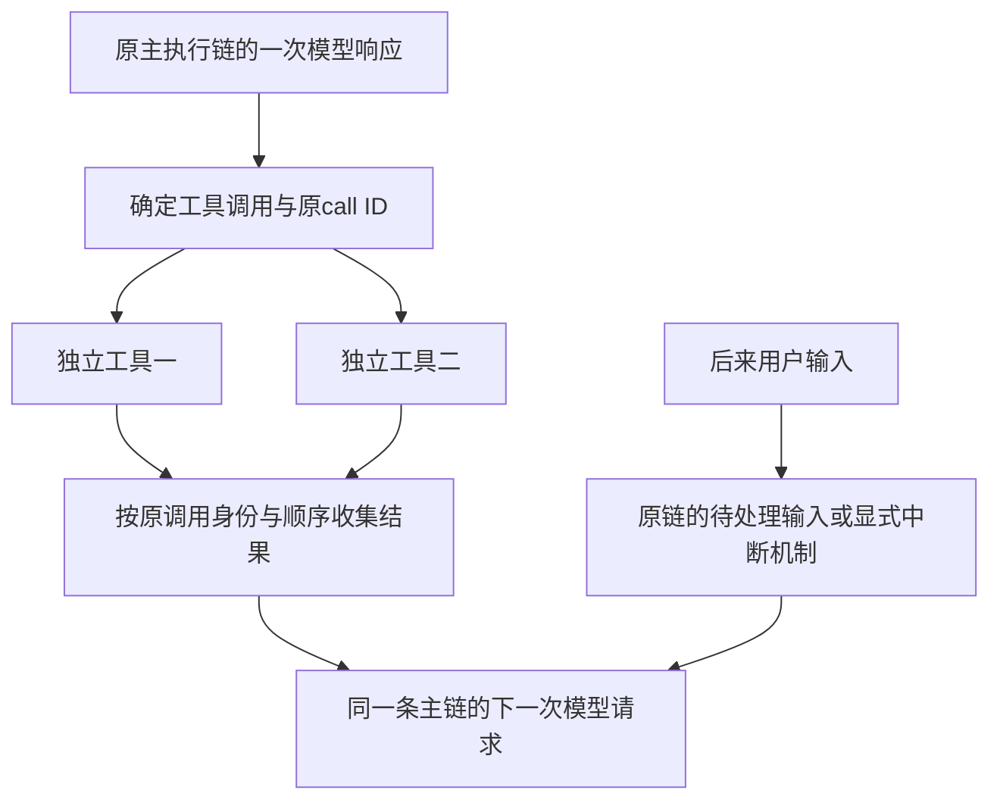

# Memoh、pi、Codex 与 Yuki 的并发实现对照

日期：2026-10-18（UTC+8）。状态：**源码与既有测试阅读，未执行模型、平台操作或这些项目的测试；未修改Yuki运行时代码。** [前台链路删减与并发边界任务书](Yuki-前台链路删减与并发边界任务书-2026-10-18.md)保留当前前台删减范围；工具并行的后续改动移入独立 issue（编号待补），本报告作为其研究材料。

## 1. 先回答“有并发吗”

有。下面三个对照项目都支持某些并行工作；Yuki也已有direct批次与可选CodeMode的读取并行。在本次核对的实现中，**一个普通主会话/Agent实例保留一条主执行链；工具和独立子Agent可以另行并行。** 单条主执行链不等于所有工作串行，也不等于所有执行共用一份实时更新的上下文。

| 项目及核对版本 | 主执行链的归属 | 正在运行时的新输入 | 主要并行位置 |
| --- | --- | --- | --- |
| Memoh `7e40b52ec46d076c17d93e578f5fc18f88742f97` | 内部session的一个持久活动run | 新独立run接纳遇busy；可沿原run steer，或按入口排队/等待后再接纳 | 不同session、独立子Agent、一批已批准工具 |
| pi `3daa20280f6a7c7cbe0935680c9a38fdc3863005` | 一个Agent/session runtime实例的`activeRun` | 普通prompt重入报错；steer/followUp进入原实例队列 | core原生工具批次；coding-agent启用CodeMode后的脚本内嵌调用；示例扩展的独立子进程 |
| Codex开源CLI/App Server `8c076942cb70fba8e5c4732c23f1faabc4aed484` | 一个Session中的活动任务 | 普通turn/start优先转steer，返回已有turn ID；无活动任务才新建普通turn | 符合并行声明的工具、独立child thread及不同thread |
| Yuki `a12f9dd1e6299fc8753f48e8416cbef8152cb1d3` | 普通会话Main沿原执行；Work、SELF等另循原owner | 本报告不据其他项目改写Yuki的接纳与输入合同 | direct连续`parallel_safe`段；可选CodeMode的`asyncio.gather`仍由Host分类、限流与效果屏障执行 |

Memoh和pi来自用户本地工作树，读取前后保持原样。Codex本机安装包只有启动器、exe和资源，因此另取官方开源仓库的独立研究检出；该提交的结论不自动等同当前安装的桌面客户端、所有协议版本或所有feature flag默认值。

pi必须区分两层：`packages/agent`支持原生工具批次，不代表coding-agent每个请求都直接声明这些工具。coding-agent内置CodeMode与tool_search默认不激活；激活后的`on`/`only`决定请求声明投影。Yuki同样要区分完整执行清单、模型直调清单与Code脚本调用，不能把“支持CodeMode”写成“默认强制只看两个工具”。

这里的“单条主链”指逻辑上的活动owner和上下文接纳，不承诺远端物理上永远只有一笔采样：取消请求后，上游可能尚未确认停止，而原链已经继续下一次请求。旧输出拒收、远端停止与是否计费是不同事实。

## 2. 同一主循环怎样使用并行

下面是便于理解的共同形状，不表示各项目每一个采样、流式与取消细节完全相同；CodeMode还在外层模型工具调用内增加脚本与Host派发这一层：



主循环负责汇总：两个工具的完成时间可以不同，但它们仍属于这一轮已有的调用，结果不会变成两份各自继续回答的主聊天。Codex的工具还可能在响应流处理期间启动；“一条主链”不要求工具必须等整条HTTP响应完全读完才开始。

模型看到的是每次请求派发时确定的输入。steer可能等待下个边界，也可能中断当前采样再续接；两种实现都没有把新的文字神奇地改进已经发出的请求。

另一类并发是子Agent：父链向多个独立子上下文分派工作，各子链独立调用模型/工具，再把结果消息交给父链。**它们有意分开上下文，父链负责采用结果；不是把所有子链的私有轨迹自动拼成公共历史。**

## 3. Memoh：持久接纳控制一个session的活动run

### 3.1 两条消息同时进入同一session

`StartTurn`先做`admitTurnRun`，取得真实接纳后才进入模型执行。`Manager.Admit`依次处理持久接纳、fencing token、claim、激活当前owner与启动run。数据库以`(team_id, session_id)`部分唯一索引约束accepted/running/waiting_decision/finishing状态，第二个独立调用不能同时取得另一个活动run。

```text
A、B同时申请同session
→ A取得持久活动run并被owner认领
→ B得到ErrSessionBusy，不创建第二条模型主循环
→ B按入口采用原等待/队列路径，普通busy不自动转steer
→ 仅显式/steer命令或steer API可另行将补充交给原run
```

入站4个worker只表示多个入口工作可以同时进行，不表示同session有4个Main。不同session有不同live key，可以各自生成。

源码：[接纳入口](https://github.com/felinics/Memoh/blob/7e40b52ec46d076c17d93e578f5fc18f88742f97/internal/agent/application/turn_service.go#L33)、[单活动run与接纳顺序](https://github.com/felinics/Memoh/blob/7e40b52ec46d076c17d93e578f5fc18f88742f97/internal/agent/runtime/session/admit.go#L173)、[持久唯一索引](https://github.com/felinics/Memoh/blob/7e40b52ec46d076c17d93e578f5fc18f88742f97/db/postgres/migrations/0001_init.up.sql#L2239)。

### 3.2 steer与同一run继续

Memoh允许steer在特定采样窗口取消当前模型调用，保存中断检查点后在原run续步；工具开始及finish附近有各自的窗口关闭边界。这里是“改变原执行接下来的输入”，不是让两份Main同时生成，也不是修改已发payload。

取消后可以不等provider stream完全关闭就继续，gate拒收旧调用晚到输出。因此本地主链有序，不代表远端旧采样已确认停止或不再收费。不能据此向Yuki引入主动取消后重购模型的优化。

外部平台与web/CLI的忙时策略不同：外部入口要持有原run handle投递结果，因此可能等待重试；本地入口可以保存完整follow-up命令，在当前run终结后启动。重试原接纳不等于重放一次模型或平台效果，不能把它们混为同一种retry。

源码：[steer gate](https://github.com/felinics/Memoh/blob/7e40b52ec46d076c17d93e578f5fc18f88742f97/internal/agent/runtime/native/steer.go#L104)、[取消与中断检查点](https://github.com/felinics/Memoh/blob/7e40b52ec46d076c17d93e578f5fc18f88742f97/internal/agent/runtime/native/loop_stream.go#L667)、[不等待旧stream关闭的测试说明](https://github.com/felinics/Memoh/blob/7e40b52ec46d076c17d93e578f5fc18f88742f97/internal/agent/runtime/native/steer_test.go#L137)。

### 3.3 工具批次

一批工具先按顺序处理批准，遇deferred则该批次暂不执行；全部批准后启动goroutine，结果按原索引写回，WaitGroup汇合后进入后续步骤。因此T2可以先完成，但模型不会因为完成先后把T2的结果误配给T1。单项错误变成该项结果，不自动撤销其他项；取消是否及时仍取决于工具对ctx的处理。

这不自动形成对外事务。该处没有Yuki的`parallel_safe`只读段语义；文件edit的读旧内容再原子rename，也不等于通用同文件锁或跨调用CAS。两个独立修改可能都读到旧内容，原子替换只能保证某次替换的完整性，不能证明没有覆盖别人的更新。

源码：[工具派发及有序结果](https://github.com/felinics/Memoh/blob/7e40b52ec46d076c17d93e578f5fc18f88742f97/internal/agent/toolexec/tool_exec.go#L47)。本任务不据此扩大Yuki的发送/修改并行。

### 3.4 子Agent与恢复边界

spawn创建独立ThreadID并记录父thread，child取得自己的原run名额。不同child能并行；同一child忙时的后续任务沿自己的FIFO，当前任务结束后再开始。

`fork=true`才将父模型messages快照存给child；快照发布于父模型请求派发前，因此不包含触发此次spawn的assistant tool call，但包含此前已进入请求的工具历史。之后child使用父快照与自己的history，不持续实时共享父请求。

前台spawn等待报告；后台spawn先返回task handle，父链再通过既有等待/状态工具取得结果。它没有自动合并child全部历史，后台handle也不提供跨进程恢复保证。子Agent默认仍共享父工作目录，所以上下文隔离不自动提供文件隔离。

持久run、owner与fence用于确认哪个执行有权写入原结果。恢复策略须分开看：有resume context的停机任务可能记lost/interrupted，再以`resume:<原runID>`形成新admission继续；parked decision在符合条件的分布式backend下也有沿原run转交owner的路径。不能将其一概描述为“重启只记lost”或“永远同run恢复”。

**fence不是外部副作用exactly-once证明**：不理解fence的远端API或文件写入，不会因此自动回滚或撤销。结果丢失的效果仍可能未知，恢复上下文要求先查历史、工作区和外部回执，而非机械重派已批准工具；这不是任意效果的exactly-once保证，不移植为Yuki的原执行恢复合同。

源码：[子Agent与fork](https://github.com/felinics/Memoh/blob/7e40b52ec46d076c17d93e578f5fc18f88742f97/internal/agent/tool/subagent.go#L492)、[原thread与共享目录](https://github.com/felinics/Memoh/blob/7e40b52ec46d076c17d93e578f5fc18f88742f97/internal/chat/thread/service.go#L540)。

恢复源码：[resume新接纳](https://github.com/felinics/Memoh/blob/7e40b52ec46d076c17d93e578f5fc18f88742f97/internal/agent/application/session_resume.go#L388)、[未知效果处理](https://github.com/felinics/Memoh/blob/7e40b52ec46d076c17d93e578f5fc18f88742f97/internal/agent/application/session_resume_decision.go#L72)。

## 4. pi：单实例activeRun，产品声明与两层工具并发

### 4.1 原子地开始一次主运行

`prompt → runPromptMessages → runWithLifecycle`在第一次让出JS执行权前就检查并设置`activeRun`。同一实例上的第二个prompt会看到busy，不存在先等网络、再登记运行的空隙。这是进程内单实例的次序，不是跨进程数据库锁。

steering与follow-up各有队列。默认逐条消费；主循环在合法边界取steer，在原本将结束时再取follow-up。流中不轮询并改写输入，也不会因一条steer跳过当前响应剩余工具；显式abort才负责取消。

```text
prompt(A) → 设置activeRun → LLM(A)
此时prompt(B)被拒绝；steer(B)只入队
→ 当前模型与整批工具结束 → finishTurn
→ 下一次模型请求接入B
→ 主链将结束时再处理follow-up
```

源码：[prompt重入检查](https://github.com/earendil-works/pi/blob/3daa20280f6a7c7cbe0935680c9a38fdc3863005/packages/agent/src/agent.ts#L373)、[activeRun生命周期](https://github.com/earendil-works/pi/blob/3daa20280f6a7c7cbe0935680c9a38fdc3863005/packages/agent/src/agent.ts#L507)、[主循环输入消费](https://github.com/earendil-works/pi/blob/3daa20280f6a7c7cbe0935680c9a38fdc3863005/packages/agent/src/agent-loop.ts#L175)。

### 4.2 coding-agent的CodeMode入口与实际请求投影

当前coding-agent默认工具为`read/bash/edit/write`。CLI装载内置codemode、tool_search扩展，但两者的`defaultActive`均为false；SDK也不自动装载CLI的这些内置扩展。显式工具选择、扩展设置或MCP发现路径可以激活它们，MCP的自动启用又受自身配置控制。因此不能把用户某个已启用CodeMode的入口，概括成此提交所有coding-agent入口都强制CodeMode。

这里有两个独立开关：是否激活`codemode`，以及激活后怎样投影声明。`codemode.mode`默认`on`，保留活动direct工具的模型声明，并提供脚本入口；`only`把活动direct工具从实际请求的工具声明中隐藏，仍保留其脚本可调用性。`AgentSession`保存hiddenDeclarations，发请求前过滤工具增删声明；所以仅看`agent.state.tools`或活动名称列表，不能证明模型实际看到了哪些工具。

`only`也不保证所有后续请求永远恰好只有`codemode`和`tool_search`：其他model-only工具仍可声明，tool_search还能激活codemode/deferred暴露的工具，而该隐藏规则针对direct工具。这里的查找/装载语义与Yuki冻结清单、查询不改声明的合同不同。

```text
createAgentSession / AgentSession注册工具
→ 初始活动工具与exposure → prepareLoadout
→ codemode on：保留direct；only：记录要隐藏的direct声明
→ transformContext投影实际请求 → 模型选择原生调用或codemode脚本
```

源码：[默认工具](https://github.com/earendil-works/pi/blob/3daa20280f6a7c7cbe0935680c9a38fdc3863005/packages/coding-agent/src/core/settings-manager.ts#L84)、[初始活动清单](https://github.com/earendil-works/pi/blob/3daa20280f6a7c7cbe0935680c9a38fdc3863005/packages/coding-agent/src/core/sdk.ts#L280)、[codemode默认不激活](https://github.com/earendil-works/pi/blob/3daa20280f6a7c7cbe0935680c9a38fdc3863005/packages/coding-agent/src/extensions/codemode/index.ts#L32)、[tool_search默认不激活](https://github.com/earendil-works/pi/blob/3daa20280f6a7c7cbe0935680c9a38fdc3863005/packages/coding-agent/src/extensions/tool-search/index.ts#L12)、[on/only投影](https://github.com/earendil-works/pi/blob/3daa20280f6a7c7cbe0935680c9a38fdc3863005/packages/coding-agent/src/extensions/codemode/tool.ts#L320)、[请求过滤](https://github.com/earendil-works/pi/blob/3daa20280f6a7c7cbe0935680c9a38fdc3863005/packages/coding-agent/src/core/agent-session.ts#L1772)、[MCP条件激活](https://github.com/earendil-works/pi/blob/3daa20280f6a7c7cbe0935680c9a38fdc3863005/packages/coding-agent/src/extensions/mcp/index.ts#L498)、[tool_search装载](https://github.com/earendil-works/pi/blob/3daa20280f6a7c7cbe0935680c9a38fdc3863005/packages/coding-agent/src/extensions/tool-search/tool.ts#L186)。[请求捕获测试](https://github.com/earendil-works/pi/blob/3daa20280f6a7c7cbe0935680c9a38fdc3863005/packages/coding-agent/test/suite/agent-session-codemode.test.ts#L141)直接比较on与only下的Provider context；本轮仅阅读。

### 4.3 CodeMode脚本的Promise.all属于内嵌派发

模型发出一个`codemode(C)`后，QuickJS脚本可用`Promise.all([tools.A(), tools.B()])`重叠调用。sandbox把每项送入`ctx.executeTool`，再由`NestedToolCallRunner`分配`C/1`、`C/2`等子call ID，沿原父call ID执行工具hooks与权限处理。子调用详情与usage归入外层C的toolResult，不是凭空新增两条模型主链，也不是core收到一批原生tool calls的同一层。

内嵌派发按全局顺序策略或单项`executionMode: sequential`决定是否等待自己的queue。全局为parallel时，普通parallel项不等待这份queue；不能据一个sequential项宣称它和所有普通内嵌调用形成读写屏障。现有测试分别验证全为sequential与全为parallel的重叠数，没有由此证明混合副作用安全。

```text
模型调用codemode(C) → 脚本Promise.all(A,B)
→ sandbox并发Host回调 → ctx.executeTool → nested(C/1,C/2)
→ 各自执行与返回 → 脚本输出 → 一个C的模型工具结果
```

脚本的普通`Promise.all`拒绝不等于其他工具已撤销。脚本结束、失败或取消会向仍活动的Host调用传播AbortSignal；sandbox可结束本次脚本并丢弃晚到结果，但不等待所有忽略signal的外部工具真正停下。已经写入或已发送的效果仍然存在；脚本结束、worker关闭与外部效果全部停止须分别判断。

源码：[脚本工具适配](https://github.com/earendil-works/pi/blob/3daa20280f6a7c7cbe0935680c9a38fdc3863005/packages/coding-agent/src/extensions/codemode/execute.ts#L467)、[父call上下文](https://github.com/earendil-works/pi/blob/3daa20280f6a7c7cbe0935680c9a38fdc3863005/packages/coding-agent/src/core/extensions/runner.ts#L968)、[内嵌派发与队列](https://github.com/earendil-works/pi/blob/3daa20280f6a7c7cbe0935680c9a38fdc3863005/packages/coding-agent/src/core/nested-tool-calls.ts#L176)、[Host调用与结束取消](https://github.com/earendil-works/pi/blob/3daa20280f6a7c7cbe0935680c9a38fdc3863005/packages/codemode/src/runtime/execution.ts#L378)。测试：[脚本并行与父子结果](https://github.com/earendil-works/pi/blob/3daa20280f6a7c7cbe0935680c9a38fdc3863005/packages/coding-agent/test/suite/agent-session-codemode.test.ts#L206)、[内嵌顺序/并行](https://github.com/earendil-works/pi/blob/3daa20280f6a7c7cbe0935680c9a38fdc3863005/packages/coding-agent/test/nested-tool-calls.test.ts#L164)、[脚本返回时取消未等待调用](https://github.com/earendil-works/pi/blob/3daa20280f6a7c7cbe0935680c9a38fdc3863005/packages/codemode/test/sandbox.test.ts#L364)、[abort收拢脚本](https://github.com/earendil-works/pi/blob/3daa20280f6a7c7cbe0935680c9a38fdc3863005/packages/codemode/test/sandbox.test.ts#L587)。

### 4.4 core原生工具批次先准备、再启动、按原顺序入历史

`packages/agent`当前默认`parallel`；任一工具声明`executionMode: sequential`会使整批原生tool calls顺序执行。这是core原生批次策略，不能替代上一节的coding-agent内嵌派发分析。preflight逐项await，只准备闭包；全部准备完成后，`Promise.all`启动这些闭包并按原数组位置返回结果。

```text
模型给出[T1,T2]
→ preflight(T1) → preflight(T2)
→ execute(T1)与execute(T2)重叠
→ T2先完成，UI可先显示T2完成
→ 汇合结果仍为[T1结果,T2结果]
→ 按原call ID/次序写toolResult，再请求模型
```

普通工具错误转换为`isError`结果，不撤销兄弟工具。这里是`Promise.all`，不是`allSettled`，也不是跨工具事务：事件订阅者等异常仍可使Promise链拒绝；AbortSignal是协作取消，不能强制停止忽略signal的自定义工具。

源码：[默认策略](https://github.com/earendil-works/pi/blob/3daa20280f6a7c7cbe0935680c9a38fdc3863005/packages/agent/src/agent.ts#L247)、[批次策略](https://github.com/earendil-works/pi/blob/3daa20280f6a7c7cbe0935680c9a38fdc3863005/packages/agent/src/agent-loop.ts#L515)、[preflight与Promise.all](https://github.com/earendil-works/pi/blob/3daa20280f6a7c7cbe0935680c9a38fdc3863005/packages/agent/src/agent-loop.ts#L596)。

### 4.5 文件修改的锁属于具体工具

coding-agent的内置write/edit使用进程内`withFileMutationQueue`，将同路径完整写入/读改写排队；现存文件以`realpath`归一符号链接，不同文件仍可并行。操作结束才释放队列，不能因调用方显示取消就提前让下一个修改进入。

这不是core对所有工具自动分析依赖。bash、自定义副作用、其他进程或其他别名关系不自动由这份Map保护；子进程也不共享父进程的队列。“取消了”同样不证明文件完全未改变。

源码：[路径队列](https://github.com/earendil-works/pi/blob/3daa20280f6a7c7cbe0935680c9a38fdc3863005/packages/coding-agent/src/core/tools/file-mutation-queue.ts#L16)、[write使用该队列](https://github.com/earendil-works/pi/blob/3daa20280f6a7c7cbe0935680c9a38fdc3863005/packages/coding-agent/src/core/tools/write.ts#L67)。

### 4.6 fork与子进程扩展

coding-agent fork先abort并等待旧session idle，旧工具结果与中止尾部归旧会话，再dispose旧runtime并切到所选历史形成的新分支。这防止旧运行的迟到结果进入新上下文，不是在旧Agent上同时跑两条主循环。

示例subagent扩展另起`pi --no-session`进程，以专用system prompt与Task输入启动，并将结果作为父工具结果返回；没有自动复制父整份transcript。core不默认内置这项扩展。默认cwd可与父相同，不能据独立进程推断文件操作无冲突。

源码：[切换前收拢](https://github.com/earendil-works/pi/blob/3daa20280f6a7c7cbe0935680c9a38fdc3863005/packages/coding-agent/src/core/agent-session-runtime.ts#L167)、[子进程示例](https://github.com/earendil-works/pi/blob/3daa20280f6a7c7cbe0935680c9a38fdc3863005/packages/coding-agent/examples/extensions/subagent/index.ts#L300)。

## 5. Codex开源实现：一个活动任务，输入注入、有序工具结果与独立child

### 5.1 普通turn/start优先接入原turn

App Server调用`start_or_steer_turn`，核心经submission channel处理输入。存在可接受输入的Regular task时，`steer_input`追加pending input，返回原turn ID；无活动turn才spawn新的RegularTask。活动结构保存单个`Option<RunningTask>`，不是并行Main列表。

`spawn_task`有替换旧任务的取消路径，但普通输入已经命中steer时不会走到该路径。Review/Compact等不是任意可steer的Regular task；显式Queue有自己的idle启动条件，不能概括为所有操作都无条件接入。

```text
A的普通turn正在请求模型
→ B发送普通turn/start
→ start_or_steer找到A，追加pending B，返回A的turn ID
→ 原turn后续采样采用B；不是A、B各开一个Main
```

源码：[App Server入口](https://github.com/openai/codex/blob/8c076942cb70fba8e5c4732c23f1faabc4aed484/codex-rs/app-server/src/request_processors/turn_processor.rs#L661)、[start_or_steer分支](https://github.com/openai/codex/blob/8c076942cb70fba8e5c4732c23f1faabc4aed484/codex-rs/core/src/session/turn_input.rs#L374)、[活动任务结构](https://github.com/openai/codex/blob/8c076942cb70fba8e5c4732c23f1faabc4aed484/codex-rs/core/src/state/turn.rs#L30)。

### 5.2 steer的抢占是可配置的原turn续接

未启用InstantInterrupt时，pending input在下一采样边界处理；启用时watcher可取消当前step的采样等待。有transport interrupt handle则先drain，否则drop stream，然后以needs_follow_up继续原turn。

这改变后续采样，不修改已经发出的payload，也不撤销已经输出的文字或已经启动的工具。该flag在用户当前安装/部署中的默认值未核，不将源码分支当成当前客户端必然使用的行为。

源码：[采样抢占分支](https://github.com/openai/codex/blob/8c076942cb70fba8e5c4732c23f1faabc4aed484/codex-rs/core/src/session/turn.rs#L2733)。官方[App Server](https://learn.chatgpt.com/docs/app-server)也明确steer追加当前turn而不创建新turn；[Queue与Steer说明](https://developers.openai.com/blog/mastering-codex-remote-for-engineering)描述产品入口的两种选择。

### 5.3 工具的读写门与FuturesOrdered

工具派发使用`tokio::spawn`。声明支持parallel的工具取得共享`RwLock.read`，其他工具取得独占`write`；因此可并行项能重叠，需要独占的项与它们形成屏障。声明来自工具合同，不等于自动证明任意脚本不会写共享资源。

采样处理按原调用顺序将future放进`FuturesOrdered`，收回模型历史时保持顺序；UI/进度事件可以按真实完成时间出现。取消时按handler是否达到终态或必须完成处理已起调用，不把它们重新编号成一次新工具执行。

源码：[并行/独占门](https://github.com/openai/codex/blob/8c076942cb70fba8e5c4732c23f1faabc4aed484/codex-rs/core/src/tools/parallel.rs#L202)、[结果顺序](https://github.com/openai/codex/blob/8c076942cb70fba8e5c4732c23f1faabc4aed484/codex-rs/core/src/session/turn.rs#L2568)。

### 5.4 child有独立历史，通过mailbox返回结果

fork准备时先flush父历史，构造child初始快照，再创建新thread；之后两边历史各自增长。child默认继承运行时cwd，不自动创建worktree。上下文独立与文件隔离需要分别判断。

后续交互走mailbox，发送消息与发送后唤醒目标turn是可区分的操作。child完成由watcher把Result消息交给直接父thread，不把child全部工具轨迹拼入父prompt。父已发终端答案后，晚到mail转入NextTurn，不直接将已展示的答案无限延长。

interrupt目标thread、普通turn结束和关闭整棵树是不同操作；不能据某个控制名推断必然取消所有后代或撤销其效果。

源码：[child快照及创建](https://github.com/openai/codex/blob/8c076942cb70fba8e5c4732c23f1faabc4aed484/codex-rs/core/src/agent/control/spawn.rs#L807)、[cwd继承](https://github.com/openai/codex/blob/8c076942cb70fba8e5c4732c23f1faabc4aed484/codex-rs/core/src/agent/child_config.rs#L179)、[结果通知](https://github.com/openai/codex/blob/8c076942cb70fba8e5c4732c23f1faabc4aed484/codex-rs/core/src/agent/control.rs#L475)。官方[子Agent说明](https://learn.chatgpt.com/docs/agent-configuration/subagents)也将子工作归于各自agent thread。

## 6. Yuki：已有direct与可选CodeMode，共用原工具和效果事实

### 6.1 完整执行清单与模型声明分开

本节绑定`a12f9dd1e6299fc8753f48e8416cbef8152cb1d3`。`code_mode_enabled`默认false；Docker保留direct与codemode镜像阶段，CodeMode是可选部署能力。direct向模型声明完整冻结工具清单；CodeMode从同一完整清单投影固定直调子集，其余调用经脚本桥接。`lookup_tools`查询原schema与script_name，不像pi的tool_search那样动态改模型活动声明。

脚本为Monty受限Python：`await yuki_<工具名>({参数})`使用原schema，独立读取可写成`asyncio.gather`。Host不把它当成任意宿主Python；`execute_code`当前要求已接纳有效持续Work，短聊和单次发送直接调用原工具。持续Work的Code编排指引已经存在，不是本次需要新建的机制。

源码：[默认关闭](https://github.com/YuanYeYouTao/Yuki/blob/a12f9dd1e6299fc8753f48e8416cbef8152cb1d3/src/yuki/config.py#L71)、[两种镜像](https://github.com/YuanYeYouTao/Yuki/blob/a12f9dd1e6299fc8753f48e8416cbef8152cb1d3/Dockerfile#L65)、[冻结清单及模型投影](https://github.com/YuanYeYouTao/Yuki/blob/a12f9dd1e6299fc8753f48e8416cbef8152cb1d3/src/yuki/services/main_agent_contract.py#L59)、[脚本API一一映射](https://github.com/YuanYeYouTao/Yuki/blob/a12f9dd1e6299fc8753f48e8416cbef8152cb1d3/src/yuki/codemode/api_projection.py#L77)、[Python调用合同](https://github.com/YuanYeYouTao/Yuki/blob/a12f9dd1e6299fc8753f48e8416cbef8152cb1d3/src/yuki/codemode/contract.py#L41)、[原Work要求](https://github.com/YuanYeYouTao/Yuki/blob/a12f9dd1e6299fc8753f48e8416cbef8152cb1d3/src/yuki/services/agent_runner.py#L588)。

### 6.2 gather提出重叠，Host决定实际派发

CodeMode在引擎等待边界按Host ordinal登记子调用，连续`parallel_safe`读取段受semaphore限制并行；发送、写入与控制调用形成屏障，前段收拢后才执行该项，再进入后段。因此脚本写出gather不等于Host允许任意效果并行。direct批次也已有连续`parallel_safe`段，`send_message`须完成后才进入后续读取段。工具并行不是Yuki当前缺少的整体能力。

```text
同一Main调用execute_code → 脚本gather(读取A,读取B,发送C,读取D)
→ Host按原ordinal登记 → 有界并行A/B并收拢
→ 单独完成C → 才进入D → 原execute_code结果回到同一Main
```

父调用、子operation与快照意图沿原执行登记，恢复先使用原持久回执；pending/unknown不因重启或取消被当作未发生而重派。Monty终止等待原owner清理并释放容量，这收拢的是本次worker生命周期，不撤销已派发的外部效果。

源码：[等待边界与登记](https://github.com/YuanYeYouTao/Yuki/blob/a12f9dd1e6299fc8753f48e8416cbef8152cb1d3/src/yuki/codemode/driver.py#L408)、[读取段与效果屏障](https://github.com/YuanYeYouTao/Yuki/blob/a12f9dd1e6299fc8753f48e8416cbef8152cb1d3/src/yuki/codemode/driver.py#L540)、[Host分类](https://github.com/YuanYeYouTao/Yuki/blob/a12f9dd1e6299fc8753f48e8416cbef8152cb1d3/src/yuki/services/agent_runner.py#L661)、[direct批次](https://github.com/YuanYeYouTao/Yuki/blob/a12f9dd1e6299fc8753f48e8416cbef8152cb1d3/src/yuki/capabilities/coordinator.py#L169)、[父子operation登记](https://github.com/YuanYeYouTao/Yuki/blob/a12f9dd1e6299fc8753f48e8416cbef8152cb1d3/src/yuki/codemode/driver.py#L444)、[原调用恢复](https://github.com/YuanYeYouTao/Yuki/blob/a12f9dd1e6299fc8753f48e8416cbef8152cb1d3/src/yuki/services/invocation_service.py#L237)、[worker终止收拢](https://github.com/YuanYeYouTao/Yuki/blob/a12f9dd1e6299fc8753f48e8416cbef8152cb1d3/src/yuki/codemode/engine_monty.py#L282)。

| 执行层 | 并行提出者 | 顺序与效果范围 |
| --- | --- | --- |
| pi core原生批次 | 模型的一批tool calls | 默认parallel；任一sequential使整批顺序执行 |
| pi coding-agent CodeMode | 一个外层调用内的JS脚本Promise.all | nested dispatcher；单项sequential的queue不自动阻挡普通parallel项；具体write/edit另有进程内路径队列 |
| Yuki direct | 模型的一批tool calls | 连续parallel_safe段重叠，发送等非parallel_safe项形成边界 |
| Yuki CodeMode | 一个外层调用内的Python asyncio.gather | Host按ordinal、有界读取段与发送/写入/控制屏障执行，保留父子operation与原回执 |

## 7. 各种实现都不能替代的事实

- 单活动Main保护主执行顺序；不能证明其内部所有工具都可并行。
- 结果按call ID和原顺序配对，避免错配；不能撤销两个真实工具已经产生的冲突效果。
- fork/子Agent可共享初始前缀，但后续不自动共享最新私有尾部。需要结果交接，不存在“开几个模型后自动合成同一个脑子”。
- 上下文隔离不等于工作目录、数据库或外部账号隔离。pi内置文件队列也是有作用范围的具体实现，不是所有副作用的通用保证。
- 取消模型、取消工具、关闭会话与关闭子树的语义不同；已确认或未知的效果不能靠取消标记抹去。
- 进程内activeRun、数据库run接纳和执行fence各保护自己的owner边界，不自动提供外部exactly-once。

## 8. 对Yuki任务书的影响

本次研究支持保留普通聊天前台的单Main顺序。当前前台删减任务优先减少重复准备和跨会话无关等待；**工具编排与当前轮资料、附件的新增并行移入后续独立 issue（编号待补），不作为本轮减负的实施或验收项。** 两者可以分别评估，不依赖启用同会话双Main。

后续issue应从Yuki已有direct/CodeMode与真实调用形状出发，先找具体重复等待及可并行读取；区分外层模型批次与脚本内嵌派发。保留现有parallel_safe、效果屏障与原执行回执，不将pi core默认parallel当作其产品必经路径或Yuki改动依据，不为研究对照引入新队列、数据库接纳表或文件锁。Yuki的持久环境仍按原Linux文件语义与原执行合同工作。

Work、SELF、插件/SDK和子Agent分别沿原lease、调用者所有权、来源及回执；不能宣称它们都经过普通ChatService的同一把锁。原Main请求、公共冻结历史、私有尾部、内部Person/event/execution ID与原效果回执保持；实际缺口由具体触发证明后沿原入口修正。

## 9. 阅读过的测试及验证边界

| 项目 | 测试源码覆盖的相关行为 |
| --- | --- |
| Memoh | `TestAdmitAnswersBusyForConcurrentInvocation`、`TestSROWN001BusyWritesNothingAndRetryLaterSucceeds`、`TestBusyAgentQueuesAndRunsFIFO`：同session竞争、busy不持久化第二条admission且不启动第二个Main，以及同child后续任务顺序 |
| pi core与fork | [重入拒绝](https://github.com/earendil-works/pi/blob/3daa20280f6a7c7cbe0935680c9a38fdc3863005/packages/agent/test/agent.test.ts#L709)、[完成/结果顺序](https://github.com/earendil-works/pi/blob/3daa20280f6a7c7cbe0935680c9a38fdc3863005/packages/agent/test/agent-loop.test.ts#L668)、[整批工具后接steer](https://github.com/earendil-works/pi/blob/3daa20280f6a7c7cbe0935680c9a38fdc3863005/packages/agent/test/agent-loop.test.ts#L762)、[准备中止](https://github.com/earendil-works/pi/blob/3daa20280f6a7c7cbe0935680c9a38fdc3863005/packages/coding-agent/test/suite/regressions/8935-parallel-preflight-abort.test.ts#L16)、[fork旧尾部隔离](https://github.com/earendil-works/pi/blob/3daa20280f6a7c7cbe0935680c9a38fdc3863005/packages/coding-agent/test/suite/regressions/8724-in-memory-fork-active-tool.test.ts#L79)；另阅读file-mutation-queue测试的范围 |
| pi CodeMode | 第4.2/4.3节链接的on/only实际请求、脚本Promise.all父子调用、nested顺序策略和脚本取消测试；不把它们当作core原生批次同一层或任意外部效果停止证明 |
| Codex | `turn_start_steers_active_turn_and_returns_active_turn_id`；`turn_input_submission`并发一started一steered；`pending_input`工具drain时steer；`tool_parallelism`原call ID顺序；`control_tests`父子mailbox/fork/树关闭 |
| Yuki | [CodeMode组合](https://github.com/YuanYeYouTao/Yuki/blob/a12f9dd1e6299fc8753f48e8416cbef8152cb1d3/tests/integration/test_codemode_composition.py#L50)：真实worker的gather、并发限制、顺序与回放；[控制屏障](https://github.com/YuanYeYouTao/Yuki/blob/a12f9dd1e6299fc8753f48e8416cbef8152cb1d3/tests/integration/test_codemode_control_gate.py#L142)；[输出与取消恢复](https://github.com/YuanYeYouTao/Yuki/blob/a12f9dd1e6299fc8753f48e8416cbef8152cb1d3/tests/integration/test_codemode_output_recovery.py#L138)含FakeEngine与native参数化，不能全部称为真实引擎测试 |

上述均为源码与测试阅读，不写成测试已运行、真实并发无故障或用户当前部署已验收。Yuki真实Monty用例还会在缺少binding或`YUKI_MONTY_BINARY`对应worker时[跳过](https://github.com/YuanYeYouTao/Yuki/blob/a12f9dd1e6299fc8753f48e8416cbef8152cb1d3/tests/support/codemode_cases.py#L40)，不能只凭测试名称声称本机已覆盖。所有行为绑定文首提交，后续实现前重新核对对应版本。
