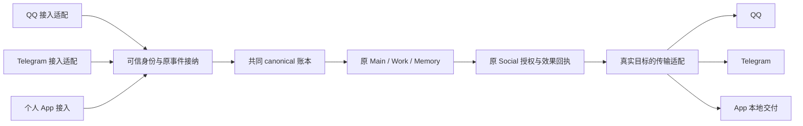

# 多平台解耦与 Telegram 接入任务书

日期：2026-10-16（UTC+8）。分支：`codex/issue-299-implementation`。

**当前状态：最新 main `0b1c2193` 已合入本分支，审01–13已完成本地修复及匹配回归。** 本地快照为 `eb9bd2f7`，同步提交为 `7053ec66`，原有实现与参与算法热修均保留。修复尚未推送、提 PR、合入 main 或部署；原生 Code VM、真实平台和 Provider usage/cache 仍未验收，不能据此宣称综合交付全部完成。

**终审优先级：禁止防御性编程是最高设计约束；严重耦合处，结构重构优先于局部最小实现。** 各编号是问题与证据索引，不要求逐处增加平台判断或保留错误接口。按 §12 的真实依赖收拢同一条链，删除旧回推、重复缓存、错误门槛和重复出口；不以改动行数最少作为选择标准。真实身份、授权、原来源与执行回执继续按事实处理，不借重构取消，也不据此制造新限制。

## 1. 基线与已有工作

| 对象 | 本次核对值 |
| --- | --- |
| 原分支 HEAD | `c8905d3839b255f79428045efc988ec9fa63cc25`；与远端同名分支一致 |
| 产品代码基线 | `c346041bcdec46955bab048ab40864b6057879c2`；其后至上述 HEAD 只有文档提交 |
| 已纳入的 main | `9e6f61476e9cf8a2c5013d92ee788dbd7b58a076`；本轮 `git ls-remote` 核对远端仍为此值 |
| 工作区 | `issue-299-review/Yuki-QQbot`；不修改其他会话的 main checkout |
| Memoh 对照 | `7e40b52ec46d076c17d93e578f5fc18f88742f97`，完整仓库位于 `D:/Code/My_Github_Repo/Memoh` |
| 语义参与依赖 | `d85bb39a5d16e1846390489b95fc3af8bc2f5627`，沿当前 `pyproject.toml` 与 `uv.lock` |

先读[共同开发约束](development-contract.md)、[Canonical runtime](canonical-runtime.md)、[Tool Kernel](tool-kernel.md)、[主 Agent](main-agent-runtime.md)、[持久工作者](persistent-subagents.md)、[聊天媒体](chat-media-workspace.md)、[语义参与](semantic-participation.md)、[个人 API](client-api.md)与[插件架构](../plugin-development/architecture.md)。本任务书描述拟改设计，不把待实现内容提前写成这些模块的现行合同。

前一轮 [#299 终审任务书](Yuki-299同步main终审与修复任务书-2026-10-16.md)的 F01–F10 已纳入共同实施；以下为原调查时的计划关系。本计划与其衔接：F01/F02/F04–F07 属于同一公共链解耦，合并处理并保留各自验收；F03/F08/F09 是个人客户端的独立真实缺陷，仍按原项处理；F10 随相关文档和入口清理收口。不能用新增 TG 绕开旧 App 断链，也不能把这些旧缺陷重算成已完成工作。

## 2. 已确认的设计要求

1. **能共用 schema 的尽量共用。** 工作区、终端、环境、Web 搜索、Memory、Work、自动化、子 Agent 和内部账本查询沿同一公共工具实现。常用社交工具优先共用名称、说明和参数结构。API 原生参数不同，首先由适配器转换；不因此复制 QQ/TG 两套业务服务。
2. **业务链永远使用内部 ID。** Person、Space、Binding、Presence、Conversation、事件、Work、调用、操作与 artifact 各沿自身现有内部 ID；`chat_events.id` 与 canonical event 关联 UUID 不混用。模型和领域 API 不用 QQ 号、TG user/chat/message ID 或 username 代替已有业务身份。
3. 外部 ID 保留在接入、引用解析、投递、撤回、去重和历史 provenance 等真实传输边界。接入先解析并接纳内部事件，随后传原内部锚点；发送先确定内部目标，适配器再取外部定位。保留历史外部字段不表示允许核心重新用它猜 owner。
4. **公共工具固定，平台操作经适配器。** 部署时冻结工具名、schema、说明、顺序、revision 与 Code 投影。会话内容、权限变化、在线状态、查询目录或一次工具返回都不追加/裁剪已提交声明。不引入渐进注册、热加载工具或第二套 Agent loop。
5. 公共能力的交集形成公共语义；确需保留的平台专有能力单独标明适用范围。删除无用途的专用入口，不为“全平台都有同名函数”制造 TG 戳一戳、伪历史或空实现。已采用的退役及 QQ SDK 边界见 §8。
6. 默认回复沿当前真实 Conversation；显式跨入口发送沿目标 Binding/路由；撤回和原回执查询沿原发送 Presence。**不能把所有操作都按当前来源平台分派。** App/TG 发向明确 QQ 目标仍能表达同一公共发送语义。
7. 共享 Person/Memory 不合并平台账号的历史或模型 session；跨入口读写与 Work 补充保持原显式授权和来源。TG topic、多 Bot 私聊的真实入口如何映射必须解决，不能把它们隐式归到一个模型上下文。
8. **解耦以删除旧回推、重复分支和错误依赖为主。** 对混合业务身份与传输字段、重复发送出口、平台生命周期侵入核心等问题，直接重构原接口及其全部实际消费者；不以“复用旧 DTO”或“最小改法”强留耦合。不建立平行身份框架、消息总线、路由协调器、权限评分、完成门槛或第二份效果账本。接口变化服务本次实际 QQ/TG/App 调用者与真实平台差异，不为假想未来造框架。

同名而不同 schema 只在确有语义差异、公共参数无法清楚表达时考虑，并按部署固定且纳入原恢复合同。不能把“用户允许差异”当作默认分叉理由。优先保持 QQ/TG 共用平台合同，App 仅保留已有跨入口读取差异；若后续确需改变两类合同，必须连同选择、revision、ScriptApi 和旧执行链一起设计。

## 3. 目标依赖与必须保住的链

接入适配负责原协议转换和凭据；核心不导入平台 Bot 类型、不拼 OneBot action、不拿 TG token URL 当公共媒体地址。Social 继续负责目标、授权、意图、实际状态和账本；平台适配负责发送/上传/引用/撤回参数及原始响应归一。沿现有准备、效果登记、派发、确认与恢复流程下沉转换，不新建一套调度。

上下文装配、公共 FrozenFragments、本轮系统运行资料、compact、已付请求、签名/opaque、工具配对、统一显式发送、原 Work 树和预算属于保留合同。平台接入只提供当前可信事实，不给 TG 另做简版提示词、历史、Memory 或后台执行系统。

## 4. 已查明的耦合与处置

以下为固定基线源码核对，不是 TG 真机复现。行号用于定位本次基线，实施时按符号复核。匹配到 QQ/OneBot 字样不等于应删除；表中区分现行调用、平台实现和历史 reader。

| 编号 | 现状与源码证据 | 后续处置 |
| --- | --- | --- |
| C01 | [身份仓库](../../src/qq_ai_bot/identity/canonical_repository.py) `IDENTITY_PLATFORM`、`find_identity_binding/find_presence/find_space_binding` 默认 QQ；[canonical_owners](../../src/qq_ai_bot/services/canonical_owners.py) 的 person/space resolver 先猜 UUID 再按 QQ 外部号查 | 业务调用改传已核内部 owner，删除外部/内部混合猜测和公共默认 QQ；外部解析只留可信接入与明确管理边界 |
| C02 | [hydrate](../../src/qq_ai_bot/conversation/hydrate.py) 78–84、[scoped_event_uow](../../src/qq_ai_bot/persistence/scoped_event_uow.py) 703–709 仅按裸 bot 外部号查 Presence；[ingress](../../src/qq_ai_bot/identity/ingress.py) 243 群 Binding 查询漏平台 | 用可信 Presence/Binding/Conversation ID 贯通；同号跨平台不串身份，不补按平台逐一尝试的 fallback |
| C03 | [ConversationScope](../../src/qq_ai_bot/domain/conversations.py) 24–47 的 key 只有裸 bot/peer/group；[会话唯一键](../../src/qq_ai_bot/conversation/canonical_db_models.py) 202–212 为私聊 Binding、群 Space，无 topic/多 Bot 维度 | 先确定入口与 topic 表达及迁移，再改全链读取/写入/恢复；保旧会话、事件、checkpoint、Work、回执及 generation，不重建归属 |
| C04 | 同一文件 600–609 的接入回执键为 Presence＋event_type＋platform_message_id，没有 chat；TG message ID 只在 chat 内唯一 | 平台边界形成准确 chat/message 定位，复用原接纳去重；不把裸 TG message ID 塞进旧全局消息号假设，也不新建平行去重表 |
| C05 | [子执行器](../../src/qq_ai_bot/services/subagent_execution.py) 254–257、[processor](../../src/qq_ai_bot/services/processor.py) 787、[chat](../../src/qq_ai_bot/services/chat.py) 811/927/1067 和权限/插件入口直接将外部账号与 QQ `superusers` 比较；WorkResume 423 是已有平台限定的例外，command_service 仍调用 `principal_for_qq` | 高优先级贯通所有入口的真实主体授权，移除裸外部号的跨平台权限推断。QQ/TG 数值相同不得继承 QQ 超管或 generic OneBot 权限；旧 `SUPERUSERS` 保留明确 QQ 配置语义，不改成全平台账号名单 |
| C06 | [GatewayProvider](../../src/qq_ai_bot/gateway/provider.py) 58–64 仅描述连接元数据；[Social](../../src/qq_ai_bot/social/service.py) 266–268 固定调用 OneBot，1092 起直接构造 action、整数目标、reply/at 段 | 在现有 Provider/传输边界补真实操作契约，把协议转换下沉。不要让 TG handle 假装实现 OneBot `call_api` |
| C07 | 同一 Social 的联系人、person_binding、群回复、SELF 等路径硬筛 QQ（280、330、375、529、574、732、942）；[routing](../../src/qq_ai_bot/identity/routing.py) 的默认成员探针固定 OneBot；processor 768、2000–2004 群策略仍接裸 group_id，私聊已传平台 | 目录和目标按内部主体解析真实 Binding，群策略沿内部 Space；成员/可达性核验由对应适配器给出真实事实，沿现有路由事务，不放宽或扩大身份授权 |
| C08 | [社交工具 schema](../../src/qq_ai_bot/social/tools.py) 同时含通用发送、QQ 多账号描述、文件后另发说明、网关历史和转发 raw | 公共参数去 QQ 特指与固定 QQ 文件分步假设；通用账本读取和平台远端/raw 能力语义分清。不因本地空结果自动读网关或其他入口 |
| C09 | Social 1557 调 `parse_onebot_send_receipt`；1657–1658 将 App 文件成功重放送入 QQ caption 结算（旧 F04） | 沿原 Provider 结果归一真实回执，App 原子交付、QQ 分步交付、TG 实际发送分别如实投影；模型侧统一内部 operation/event ID |
| C10 | [MainAgentContract](../../src/qq_ai_bot/services/main_agent_contract.py) 128–164 仅 platform/App 两类；[子执行器](../../src/qq_ai_bot/services/subagent_execution.py) 与 container 无参加载 platform 清单（旧 F01/F02） | 主/子/定时/插件/冷恢复复用原入口的同一冻结合同与 Person 配置；禁止为 TG 临时按轮注册清单 |
| C11 | [执行来源](../../src/qq_ai_bot/services/execution_sources.py) 的群、SELF、自动化查询仍筛 QQ；[自动化](../../src/qq_ai_bot/automation/service.py)、[repository](../../src/qq_ai_bot/automation/repository.py)、[worker](../../src/qq_ai_bot/automation/worker.py) 仍有外部号解析和配置读取（旧 F05） | 恢复原内部事件/执行身份及原 Conversation、Presence、Binding；不借 Person 最新主动路由改换执行入口 |
| C12 | [Memory mutation](../../src/qq_ai_bot/memory/mutation/service.py)、[Memory service](../../src/qq_ai_bot/memory/service.py)、[agent_tools](../../src/qq_ai_bot/services/agent_tools.py) 中 actor、显式 target、证据 requester 和最终 writer 仍走 QQ owner（旧 F06）；[read_scope](../../src/qq_ai_bot/memory/read_scope.py) 的自然名称/显式读取也有 QQ 入口；[MemoryFactCreate](../../src/qq_ai_bot/memory/models.py) 169–208 仍只有外部 subject/visibility 字段，不能误称已有 canonical 创建字段 | 重构创建、验证、准备与仓库写入的真实 owner 参数，贯穿已有内部 Person/Space 身份；现有 MemoryFact/MemoryEntityTarget 的 canonical 字段及 AuthorizedMemoryScope 可复用，不能为迎合旧 Create 校验再反投影 QQ。保 partition 的 canonical 优先路径；现行重建 writer 的 QQ 门槛另列 C30，旧格式解码另按原边界 |
| C13 | [插件 Main](../../src/qq_ai_bot/plugin_host/main_turn.py) 原基线默认 QQ 复核；冷恢复重建入站省略 platform；插件 session/ownership/直接通知另有同类路径（旧 F07）。原内置养鲲用裸群/账号作为 KV/player 身份 | 主调用、独立 session、通知保原主体/平台/批准/来源；SDK 状态消费 canonical Person/Space/Conversation。养鲲随后按用户要求整体移至独立 [Yuki-Kun-Game](https://github.com/YuanYeYouTao/Yuki-Kun-Game)，旧 KV 离线迁移也归插件仓库，不在 Host 附加游戏专用迁移；不清空或猜测合并存档 |
| C14 | [语义参与 Host](../../src/qq_ai_bot/services/semantic_participation.py) 334/342、1111 和 [SELF](../../src/qq_ai_bot/conversation/self_initiative.py) 49 限 QQ；普通 continuation 也依赖该 scene | 从真实 Space 路由与内部事件构造通用 scene；复用原 JEV/engage/quiet/K/迟到反馈和唯一接纳，不给 TG 另建控制器或扩大 JEV 频率 |
| C15 | [媒体 resolver](../../src/qq_ai_bot/services/media_resolver.py) 27–31、102、127 固定 `call_api/get_image/get_record`；ASR、attachment_inputs、媒体缓存、Emoji collector、辅助视觉消费该接口；[attachment_inputs](../../src/qq_ai_bot/services/attachment_inputs.py) 83–87 与 [VisionService](../../src/qq_ai_bot/services/vision_service.py) 522–526 用裸外部 user/group ID 作为现有限流桶 | OneBot 文件解析/转码下沉；公共链消费经真实来源授权的媒体。TG `getFile` 与凭据由 TG 适配处理，共用现有缓存、ASR、文档/视频/主模型输入。原限流语义沿真实内部主体/空间，不让跨平台同数字账号误共享桶，不新增限额 |
| C16 | [Emoji repository](../../src/qq_ai_bot/emoji/repository.py) 使用默认 owner resolver，984–990 将内部 Space 反投影为 QQ 外部群号 | 保存/使用内部 Person/Space 与事件来源；仅 QQ 展示/操作在边界取 QQ Binding。跨平台复用不可变图片，不复用平台专属 file_id |
| C17 | [历史渲染](../../src/qq_ai_bot/event_prompt.py) 11 导入 OneBot projector，300 硬写 QQ 外部作者号，380–384 旧 envelope 还展示 platform_message_id；[context_assembler](../../src/qq_ai_bot/services/context_assembler.py) 354–360 在内部 trigger 后再次比裸 bot/message；[公共提示合同](../../src/qq_ai_bot/prompting/contracts.py) 70–71 和默认配置仍将主体写为 QQ | 模型与上下文沿内部 actor/event/Conversation；复用原内部事件、Conversation/generation/Presence 来源核验，去掉重复外部号判断。平台 segment 投影从共同渲染层移回边界，公共说明改为平台无关语义；保既有人格、进度报告和防刷屏要求，只在合法新上下文边界采用新渲染，不重写已冻结/已付原件 |
| C18 | [main](../../src/qq_ai_bot/main.py)、[QQ matcher](../../src/qq_ai_bot/plugins/ai_chat/matcher.py) 负责 NoneBot/OneBot 启动；[container](../../src/qq_ai_bot/container.py) 装配 QQ 专用 sender/recovery；[doctor](../../src/qq_ai_bot/gateway/compatibility.py) 仅 OneBot。[Compose](../../docker-compose.yml) 22–26 默认注入 QQ 配置路径/凭据，[启动脚本](../../scripts/start.sh) 10–21 随之渲染 SnowLuma，setup 178–182 也无条件准备 QQ 私有凭据 | 把 QQ 生命周期保留在 QQ 模块，TG 注册到同一 Runtime/Registry。公共启动、健康、停机和配置不以 QQ 在线或已准备 QQ 私有材料为成立条件；沿实际启用平台收拢原装配，不为 TG 复制 container 或新增开关框架 |
| C19 | [旧 Work 交付修复](../../src/qq_ai_bot/runtime/work_delivery.py) 257–310 读旧持久回执后补缺失出站账本，是 `find_by_platform_message` 的现有消费者 | 保留真实升级 reader 及原来源关联，不重发；不把它当正常新执行的外部号定位 fallback。盘清旧回执后才能删除其唯一消费接口 |
| C20 | [event_repository](../../src/qq_ai_bot/persistence/event_repository.py) `hydrate_rebuild_subjects` 711–757 仍读 `at.data.qq` 再沿默认平台重建人物；入站、发送和公共渲染各自处理 mention | 原 mention 的实体、位置、Binding 和来源应沿内部身份保存/恢复；新 TG 不伪造 `at.qq`。旧 QQ 段 reader 仍按真实旧格式读取，不追溯改写原冻结历史 |
| C21 | container 371–373 的子 sender、[WorkResume](../../src/qq_ai_bot/services/work_resume.py) 277–295 的 AutomationGateway、[插件 facades](../../src/qq_ai_bot/plugin_host/facades.py) 2640–2696 的发送/回执直接依赖 OneBot；原 `social/transfer.py` 18–59 依赖 QQ 共享挂载（实施时已删除） | 后台和插件复用同一实际传输实现与原执行来源；共享挂载交接只留 QQ 适配。插件通知保已有独立授权 outbox/通知回执，不伪装成 Main 发言或强迁为另一份 Social operation |
| C22 | [BindingOwnership](../../src/qq_ai_bot/identity/ownership_interval.py) 10–23 无平台；[隐私清退](../../src/qq_ai_bot/persistence/people_repository.py) 192–217 把 canonical owner 与裸账号 alias 匹配并列，723 准备无界旧账号，830–837 对 affected Conversation 清 Work/改 generation | 高优先级以真实 canonical owner 为准，删除对已归其他主体事件的裸 alias 归属回推。旧 owner 缺失的 reader 限真实原平台与拥有区间；自然正文同数字不证明主体归属，不因此误清退另一平台的 Work、历史或媒体 |
| C23 | [scope](../../src/qq_ai_bot/conversation/scope.py) 56–70 读取原 primary alias；[WorkSourceGuard.restore](../../src/qq_ai_bot/runtime/work_source_guard.py) 64–68 直接恢复旧 scope 字典；既有 0120/0121 保旧 Conversation/Binding 与拥有区间 | 新入口维度需覆盖真实旧 codec 和 alias reader，不能重命名已冻结 primary alias、删 checkpoint 或重置预算来通过升级。TG 平台 token 已可存储，不为新增一个平台名伪造枚举迁移 |
| C24 | [UserProfiles.capture](../../src/qq_ai_bot/services/user_profiles.py) 138–142 读资料仍沿旧账号 helper；processor 818–819 的人物配置已有 canonical Person，但群配置仍传裸号，配置服务回推 QQ Space | 资料、群策略和配置消费已接纳内部 Person/Space/Binding；删除重复外部 owner 解析。保真实平台显示资料在各 Binding 上，不用同数字的 QQ 昵称或群配置覆盖 TG |
| C25 | [工具证据 recorder](../../src/qq_ai_bot/tool_results/recorder.py) 196–218 已拿到原 initiative/Conversation/Space/Presence，却在来源 guard 再要求 QQ 与外部 bot 号；399–416 不满足时不能写原 Memory 工具证据。Chat 1003 起实际调用该 recorder | 将来源核验收回到原内部 ID、generation、隐私代次与真实主体，不因 TG SELF 缺 QQ 投影丢证据。保真实 Memory evidence 与可丢诊断的区别，不把审计修复变成重新派发工具或完成门槛 |
| C26 | [部署向导](../../src/qq_ai_bot/deployment_setup/command.py) 299–305 必问管理员 QQ，852–855 限数字；同文件 860 及 [service](../../src/qq_ai_bot/deployment_setup/service.py) 807 把 `SUPERUSERS` 列为所有部署的必填，虽可不启用 SnowLuma | TG/App-only 初始化不要求填写假 QQ；沿已有 operator/管理配置接入，QQ 管理字段只约束明确配置的 QQ 功能。公共初始化、后续本地验证和重新配置一起改，保原凭据保护与 QQ 授权语义 |
| C27 | [Self Reflection repository](../../src/qq_ai_bot/memory/self_reflection/repository.py) 1153–1162 把已有 canonical Person/Space 反投影 QQ 外部 ID，缺失就返回 None；668–670 的 claim 因此跳过该主体。service 387–407、705–720 又消费这些外部投影 | 后台反思直接沿现有 canonical owner 与批次/证据执行，删除“有 QQ 账号投影才运行”的门槛。保原 claim、批次、预算与回执；不是仅修改手动 Memory 工具便算全链完成 |
| C28 | [SDK direct delivery](../../src/qq_ai_bot/plugin_host/direct_delivery.py) 28–35 在 callback scope 存一份 `unknown`；[facades](../../src/qq_ai_bot/plugin_host/facades.py) 2637–2639 在分配下一调用 ordinal/prepare 前直接返回它 | 删除 callback 级“一次 unknown 封住所有后续发送”的耦合。每个原 call 继续沿持久 source＋ordinal＋payload 及原 uncertain 回执；不同正文/目标的新显式调用保各自真实授权。公开结果返回旧 operation/status，不能描述成不存在的公开 target 字段错误 |
| C29 | [control_auth.is_self](../../src/qq_ai_bot/services/admin/control_auth.py) 45–48 在 principal 与 target 的 canonical Person 已知且不相等时，仍回退裸外部账号相等；preference_admin 的自助变更消费这一结论 | 删除已知内部主体不等后的外部号“认本人”回退；偏好目标、存储和权限沿原 Person。不能只修超管名单而保留自助权限旁路，也不新增额外审批或第二份权限表 |
| C30 | [Memory rebuild receipt writer](../../src/qq_ai_bot/memory/rebuild/receipt_finalization.py) 106–124 在事件已有 canonical Conversation 后仍要求 QQ Binding，156–163 丢 owner，315–316 得到 `source_owner_unavailable`；[trusted_sources](../../src/qq_ai_bot/memory/rebuild/trusted_sources.py) 50–123 为当前准备/CAS 消费者且固定 QQ | 现行重建以原内部事件、owner、Binding 和证据版本准备/发布，删除 canonical 已定还须 QQ 投影的门槛。旧 `at.qq` 解码保在明确历史边界，不能把当前 writer 误归为“旧 reader 保留不动” |
| C31 | [event_author](../../src/qq_ai_bot/identity/event_author.py) 115 在已按真实 platform 找到 Binding 后，仍优先用 QQ `IGNORED_BOT_USERS` 裸号判为 external_bot；ingress 292–300 因此不给真人 owner，semantic_participation 644 的真人读取会排除它 | 旧忽略名单只用于真实 QQ 接入，其他平台沿适配器真实 `sender_is_bot`。删除跨平台裸号分类，不新增另一套名单或 bot 判定状态；同数字 TG 真人保原 Person/授权与接纳 |
| C32 / P1 | [任意 OneBot 工具](../../src/qq_ai_bot/services/agent_tools.py) 805–815 声明 raw action/params，2417–2433 直接调用网关；发送类仅在 2644–2696 事后补 ledger，绕过 Social 目标、意图、operation 与原发送 Presence 语义 | 它是现有显式授权的 QQ 管理能力，不能误称完全没有外层 Invocation/Work 回执；但现行统一出口合同没有豁免 raw 发送/撤回。通用效果归原 Social，模型业务参数归内部 ID；真正 QQ 管理与 SDK raw 扩展保在明确授权边界，不能借未决退役范围保留第二出口，也不加 action 字符串黑名单冒充重构 |
| C33 / P1 | [Runner](../../src/qq_ai_bot/services/agent_runner.py) 1051–1070 对新的不同 call ID 同参 READ 直接返回旧结果，1153–1163 保存该缓存；[ChatTool](../../src/qq_ai_bot/domain/messages.py) 324 默认 result_cacheable=true，插件声明也沿默认值。此路径跳过 [MainBackend](../../src/qq_ai_bot/services/main_agent_backend.py) 248–258 的调用核验与 [插件](../../src/qq_ai_bot/plugin_host/capability_adapter.py) 155–198/283–298 的合同、批准、启用/运行状态检查 | 新业务调用不能以同参旧结果代替当前执行授权和当前数据读取；退出动态业务结果的跨新 call 复用及同参冒认旧调用，不建失效总线、权限 revision 表或缓存守卫体系。保纯向量/不可变内容缓存、部署固定目录及原 call 的真实持久回执；旧已落账 readonly alias reader 仍沿原 key 恢复。Memory 双层缓存是本项在 M04 的具体消费者，不重复实现两套修复 |
| C34 / P1 | [WorkResume](../../src/qq_ai_bot/services/work_resume.py) 221/233–235、[子执行器](../../src/qq_ai_bot/services/subagent_execution.py) 159–161/199–203 与 [自动化 worker](../../src/qq_ai_bot/automation/worker.py) 245–259 对内部执行先取在线连接，再要求完整 connection.snapshot 不变；[Registry](../../src/qq_ai_bot/gateway/registry.py) 89–122 同 Presence 正常重连也改变连接代数。后续 model/read/terminal 前验证因 connection_changed 类错误失败，原来源、Conversation、主体和租约可以完全没变 | 删除在线连接与连接代数作为整个 Work/子任务/自动化来源的条件；仅真实平台操作解析当次连接并沿原派发围栏执行。保原 Person/Presence 身份、授权、generation、隐私、来源和租约；不以简单改成 retryable 或不断重排来保留错误闸门。WorkResume 413/421 本来给内部执行传 gateway=None，也不能为此伪造平台连接 |

其中 C05/C29 为源码已确认的跨平台同号授权风险；C22 为静态可见的同号误归属/清退链，尚未运行写库探针。TG 尚未接入，不宣称线上已发生提权或误删。C03 的多 Bot/topic 是当前模型尚不能表达的入口问题，不是已发生的 TG 会话事故。C28 另有一次无文件、无网络、替身 Repository/DB 的函数级观察：两个不同目标/正文的显式发送最终只 prepare/dispatch 一次，ordinal 为 1，第二次拿到第一份 operation/status；这只验证分支行为，不是产品集成验收。其他旧 App 复现沿原 F 项证据，不重复声称本轮运行过。

C33 的正常触发链为：同一激活首次调用一个 READ 插件成功，另一管理执行停用插件、撤销批准或改变注册合同，模型随后以新的 call ID 同参再次调用；原来源仍有效、固定声明仍有该名称，Runner 缓存会绕过应产生拒绝的执行入口。它不是重放原 call，也不要求先出现平台故障。C32/C33 本轮为根会话与并行审查的源码交叉核对，未运行集成复现，不声称已在线发生。

C34 的正常反例是纯模型/Memory/文件子任务执行期间，同账号断开后重新连接；来源与授权仍合法，完整连接快照比较却拒绝后续内部工作。该错误在现行 activation_outcome 不归可重试类别，未接纳结束决定时 supervisor 可将 Work 写 failed。断连等待、实际发送失败与真实来源撤销各有自己的事实，不能把三者统一为任务来源失效。本项为静态调用链确认，未运行重连探针。

### 4.1 保留边界与可删范围

- **保留并下沉：** QQ Normalizer、CQ/segment/card/face 解析、QQ 图片/语音文件查询、SILK 转换、OneBot 消息号解析、SnowLuma 连接和其私有配置。这些是真实平台实现，不因“解耦”改造成通用字符串 action。
- **删除或替换：** 核心缺平台时默认 QQ、拿裸外部号恢复内部 owner、领域中 `int(user/group)`、非 QQ 也调用 OneBot、为平台能力复制整套 Social/Memory/Work、仅为沿用旧接口而伪造 platform/message ID。
- **复核消费者后删除：** 已被内部 ID 入口替代的 raw-account 业务 API、重复身份与路由包装、无调用的声明辅助函数及失效测试。保留实际历史、迁移 reader、原回执与真实协议转换。
- **不顺带做：** 全仓包名 `qq_ai_bot` 重命名、LLM Provider 路由重做、搜索 #447 修复、无关工具大合并、Android/ACP/设备执行器、人格重写。它们不证明本次平台解耦完成。

## 5. 公共工具与实际平台接口

下表是接口调查结果及拟定映射，不是新增工具清单。以现有工具为起点，避免既保留原名又再加一套跨平台别名。

| 能力 | 公共合同优先方案 | QQ / Telegram 的真实差异 |
| --- | --- | --- |
| 发送文字、图片、文件 | 沿 `send_message`；内部 target/binding、text、artifact、mentions、reply event | QQ 使用已有消息/上传操作；TG 使用 `sendMessage/sendPhoto/sendDocument`，caption 按真实载荷处理 |
| 引用与撤回 | 只收内部 event ID，执行边界读取原消息定位 | OneBot 使用其消息号；TG 需要 chat＋message，发送 topic 随真实目标保留 |
| 最近/搜索/附近历史 | 同一 canonical 账本，内部事件游标与实际可见范围 | TG 普通 Bot 没有任意群历史拉取；QQ 远端历史/合并转发不伪装成通用完整历史 |
| 人物与空间查找 | 输入名称/subject_ref 做发现，返回 Person/Space/Binding 内部 ID 供后续调用 | 平台账号名不作为永久 owner；多绑定候选沿原消歧，不按数值或 username 猜人 |
| 成员信息 | 明确目录覆盖范围与实际来源 | QQ 可查成员列表；TG 提供管理员、人数和指定成员查询，不能拿已观察成员冒充完整名册 |
| 媒体读取 | 内部 event ID＋attachment index；工作区沿 path/version 或 artifact ID | QQ 文件查询与 TG `getFile` 都留在各自边界；TG 下载凭据不进入账本、提示词、日志或工具结果 |
| 接入 | 共用后续身份、账本与 Main 接纳 | QQ reverse WS；TG 选定 polling 或 webhook 一条真实部署方式，沿原接纳记录后确认更新 |

协议来源：[OneBot 公开 API](https://github.com/botuniverse/onebot-11/blob/master/api/public.md)、[Telegram 发送](https://core.telegram.org/bots/api#sendmessage)、[文件](https://core.telegram.org/bots/api#senddocument)、[消息定位](https://core.telegram.org/bots/api#message)、[成员](https://core.telegram.org/bots/api#getchatmember)、[媒体](https://core.telegram.org/bots/api#getfile)、[接入更新](https://core.telegram.org/bots/api#getupdates)。TG 群完整观察取决于实际隐私模式/权限，部署说明按[官方 FAQ](https://core.telegram.org/bots/faq#what-messages-will-my-bot-get)记录，不把未收到的消息声称为已读历史。

### 5.1 Memoh 只作有限对照

沿既有[工具参考报告](Yuki-工具设计与Memoh参考报告-2026-10-16.md)，本次只借鉴公共 `send`、附件准备、目标路由和适配器的分工。它的 [send schema](https://github.com/felinics/Memoh/blob/7e40b52ec46d076c17d93e578f5fc18f88742f97/internal/agent/tool/message.go#L76-L175)共用名称，但会按会话改 required/描述，不作为 Yuki 动态声明模板。

它的 QQ 适配是腾讯官方 AppID/OpenID API，与 Yuki OneBot 不同；TG 入站 [Conversation](https://github.com/felinics/Memoh/blob/7e40b52ec46d076c17d93e578f5fc18f88742f97/internal/channel/adapters/telegram/telegram.go#L1170-L1194)没有填 topic，发送选项也未贯通 topic。其公共 Sender 返回 error，不足以证明 Yuki 所需的逐项成功、unknown、确认丢失恢复与不重发。工具运行中刷新、子 Agent 裁清单、外部平台号直接作为工具引用等不纳入本方案。

## 6. 实施项（已授权，进度见实施记录）

| 项目 | 要做的改动与完成证据 |
| --- | --- |
| D01 | 确定 Conversation 的入口/topic 表达，写清与 Person/Space/Presence 的关系及 §8 决策；给出 QQ/App 老数据迁移与 TG 新入口样例，先覆盖读写所有调用者 |
| D02 | 收拢身份接纳：平台外部号只在明确边界解析，核心传内部 Person/Space/Presence/Binding/Conversation；移除公共默认 QQ 及 bare-ID 查询 |
| D03 | 将消息去重、引用、编辑更新、群迁移等接入定位映射到原内部事件；TG 不同 chat 相同 message ID 不碰撞，原事件不因更新新建独立业务所有权 |
| D04 | 按原真实主体贯通角色、权限、配置、超管与插件批准；清理 C05 的裸数字比对和 C29 的已知 Person 不等后认本人回退，保 QQ 配置的明确原语义，不让 TG 自动获得 QQ 授权 |
| D05 | 与身份迁移一起修正 C22：隐私清退按 canonical owner、真实原平台/区间与可确定引用准备；清理别名反推与正文数字对业务所有权的影响，保原隐私事务和真实旧 reader，不新增所有权表 |
| D06 | 在现有 Gateway/Registry 下实现实际传输操作边界；抽离 OneBot 参数/响应，QQ/App 对照仍走原 Social；不创建通用任意 action 总线 |
| D07 | 接 TG 的认证、生命周期、配置、健康与更新确认；复用运行中 Bot 的公共服务。重复投递只接纳一次，取消/停机保原接纳及恢复事实 |
| D08 | 共用发送 schema，明确默认回复、目标 Binding、跨平台投递、原账号撤回/查询；发送原生定位不得回流模型业务参数 |
| D09 | 共用原 Social 意图、operation/call ID、效果登记和账本；按真实分步/原子结果保存，修 F04。未知不自动重传，部分成功不抹掉成功项 |
| D10 | 解耦历史、联系人和成员读取；公共账本查询保内部 ID，远端/raw 能力明确平台与覆盖。审查外部账号出现在模型返回中的所有消费者 |
| D11 | 贯通媒体获取、缓存、ASR、图片/视频/文档、Emoji 和 artifact 投递；平台 file_id/token/网关路径止于传输边界，不另建 TG 媒体索引 |
| D12 | 修 F01/F02，主/子 Agent、自动化、插件、主动轮和冷恢复使用原入口冻结合同。同一部署/模式/入口合同内声明与 revision 稳定；QQ/TG 公共合同的 schema/顺序一致，App 额外 reader 与 direct/Code 的有意差异各保自己的 revision/ScriptApi |
| D13 | 修 F05，自动化创建/管理/默认目标/到期/等待/恢复使用原 canonical actor 与入口；原 run、occurrence、Work、预算和回执不重置 |
| D14 | 按 C12/F06 重构 Memory 的创建/验证 DTO、手动与自动提取、owner partition、证据读取及最终 writer，使内部 owner 不再降回裸账号；人物记忆共享不扩大聊天原文范围，不建立平行 owner 系统 |
| D15 | 修 F07 并检查插件 direct delivery、通知 outbox、独立 session、ownership 和冷恢复；沿已有批准/委托与原插件合同，不另开 TG 出口 |
| D16 | 将 JEV/SELF/普通 continuation 的 scene、来源与实际反馈从 QQ 筛选中解耦；保原唯一接纳、quiet 负反馈、快路退出和 selected-input 迟到处理 |
| D17 | 当前/历史/引用/compact/Memory 证据/trace 的业务定位统一内部 ID；公共 renderer 不导入 OneBot projector，不输出 QQ 标签充当 TG 身份；冻结原件沿合法新边界升级 |
| D18 | 收回任意 raw action 暴露的第二社交效果出口，通用发送/撤回归原 Social；任意外部 params/result 不继续作为模型业务合同。真正 QQ 专用管理功能按 §8 保留、收敛为内部 ID 能力或退役；核提示、Code 投影、插件和真实历史 reader，不另造通用 action 翻译框架 |
| D19 | 更新 Admin/CLI/doctor/配置示例、启动停止、Docker/CI/双语文档；QQ 连接与其凭据/配置生成仅属于实际 QQ 装配，TG/App-only 不伪填 QQ 资料、不渲染 QQ 配置。健康不伪报 TG 已实测，保明确 QQ 部署中的 SnowLuma 自身 WebUI 与资源 |
| D20 | 保留 #299 F03/F08/F09 独立修复与 F10 文档清理；公共改动覆盖 App，不能用新 TG 用例替代旧 App 的真实回归 |
| D21 | 定向验证、清理无消费者旧包装与失效测试，逐项填实证；完成后才更新现行架构合同。分别记录本地、提交、推送、PR、合并、部署与自然流量 |
| D22 | 修 C25，SELF 工具 evidence 从真实内部来源写入；审计失败与真实效果分别处理，补 App/TG 来源及原回执修复对照，不重新执行已确认工具 |
| D23 | 修 C26，初始化/重配/本地验证沿实际启用平台与现有 operator 配置，删除全局必填管理员 QQ；补 TG/App-only 和 QQ 原部署路径 |
| D24 | 修 C27/C30，检查 SELF 反思、Dream、重建准备和最终 writer 的实际调用者，退出 QQ 反投影门槛；正确 canonical Dream/embedding 分区保持，旧 decoder 与当前 writer 分开处理 |
| D25 | 修 C28，删除 callback 级 unknown 闸，保原每调用 ordinal、payload、权限及 uncertain；不同目标/正文的后续显式调用有自己的原操作回执，不重发第一条 |
| D26 | 修 C31，忽略名单与平台真实 bot 标记沿各自接入事实分类；跨平台同号真人不丢 canonical owner，不被普通/JEV/SELF 观察链当外部 Bot 排除 |
| D27 | 按 §11 的 Memory 专审 M01–M11 修来源投影、原操作回执、永久证据、检索缓存、canonical 目标、后台纯数据库收尾、空转参数、短词检索、审计与实际缓存计量；与 C12/C25/C27/C30/F06 合并追踪，保各项验收，不重复建立 Memory 系统 |
| D28 | 按 C33 收拢新 READ 调用与原调用回执恢复的边界，退出动态业务结果跨新 call 的同参复用；M04 同时退出工具层完整结果缓存。direct/Code 各沿真实 Invocation 检查，保固定目录、纯 query-vector、不可变内容缓存及旧 readonly alias/原 call 的持久恢复，不新增缓存权限协调层 |
| D29 | 按 C34 删除 Work/子任务/自动化内部执行对在线网关与同一连接代数的全局依赖；平台发送/撤回/取件按真实目标与原 Presence 在操作处取得连接。真实来源与授权不变的断线/重连不终止纯内部工作，不靠重试分类、伪连接或重开 Work 绕过 |

每项只保留完成真实工作所需的代码；对同一根因贯通重构，不按编号逐个叠加兼容分支。不得以日志比例、固定测试数量、工具数量减少、代码行数或“所有后代完成”代替真实目标。§8 未决项只影响相应设计，不阻断其他调查与任务书编写。

## 7. 验收矩阵与证据要求（当前证据见实施记录）

| 编号 | 必须证明的真实行为 |
| --- | --- |
| V01 | 同 Person 的 QQ/TG/App 账号各自保 Conversation、generation、历史和模型 session；App 多设备仍同入口；关联 Person 不合并聊天 |
| V02 | QQ/TG 同数字 user/bot/group ID 不串 owner、Presence、alias、权限、资料或配置，也不误共享原媒体限流桶；TG user ID 等于 QQ 超管号也不提升授权 |
| V03 | 不同 TG chat 相同 message ID 独立接纳；原 update 重投、编辑和断点确认按原语义处理，内部事件和已确认效果不重复 |
| V04 | TG topic 和多 Bot 私聊按确认后的入口模型隔离；reply、主动投递、定时和冷恢复保留原 chat/topic/Presence，无跨入口拼历史 |
| V05 | 同一公共 `send_message` schema 表达 QQ/TG/App 默认回复，目标值沿各自真实内部 ID；显式跨入口沿目标 Binding；撤回原消息沿原 Presence，切主动路由不换原账号 |
| V06 | 纯文本、文件＋说明、图片、引用、mentions 的真实参数映射和结果可核；附件多步部分成功、超长文字实际拆分、取消和断连均保原逐项回执 |
| V07 | 发送已成功但确认丢失/重启时按原 operation/event/call ID 查询；无原生幂等证明时不重发。TG webhook 的无回执直接响应不冒充已确认发送 |
| V08 | App 原子文件成功重放仍为成功，QQ 实际 caption 分步状态不退化；F04 原复现转为正确行为回归 |
| V09 | 公共历史只读授权账本，TG 未收到/未入账的消息不伪造；QQ 远端/raw 读显式来源与覆盖，已观察成员不冒充完整 TG 名册 |
| V10 | 模型工具输入/返回、提示、引用和新持久业务引用使用内部 ID；平台定位只出现在相应传输/provenance 中，不能据其重建 Work 或执行授权 |
| V11 | 当前、引用、历史媒体和 workspace 看图沿同一授权与预处理；TG file/token不泄漏，跨平台交付从真实 artifact/字节准备，平台 file_id 不跨端冒用 |
| V12 | QQ/TG/App 主/子 Agent 的 direct/Code 请求合同稳定，Code API 与模型声明同源；F01/F02 真实业务入口和交错/冷恢复回归通过 |
| V13 | App/TG 自动化创建、管理、首次到期、等待与恢复保原创建者和执行场景；无真人的 SELF 不借群最近说话人 |
| V14 | App/TG Memory 本人写读、自动提取和证据读取正确；相同 Person 事实 owner 一致，绑定转移/隐私删除后不沿旧外部号读取新归属 |
| V15 | 插件 Main、独立 session、通知、直接交付和恢复沿原身份与批准；QQ 专用插件不会收到 TG 凭据或伪造 OneBot 成功 |
| V16 | TG 群普通消息、明确请求、Work 输入与 JEV/SELF 共用原接纳；engage→quiet 和语义纠偏退出快路，selected Main 输入不被迟到反馈吞掉 |
| V17 | 公共冻结前缀、当前运行资料位置、compact、私有工具配对、opaque/签名和已付恢复不退化；同执行的 tool schema/order/description 原件不被入口变化改写 |
| V18 | SQLite 写事务不等待平台网络、文件转换、模型或历史扫描；并发路由/绑定变化沿原首次写入与发布复核，无新增协调器/全库扫描 |
| V19 | 旧 QQ/App 数据、0120/0121 夹具、primary alias、scope codec、真实回执和 Work 升级后能按原 ID 读取；旧 nullable-event Social 成功回执保持其未知范围，不逆查补造。迁移不清库、不重置会话、不重跑旧工具；代码回退不恢复旧库覆盖新事实 |
| V20 | TG-only、App-only、QQ-only、QQ＋TG＋App 按各自真实装配启停/配置/诊断；未启用 QQ 时不索要/伪填其管理员和私有凭据、不渲染 SnowLuma 配置。同一数据库由一个主动 Bot Runtime 处理，各入口共享领域服务；连接注册不是所有内部工作恢复的前置条件 |
| V21 | F03 的请求号竞争及丢确认恢复、F08 的旧请求不可读、F09 的无账本变化提示继续按各自真实复现验收 |
| V22 | 文件/代码检查证实平台原生调用留在边界，共同服务无裸账号回推；删除点核完消费者、配置、提示、文档和 CI，不能靠改名宣称解耦 |
| V23 | 旧 QQ Person 与新 TG 另一 Person 外部数字相同，遗忘前者不清退后者 Conversation、generation、Work、Memory 或媒体；绑定转移时间区间、真实跨人提及与自然正文同数字分别核事实 |
| V24 | 只有 App/TG Binding 的 canonical Person/Space 可进入获准的反思/重建批次和原工具 evidence；缺 QQ 投影不静默跳过。claim/CAS、原事件、批次、隐私代次和已确认效果不重建 |
| V25 | 同插件 callback 的发送 A unknown 后，合法的新发送 B（不同目标或正文）取得独立 ordinal/operation；重放 A 仍返回 A 的原 unknown，B 不冒领 A 的回执，目标/插件权限不扩大 |
| V26 | principal Person 与 target Person 已知不等而外部数字相同，自助偏好变更不能认作本人；已确认同 Person 的合法自助仍沿原授权执行 |
| V27 | TG 真人 ID 等于 QQ 忽略机器人号时仍按真实 Person 入账并进入原参与观察；真实外部 Bot 不创建人物。插件游戏的同号跨平台 KV/player 保实际主体和入口，旧存档不清空 |
| V28 | 真实 Runner 中新的不同 call ID 同参 READ 在插件停用、批准撤销或合同改变后进入原执行入口，按当前事实拒绝；Memory 由另一执行修改后返回当前数据。原 call 及已持久 alias 的冷恢复仍配原回执，不重跑已付效果。分别覆盖 direct 与 Code 实际子调用，不以直接测 handler 代替上层链 |
| V29 | 模型的普通发送、文件、引用、撤回不会通过任意 raw action 绕过 Social 目标、意图、原 Presence 与原 operation；显式 QQ 管理/SDK raw 边界仍只按原批准作用，不能借 raw 外部 ID 复原业务授权。核实际出站账本与持久回执，不用工具名被删除或字符串过滤测试代替 |
| V30 | 已接纳 Work/子任务及自动化原 occurrence 在真实 source/lease/Person/Presence/Conversation/generation 未变时，经历断线与同账号重连仍能继续模型、Memory、工作区/终端工作；不因连接代数变化写 failed 或反复重开。实际平台操作仍核当前连接与原回执，授权撤销/generation 失效继续停止旧来源新效果，未确认发送不重发 |

离线阶段使用真实 ApplicationContainer/Runtime、SQLite、传输边界 fake HTTP、原工具和实际 Provider payload；覆盖重复接纳、断连、重启、部分成功与未知。测试验证行为，不冻结抽象类名、文件布局、固定工具数或经验阈值。

真实 TG Bot/QQ、付费模型、生产及缓存 usage 单列授权和证据，不用离线通过冒称真机交付。缓存先核实际请求的稳定工具/系统前缀与当前尾部，再记录真实 Provider usage；没有 cache 字段就保持未知，不估算命中率。任务书阶段不为这些验收运行模型或平台发送。

## 8. 实施采用的产品边界

| 问题 | 已采用的边界 |
| --- | --- |
| 群 topic | SpaceBinding＋topic 各有独立 Conversation，共享同一真实群 Space 和既有记忆语义。群接纳 Presence 切换不拆 Space 或会话 |
| 多 Bot 私聊 | Binding＋Presence 区分 Conversation，共享 Person；QQ 和 TG 新入口一致，原历史和旧 primary alias 不重分，旧真实来源通过专用 reader 恢复 |
| QQ 专有模型工具 | 退役默认任意 OneBot action、戳一戳和远端/raw 转发历史展开；公共发送、撤回和账本读取使用内部 ID。独立批准的 QQ SDK 扩展保明确传输边界，旧回执不删除 |
| TG 首期 | long polling；普通 Bot 私聊、群/topic、文本与常见媒体、引用、命令、Work、后台来源。Channel/Business/inline 不伪装成普通会话。Token 与原生参数留在适配器 |
| 后续平台 | 继续实现同一 GatewayProvider 和实际平台操作接口，复用共同领域服务；无动态工具渐进加载、无平台复制版 Memory/Work、无伪造 OneBot 实现 |

以上是当前实施选择，验收进度见实施记录。原任务书的调查证据仍保留为历史基线。

## 9. 实施次序与当前交付

实施按入口及兼容迁移、内部身份及原事件、Social/媒体与 TG 接入、共同执行与 Memory、旧接口及文档清理的依赖推进，相关单元并行。编号用于追踪，不代替真实依赖。各阶段保 QQ/App 可工作，不用两套长期并存的业务实现过渡。

原任务书阶段仅作源码调查及协议核对；用户随后已授权本地实现与验证。当前实际变更、回归和未证明范围见实施记录。C28 原函数级替身观察仍保留其原证据边界，不当成真实平台发送。没有操作生产或发送真实 QQ/TG 消息；任务书、本地源码、提交、推送和上线分别记录。

## 10. 逐模块二审覆盖与附加问题

### 10.1 覆盖口径

本轮对 `src/qq_ai_bot` 的 36 个模块目录/根文件组、585 个 Python 文件建立静态扫描清单，并沿关键入口、消费者、首次写入及恢复路径查阅；独立 `yuki_plugin_sdk` 另有 18 个 Python 文件，部署、脚本、工具与插件也检查实际消费者。文件数是扫描范围，不表示逐行证明或真机覆盖。以下“保留”表示没有查到本轮需要改造的新耦合，不宣称该模块不存在其他缺陷。

| 模块 | Python 文件数 | 本轮结论与任务归属 |
| --- | --- | --- |
| 根文件 | 9 | main/container/cli/config 的平台装配、默认提示及配置入口按 C17/C18/C26 改；包名不顺带重命名 |
| adapters | 9 | QQ Bot、CQ/segment、文件号、连接协议保留在边界；通用核心的反向引用按 C02/C06/C17/C20 退出 |
| admin | 31 | 主体权限、配置 owner 按 C05/C24/C29；批准事实与 operator 凭据保留；类型标注导入不另造接口 |
| admin_api | 6 | 独立 operator 控制面保留，不以 Person 发言；平台目录/配置随 C18/C26 改，原请求回执不重建 |
| agent_core | 4 | 原 model/invocation/settlement 窄接口与统一 loop 已通用，保留，不做 TG loop；外围 Runner 的跨新 call 缓存按 C33 收拢，不误归核心 loop |
| application | 14 | 装配根可以组合领域模块，按 C18 接平台；不把装配依赖当业务循环而拆成服务定位器 |
| asr | 5 | ASR Provider/音频处理共用；OneBot 获取接口按 C15 下沉 |
| automation | 12 | 创建、角色、目标、worker 和恢复按 C11/F05；不复制平台任务系统 |
| capabilities | 13 | 目录、执行授权和原 invocation 共用；schema/批准指纹保持 C10，类型依赖不当动态加载理由 |
| client_api | 11 | App 本地接纳/投递保原语义；F03 请求竞争及身份消费一并收口 |
| client_sdk | 4 | F08/F09 的旧 outbox 与历史刷新耦合保留独立修复；不与 TG 会话协议合并 |
| codemode | 10 | 原冻结投影、子调用 ID、worker 恢复保留；随 C10 校验同源 schema，不加 TG 编排器 |
| conversation | 32 | 会话维度、历史、SELF、媒体、冻结 alias/codec 按 C02/C03/C14/C17/C20/C23 |
| deployment_setup | 5 | C26 的全局必填 QQ 是真实初始化门槛；平台私有配置继续归对应部署入口 |
| domain | 9 | 已有 canonical 字段复用；平台默认、scope/topic、原生回执字段按 C01–C04/C09 处理 |
| emoji | 16 | C15/C16 的媒体、owner 与 QQ 反投影；图片事实与持久 artifact 继续共用 |
| execution_trace | 5 | 当前内部 event/execution 与隐私代次保留；平台展示和历史审计兼容不变成业务归属来源 |
| gateway | 10 | 现 Catalog/Registry 复用，按 C06/C07/C18 补实际平台操作，不再造 Registry |
| identity | 18 | C01/C02/C05/C07/C22/C29/C31；可信 actor/owner 沿内部 ID，真实路由、作者类别及绑定拥有区间保留 |
| llm | 13 | 模型协议和 continuation 与社交平台分开；未发现需要按 QQ/TG 重写的模型路由 |
| memory | 91 | C12/C22/C25/C27/C30 及 §11 的 M01–M11；保正确 canonical Dream/embedding 分区，当前后台 writer 不误列旧 reader |
| model_runtime | 13 | 原 Profile、模型池、请求 metadata 和真实 usage 保留；平台适配不按正文选择模型 |
| operations | 2 | 原离线会话 reset 按 canonical ID，保工具且不执行；不拿 reset 作为 TG 迁移方案 |
| persistence | 22 | C02/C04/C20/C22/C23/C24；写入与历史 reader 按真实消费者分类，保原短事务与回执 |
| plugin_host | 35 | C13/C21/C28/C29/C33；固定批准、独立 session、通知 outbox 保留，删除 callback unknown 总闸和绕当前授权的新 call 缓存 |
| plugins | 3 | 内置 QQ matcher 是平台入口，保 QQ 接入职责；共同调用沿 C18，不复制 Main |
| prompting | 7 | 编译/序列化已按 static/turn 分离；公共 QQ 术语按 C17 改，当前资料与冻结历史规则保留 |
| runtime | 47 | 原 Work/lease/journal/paid/effect/子树保留；来源和旧 codec 按 C10/C11/C23/C34，删除连接代数冒充任务来源的总闸，禁止平台号恢复兜底 |
| sandbox | 14 | Manager、执行 ID、工作区和授权沿现有合同；原执行环境不持平台账号/凭据，不加 TG shell 通道 |
| services | 72 | C01–C34 中实际入口/准备/反馈/权限消费按各项收口；对真实身份/传输混用、第二出口、跨调用缓存和连接生命周期耦合重构，不因文件大或导入多全面拆层 |
| social | 10 | C06–C09/C21/C32；授权、效果与账本共用，QQ action、共享挂载、媒体和响应转换下沉，收回通用效果的 raw 第二出口 |
| time | 5 | 当前共同 UTC+8/明确调度时间语义保留，未发现需要按平台拆分的时钟 |
| tool_results | 6 | 原 artifact ID/访问/Work 引用保留，C25 修真实 SELF evidence 来源，诊断不冒充成功或完成门槛 |
| vision | 5 | C15 媒体来源；另列 A01/A02 的现行配置问题，不将辅助视觉问题当 TG 主链前置 |
| web | 10 | 联网模型/页面获取与社交平台分开；纯 HTTP 复用无 gateway 的 MediaResolver 不构成 OneBot 调用；#447 另案 |
| workspace | 7 | 全局工作文件、版本、artifact、原媒体授权保留；C15 接平台取件，不按平台复制工作区 |

`admin/config_files.py` 的 WebModule 导入仅用于 `TYPE_CHECKING`，运行时调用注入对象完成原子配置准备/切换；`capabilities.invocation` 的 ToolRuntime 也为类型标注。`automation.tools/worker` 的真实 ToolRuntime 导入未查到返回其自身的导入环。按显式顶层绝对导入、排除 `TYPE_CHECKING` 与函数内延迟导入的静态口径未发现环，不能据此推断全初始化验收通过，也不为导入数量新增包装层。

Bot 模块以外的消费者按以下范围复核：

| 范围 | 结论与处置 |
| --- | --- |
| `src/yuki_plugin_sdk`（18 个 Python 文件） | 正常 SDK 不导入 Host；`testing/contract.py` 的局部 Host 导入属于明确的本地合同运行器，保留。CurrentMessage 已有 canonical 字段，真实插件消费者按 C13 使用 |
| `plugins/github-monitor`、`plugins/subscription-monitor` | 正常轮询通过 SDK HTTP/storage/notifications；插件游标/pending 与 Host 持久投递有不同事实职责，不能只因都有队列便合并。GitHub doctor 的停止库诊断/旧队列导入保留其明确边界 |
| 原内置养鲲插件 | C13 调查时的真实消费者；已外迁到独立 [Yuki-Kun-Game](https://github.com/YuanYeYouTao/Yuki-Kun-Game)，Person/Space 存档及旧 KV 离线升级由该仓库维护，Host 不再附带游戏源码、文档、测试或专用迁移 |
| `deploy/sandbox`、`scripts`、`vendor` | Manager、备份、构建/发布、Code worker 与隔离继续沿原执行/文件合同；源码目录和目标 CPU 架构的 platform 不当作聊天平台耦合，不复制 TG Manager，也不修改无关第三方补丁 |
| `tools/cache_probe_materials.py` | 677–705、752、779–790 仍从裸账号/QQ 默认配置重建审计请求；随 C18/C24 接原内部身份与实际平台。审计消费者未适配时不能声称其 TG 缓存测量有效，不为此新增运行时缓存或来源推断 |
| `migrations`、历史报告与旧回执 reader | 按 C19/C23 保真实历史格式与升级语义；冻结迁移不依赖当前可变 ORM，不为解耦批量重写历史版本 |

`memory/dream` 的候选身份和 embedding repository 已按 canonical owner/visibility/kind 分区；`source_event_fingerprint` 中原外部字段是原件一致性证据。保留这些实现，内部 ID 铁律不等于删除传输 provenance 或来源版本证明。

### 10.2 与 TG 解耦分开的附加问题

| 编号 | 已核事实、处置方向与验收 |
| --- | --- |
| A01 | [VisionAnalysisOptions](../../src/qq_ai_bot/vision/models.py) 71–74 将显式 `thinking_enabled=false` 强改 true，[Qwen 请求](../../src/qq_ai_bot/vision/qwen.py) 273–278 再硬写 true；[Emoji selector](../../src/qq_ai_bot/emoji/selector.py) 102–106 收到 vision_runtime 后也独立硬写 true。删除三条真实调用链中的强制覆盖，让现有显式配置到达最终请求，覆盖普通视觉、worker 和表情选择；不新增独立开关、最低思考档或兜底路由，默认 true 本身不列错误。本轮只确认源码，未调用视觉模型 |
| A02 | `low_confidence_retry_threshold` 从设置、runtime snapshot、DTO 传到视觉调用，但当前 Qwen 实际请求不消费它。核清消费者后删除无效设置与贯穿参数、对应当前文档/测试，保真实历史读取；不为一个旧配置补造置信度重试机制。原媒体、失败重试与真实预算另按既有合同 |
| A03 | [attachment_inputs](../../src/qq_ai_bot/services/attachment_inputs.py) 75–89 对 IMAGE/VIDEO/FILE 全部扣视觉限流，283–310 又用 `max_images_per_turn` 截断所有附件，而该设置说明是图片数量。删除纯文档对图片数量/视觉调用配额的误依赖，保已有文档字节、文本和解析资源预算，不另造文档经验阈值；用纯文档及图片/文档混合验证 |
| A04 | 当前文档 `attachment_inputs.py` 175–192 与历史文档 `conversation/media_service.py` 522–537 借用 [video_frames._run](../../src/qq_ai_bot/services/video_frames.py) 18–27；子进程非零退出均标为 `invalid_video`。解开文档与视频私有错误分类，复用原受控进程执行，不复制解析 pipeline；只对进程失败分类核验，不将正常 JSON 文档错误误报为已有故障 |
| A05 | 实施时核完真实消费者：已退出 `runtime/keys.py`、`MemorySessionState`、无人读取的 scope/关闭状态、`resolve_from_scope` 与对应错误类型；TurnMemorySession 直接保真实决策 contract/capability_view，SELF 原来源及授权读范围仍存在。`Processor._vision` 无读取，保 CommandService 的真实视觉健康服务；MainAgentBackend 的 provider registry 改为本次调用局部引用。不为已删除的镜像状态新增生命周期门槛 |
| A06 | MainAgentContract/MainAgentBackend 通过 Chat 的私有配置、registry、ledger、artifacts、插件/协调器取依赖，是可维护性候选。只随本次实际依赖迁移收窄到现有明确消费者，不把私有引用或文件体积直接认定为故障，不新建服务定位器或通用 hook 框架；固定合同、统一执行后端保持 |
| A07 | 终审时 [canonical-runtime](canonical-runtime.md) 171 原写隐私事务“有限重备”，实际 people_repository 688 为确认回滚后按原操作重备、无经验次数封口；[semantic-participation](semantic-participation.md) 162 原文同样不清楚，实际 participation_feedback 524–605 本巡回失败后由下一巡回按原 run/sequence 对账。本轮已仅纠正这两处现行文字：前者说明真实回滚/原 ID/取消条件，后者说明下一巡回恢复，不把每巡回四页误作 BUSY 重试上限，也不改成无限占用本巡回；没有改产品实现或历史报告 |

A01–A04 是本轮附带确认的配置/媒体职责问题，A05 为具体删除候选，A06 为维护候选，A07 为现行合同纠错；产品改动另按匹配风险实施与验证。它们不证明 TG 适配必须重做整个视觉或 Agent 系统。原任务书阶段只纠正 A07 文案；当前产品实施及验证以实施记录为准。

## 11. Memory 全链专项审核

本节按用户追加要求单独深审 Memory，不只检查平台默认值。基线仍为上文的 `c8905d38`；本节均为当前源码与调用链审核，**未修改实现、未运行测试/函数探针/模型、未查询生产**。前一轮 C28 的替身观察不属于本次 Memory 审核。下列问题未声称在线上发生，待实施时用真实 Runtime/SQLite 回归验证。

### 11.1 覆盖与已有任务衔接

| 子模块 | Python 文件数 | 核对的入口、写入与消费者 |
| --- | --- | --- |
| Memory 根文件 | 34 | service/repository、context/targets/subjects、read_scope、FTS/query/retrieval/ranking、提取/claim/worker、eligibility、maintenance、evidence_compaction、audit；追主工具、管理、插件及隐私消费者 |
| mutation | 4 | 原请求准备、canonical actor/target、证据查证、回执匹配、短 writer 与恢复，涵盖 F06 的手动和自动入口 |
| runtime | 9 | 主/子 Agent 的 TurnMemorySession、Query Plane、capability 与只读契约、partition lookup、关闭状态 |
| embedding | 15 | profile/content 指纹、纯查询向量缓存、候选授权、实际查询计量、job/worker 和派生索引 |
| self_reflection | 9 | 聊天与 actorless 工具窗口、claim、checkpoint、模型配额、逐项变更、run/result/watermark、回执保留及报告 |
| dream | 7 | canonical cluster、模型输入与永久证据、preview、原预算、operation、全簇提交/恢复与 compaction |
| rebuild | 8 | 原来源 token/CAS、当前准备与 completion writer、原 proposal/job 及清理；C30 不再当旧 reader 放过 |
| quality | 5 | 来源/摘录/说话者审计、fingerprint、hygiene apply、终态 staging 清理与 CLI 审计退出状态 |

91 个文件完成目录/引用扫描和关键调用链审核，不将静态覆盖写成逐行正确性证明。C12/F06 的 actor/target 全链、C22 隐私、C25 工具 evidence、C27 反思 QQ 投影、C30 重建 QQ 门槛继续保留；M05 是本轮对 C12 的具体竞态确认，不重复算一个平台默认值问题。

### M01 / P1：语音事实的手动写入与质量审计没有沿同一证据正文

**调用链与后果。** [EventRecord.evidence_content](../../src/qq_ai_bot/persistence/repository_records.py) 110–115 已将当前 ASR 纳入本人证据并排除 reply ASR；自动 [validation](../../src/qq_ai_bot/memory/validation.py) 140–147 使用它。手动 `memory_change` 虽由 agent_tools 2071–2099 按内部事件取原件，[mutation](../../src/qq_ai_bot/memory/mutation/service.py) 1824/2559–2567 却只核 `event.content`：真实语音 quote 被拒，无 quote 时可能只用语音占位正文或报空来源。[quality.event_evidence](../../src/qq_ai_bot/memory/quality/event_evidence.py) 39–43 对普通人类来源同样只读 `event.content`，会把自动提取已接受的当前语音 quote 判为缺失；随后 hygiene 的 `facts_with_valid_event_evidence`/apply 可将正常 automatic/rebuild 事实错误失效。[quality.audit](../../src/qq_ai_bot/memory/quality/audit.py) 389–394 的 job-source SQL 也把原 content 为空一律报错，而入站纯语音可正文空、当前 ASR 有效，eligibility 已明确允许这类合法来源。

**处置方向。** 普通人类事件的手动写入、审计与修复使用既有 `evidence_content` 投影；保原 event ID、作者、隐藏状态及 quote 匹配。不能扩大为含引用语音的 `perceived_content`，不关闭来源审计，也不把模型文本当作 ASR 原件。

**验收。** 当前语音有/无显式 quote 均保存真实本人 speech；reply-only 转写不能冒充本人证据；纯语音 content 空、当前 ASR 非空的合法 job 不被报 source_invalid；同一合法语音事实通过写入、audit 和 hygiene apply 对照，事实与来源不被误失效。SELF reflection 的既有特殊来源投影另沿原合同。

### M02 / P1：内容指纹吞掉不同操作或不同 fact ID

**调用链与后果。** [mutation.service](../../src/qq_ai_bot/memory/mutation/service.py) 1869–1887 的 `claim_fingerprint` 只有 event/target/key/content，不含 operation/fact_id/merge_fact_id；[receipt repository](../../src/qq_ai_bot/memory/mutation/repository.py) 39–45 以它 **或** idempotency_key 查原回执，[模型唯一约束](../../src/qq_ai_bot/persistence/models.py) 701–703 又限制它全局唯一。`_commit_prepared` 1188–1197 因此会让同一真人事件内 CREATE→INVALIDATE，或对两个同 owner/key/content 的独立事实操作，后一次领取前一次回执而不执行。[结果投影](../../src/qq_ai_bot/memory/mutation/models.py) 247–268 还可能表现为 `ok=true/requested=invalidate/applied=create`。

**处置方向。** 删除“内容相同就合并不同真实动作”的匹配与唯一约束；现有 idempotency_key 也由内容推导，遗漏 kind/category/有效期等真实载荷，不能只删一次 OR 就结束。Main 已在 [MainBackend](../../src/qq_ai_bot/services/main_agent_backend.py) 262/380 把稳定 Invocation operation_id 送入 ToolInvocationContext.call_id，手动 Memory 沿这个原键贯通既有 mutation receipt；自动提取沿原 job/event 及真实 CREATE 含义核既有回执，自省沿原 run/result_kind/index，Dream 沿已有 operation。自动提取当前没有可直接复用的持久 claim ID，不能将重新生成输出的第 N 条伪认成原 claim。载荷用于确认同一原键的请求含义，不能成为跨不同显式调用合并身份的另一个内容指纹。不新建账本，不重算历史回执身份；领域 claim 的事实关联/合并与原操作重放分开处理。

**验收。** 同事件 CREATE→INVALIDATE、两个不同 fact ID 的同内容变更分别按各自操作处理；不同新 call 的相同正文、不同 kind/category/有效期不冒领旧动作回执。同一原请求并发、确认丢失及自动提取重放仍只产生原效果。保历史 mutation/receipt ID，不按新指纹重算旧业务归属。

### M03 / P1：按固定数量或首末位置压缩永久证据会丢独立来源

**原基线调用链与后果。** 自省 `service._apply_episode/_evidence` 545–690 可合法保存九个不同工具回执；原 `memory/evidence_compaction.py` 414–425 虽选入工具来源，却到八条就停止，`_compact_fact` 324/341–342 删除余项（该运行文件已在实施时删除）。普通事件也按首末和 trigger 取样，没有证明中间来源冗余。完成 run 清 checkpoint 后，`self_reflection.repository.cleanup_receipts` 1107–1123 不再保护已无 evidence 引用的到期回执；第九条独立结果的出处可能永久消失。Dream 原来还存在每来源取首末、非 merge 最多十二条的删除策略（原删源文件 505–522）；在合法较大 cluster 下可漏掉后置来源。

**处置方向。** 退出按经验数量/位置删除永久原选中来源的任务；沿实际消费者清掉仅服务该删源任务的调度、worker、设置与当前说明。现有表已按 fact＋event/tool 来源唯一，不为“寻找可证明冗余副本”新造证明器、评分或另一套压缩模型。历史 item/run/provenance 与原恢复 reader 保留，退休后台删源不重做已发生效果。若另查到真实冗余，按其具体消费者处理；不要求把所有历史来源永久复制到每个新事实。Dream 模型输入的真实取样/容量控制继续保留。

**验收。** 一个 episode 的九个独立工具来源及中间独有事件在维护、run 收尾和 receipt cleanup 后仍可追溯；较大 Dream cluster 不漏独立来源。旧 item 的已确认/未确认提交沿原事实读取，保 reader 不等于让未执行旧 item 继续按八/十二条删源；不重新派发退休任务或模型，不为退休造状态或强凑 completed。九条仅是原八条截断的反例，不能改成新上限；剩余真实数据库操作仍遵守快照、回滚和原 ID 恢复合同。

### M04 / P2：完整 Memory 查询结果缓存让新的查询返回旧事实

**调用链与后果。** [agent_tools._read_memories](../../src/qq_ai_bot/services/agent_tools.py) 1922–1927 用 request＋runtime.memory 直接返回整个旧结果；只有本 Runtime 的 `memory_change` 清 cache。上层还有 C33：search_memory/get_memory_fact/get_memory_evidence 默认 result_cacheable=true，TurnExecution 1412–1413 把它们交给 Runner 1051–1070，新的不同 call ID 同参时甚至不会进入工具层。无 target 的 [authorized](../../src/qq_ai_bot/memory/read_scope.py) 36–72 只准备 requester/scene，真实关系与事实过滤在 SQL，两层命中都会跳过它。正常反例是 R 在原私聊查 P，P 在另一个执行新增、更正或撤回事实，R 再次同参查询仍得旧 active 内容/旧空结果。Main/Work 的原来源与 observation 围栏不复核每个 MemoryFact；此反例无需改变 R 会话或 privacy_generation。forget 可能让全局隐私围栏停止整轮，不能据本例泛称所有隐私撤销都会穿透。

**处置方向。** 同时退出工具层完整结果 cache 和上层 Runner 对 Memory 新 call 的同参结果复用，让新的 search/detail/evidence 经过原执行处与当前 SQL。沿已有 result_cacheable 合同与 C33 的公共清理完成，不在 Memory 再加一层权限缓存核验。保 [QueryEmbeddingCache](../../src/qq_ai_bot/memory/embedding/query_cache.py) 的 profile＋query 纯向量缓存和并发合并；保原 call/已落账 alias 的持久回执恢复，不加权限 revision 表、全局失效广播或第二份事实缓存。

**验收。** 经过真实 Runner 的两个不同 call ID 查询之间，由另一执行新增/纠正/撤回事实，后一次 search/detail/evidence 沿当前事实与范围收敛；只测 handler 不足以通过。原 call/历史 alias 重启后仍配原回执，相同 query 向量仍可真实命中。分别记录业务检索、embedding 缓存与 LLM 请求前缀/usage，不拿缓存命中代替事实有效性。

### M05 / P1，承接 C12：授权后的 canonical 目标丢失，换绑可让读取变成另一个人

**调用链与后果。** [read_scope.people](../../src/qq_ai_bot/memory/read_scope.py) 175–191 已按 Person P 和历史共同群授权，却在 242/256 只返回裸 subject_user_id/group_id。主工具→Query Plane→[retrieval](../../src/qq_ai_bot/memory/retrieval.py) 329/376 在外部 embedding 等待后按 target 检索；FTS 353、embedding.repository 168、repository 1585 再从当前 Binding 解析 owner。若期间原账号 N 从 P 合法转给 Q，显式目标查询会以 Q 替换已获准的 P，且该路径没有重新证明 R 与 Q 的共同群。该转移不必推进 R 的会话或全局隐私代次。

**处置方向。** 在已有 `MemoryEntityTarget` canonical 字段中贯穿原获准 Person/Space，使用 [partition](../../src/qq_ai_bot/memory/partition.py) 281 的 canonical-first 分支，删除授权后再反投影/回推裸账号的过程。最终读取沿原 canonical 目标与当前真实读范围；不添加另一份账号 owner 快照表。

**验收。** 用真实绑定转移屏障覆盖“授权后、检索前”两种提交顺序；R 获准 P 不会取得不获准 Q 的事实。覆盖本人、第三方、PersonGroup/SELF 的实际目标；同数字 QQ/TG 的手动/自动写入也不得落到另一 Person，不能只验 App UUID 报错消失。

### M06 / P2：模型额度已耗尽，会挡住已付结果的纯数据库收尾

**调用链与后果。** [自省 worker](../../src/qq_ai_bot/memory/self_reflection/worker.py) 115–119 在 claim/reflect 前按每日额度直接退出；而 `service.reflect` 149–192 有完整 checkpoint 时不调模型。当天最后一个已获准响应落 checkpoint、随后写库中断，原结果可恢复却被总闸挡到下一天。[Dream worker](../../src/qq_ai_bot/memory/dream/worker.py) 174–177 同样在 `service.process_cluster` 322–330 检查 ready_preview 前将剩余簇 defer；已存在有效付费 preview 的后置簇也无法零 HTTP 应用。

**处置方向。** 删除 worker 前置一刀切的模型额度闸，保自省 `control.reserve_request` 47–75、Dream `repository.reserve_model_call` 664–699 的真实 HTTP 原子预算；额度只阻止新的模型派发，原 checkpoint/preview、回执与纯数据库收尾继续沿原流程。预算、run ID 和 attempt 不重置，不提高额度。

**验收。** 额度耗尽且有原未完成结果时，零新增 HTTP 完成原剩余写入；无有效结果时仍不能超额派发。覆盖重启、部分已提交与 preview 来源变化，原累计调用账本保持。

### M07 / P2：检索声明存在未兑现的实体/类型偏好参数

**调用链与后果。** `search_memory` 声明接受 entities/preferred_kinds，`tool_intent` 解析保存；[query](../../src/qq_ai_bot/memory/query.py) 75–77 声称 kind 是 soft rerank，但实际 rank/global/hybrid 和 EmbeddingQueryBuilder 不消费这些信号。参数可改变请求 cache key/元数据却不改变候选或排序。purpose 目前属于意图记录/日志，不应混称已实现检索策略。

**处置方向。** 删除没有检索消费者的声明、贯穿参数及夸大说明；purpose 若保留应如实表达其诊断用途。若未来确需实体/类型偏好，先明确产品语义，不能临时补权重/阈值冒充修复。旧已付请求和已存回执沿原 decoder，在合法新合同边界精简 schema。

**验收。** 新工具声明与真实消费者逐项对应，已退休字段不继续作为“检索能力”出现；保有效 mode/日期/目标/返回预算，固定合同和新 revision 不被运行中参数改变。

### M08 / P2：多个中文短词组合会跳过词法查询并报告完整空结果

**调用链与后果。** [fts.build_safe_lexical_query](../../src/qq_ai_bot/memory/fts.py) 59 丢弃每个少于三字的 term，75 仅在整个 query 少于三字时设置 short_term。`三消 游戏`、`今天 约饭` 因此既无 FTS expression 又无 short_term，`search_authorized` 117 直接返回空；semantic 关闭时可能仍报告 exhaustive。单独 `三消` 反而会走现有短词 SQL。

**处置方向。** 复用已有短词检索处理真正的短 term，保原授权 SQL、明确查询语义及候选工作预算；未执行有效查询不能伪装成完整查无记录。SQLite trigram 对三字以下的全文项有真实能力限制，不能只去掉长度判断后原样交 MATCH。[SQLite 官方 trigram 说明](https://www.sqlite.org/fts5.html#the_trigram_tokenizer)

**验收。** semantic 关闭、已有获准事实时，对照两字词、空格分开的多个短词及长短混合；查到实际候选且授权不扩大，预算触及时如实报告截断，不新增相似度准入阈值。

### M09 / P2：合法清理 staging 后，审计把原成功回执报为损坏

**调用链与后果。** [hygiene.apply/_purge_page](../../src/qq_ai_bot/memory/quality/hygiene.py) 170–171/238–259 删除终态 rebuild items/proposals，保 run 与原 done job 回执；[quality.audit](../../src/qq_ai_bot/memory/quality/audit.py) 422–430 随后把 `claims_applied` 且没有 proposal 一律记为 `rebuild_receipt_without_proposal`，CLI memory audit 可能返回失败。正常 repository.purge 删除 run 后外键置空是另一条路径，不能据它否定本条 staging 清理反例。

**处置方向。** 审计不以合法可清理的暂存 proposal 反证永久业务回执损坏；删除这条错误绑定，保真正缺原来源/回执的诊断。无需持久 purged 标记、恢复已清 staging 或另建审计状态表。

**验收。** 合法 hygiene 清理前后事实、证据与原成功 jobs 不变，audit 不新增该错误；真实未完成/缺回执状态仍按实际含义报告。

### M10 / P2：默认查询路径漏记实际 embedding 调用与缓存命中

**调用链与后果。** 默认无 target 的 [retrieve_authorized](../../src/qq_ai_bot/memory/retrieval.py) 99–275 在 138–155 执行 embedding/cache，却丢弃 cache_hit 且不调用现有 query 指标；显式目标路径 329–359 才记录调用、失败、usage 与 cache hit。因此当前 MemoryEmbeddingMetrics 的零值不能证明默认路径没调用，现有聚合也不足以算全路径命中率。

**处置方向。** 两入口复用现有 embedding 查询计量语义，按真实 miss/hit、失败及有无 usage 记录；不新增查询业务回执或完整结果缓存。没有 usage 的计费信息保持未知，纯向量缓存继续保留。

**验收。** 默认/显式目标各一次 miss、一次 hit 与失败对照，实际 HTTP 次数和指标对应；命中不重复累计外部请求/已付 usage。M04 删除业务结果缓存后，该纯向量缓存仍可验证，真实线上 LLM 命中率另记。

### M11 / P2：普通提取的纯数据库收尾竞争会重新触发付费提取

**调用链与后果。** [普通提取 worker](../../src/qq_ai_bot/memory/worker.py) 193–197 先取得模型输出，233–250 逐 claim 提交；274–291 对随后 job.complete 的异常也统一走 `_fail_job`。原 [complete](../../src/qq_ai_bot/memory/repository.py) 2125–2146 只是按原 claim 更新 job；若该纯数据库操作遇已确认回滚的 SQLite BUSY，fail 2148–2161 会把 job 改回 pending、增加 attempts，下次又从 extract_batch 开始。已写事实仍在，纯数据库收尾竞争却购买另一轮提取。此处没有自省式持久输出 checkpoint，不能按新生成结果的位置认作原 claim。

**处置方向。** 将原 complete 收尾与“需要重新提取”的失败分开；已确认原纯数据库操作回滚的原生 BUSY 只重备该收尾，不回到模型，不重置原 job/attempt。提交确认未知时先读原 job/回执事实，取消继续传播；复用现有事务与原领取条件，不新增通用重试框架、提取账本、完成状态或固定次数封口。这里不把所有普通提取失败都改成只重试数据库，也不承诺当前普通提取具有自省式全文付费恢复。

**验收。** 原模型已返回、全部 claim 已提交后，在 complete 处制造真实两连接竞争及已确认回滚，释放竞争后原 job 正常收尾，不新增模型 HTTP、不重复应用 claim、不因这次收尾竞争增加提取 attempts。确认丢失和取消另按原事实处理，不能据异常文字认定可重放；进程崩溃后任意重提输出的语义一致性仍须另取证，不靠新增 checkpoint 假装本项已解决全部恢复。

### 11.2 保留项、删除候选与未证实项

- **保留的必要边界：** 原事实/证据 ID、真实 actor/owner/visibility、历史直接共同群政策、本人/管理证据读取、原 Model Profile、真实 HTTP 累计预算、同连接显式 WAL 读快照和首写前完整准备、短 writer 复核、确认回滚后以原 ID 重备、提交后 embedding 调度。当前实现没有依据让本轮放宽这些来源事实。
- **保留正确通用链：** Dream/embedding 的 canonical 分区、原 profile/content 指纹、QueryEmbeddingCache、原 Work/SELF 工具回执、已确认 operation/result/window 和归档来源。模型输入抽样、公开分页与永久来源删除有不同效果，不能按固定数字一概删除。
- **检索政策不加码：** 已接受的历史共同群可读完整 Person 结构化事实政策保持；不据此开放他人私聊原文、完整 evidence 或第三方写权。自然名称只是发现入口，解析后的内部目标必须保持。
- **已核消费者并删除：** `read_scope.maximum`、`MemoryPartitionLookup.resolve_from_scope`、`MemoryContractError/IllegalMemoryTransitionError`、MemorySessionState 镜像 scope/关闭状态和其无消费者文件。保留 TurnMemorySession 的真实决策 contract/capability_view、实际 SELF 来源解析及授权读取；不把旧类存在当成保留理由。
- **候选不等于旧 seed：** MemoryClaimCandidate/SELF 反思有实际消费者，不能把所有 candidate 命名当作已退役记忆种子链。未查到 importance/confidence/证据次数被作为新事实准入的新门槛，不为减少条件擅改原始 evidence/confidence。
- **不列必须修复：** 自省旧 checkpoint 后 fact metadata 改变的泛化签名疑点，尚未证明正常路径覆盖真实新内容；不为 updated_at 或合法追加证据增设全局 stale veto。保留与当前事实、来源变更直接相关的原 writer 复核。

以上 M 项为原审查及实施索引，已按目标身份、原操作、证据正文、退出删源任务、调用缓存和后台纯数据库收尾的依赖整合实施。真实服务/SQLite 的当前验证见实施记录；测试用例数、扫描数或审计全绿不代替事实语义与真实缓存证据。

## 12. 最终交叉审查与结构重构安排

### 12.1 任务书自身的纠错

本轮在相同产品基线重新阅读共同约束与相关模块合同，由根会话与三个并行审查分别复核任务书、实际消费者及反例；远端 main 与本分支 HEAD 仍为 §1 所列值。本轮没有运行产品测试、函数探针、付费模型、平台发送或生产操作。C32–C34 与 M11 为本次新增的具体缺口，其他补充是既有项的范围或修法修订，不累计成另一套问题总数。

| 原任务书的问题 | 本轮修订与后续含义 |
| --- | --- |
| 把“最小改法/复用现有字段”当成默认实现策略 | 改为处置方向；严重身份、出口、生命周期耦合按下表 R 单元贯通重构，旧 F/D/C 编号保为追踪与验收索引，不要求逐点补平台 if |
| F06 误写 MemoryFactCreate 已有 canonical 字段 | 已同步纠正旧 #299 任务书与 C12/D14；创建/版本/自动 claim 到 repository.create_fact 的原内部 owner 通路必须真实存在，不能只修入口 resolver |
| M02 只去一层内容指纹，可能仍以另一内容 hash 冒认原调用 | Main 沿已有稳定 Invocation operation_id；各后台按自己真实原输入/operation 恢复，载荷核对不代替调用身份，自动重新生成结果的序号不是持久 claim ID |
| M03 “证明冗余再压缩”可能诱发新证明器/评分框架 | 退出已确认的永久证据抽样删源任务及无其他消费者的装配；保原事实/历史 reader，不恢复未执行旧删源任务，不把反例数量改成新阈值 |
| M04 只看 Memory 内部 cache，遗漏 Runner | 已覆盖跨新 call 的 Runner 缓存和工具层完整结果缓存，关联 C33/D28/V28；不能只测 handler 就通过 |
| 把在线/原连接快照当内部工作恢复条件 | 新增 C34/D29/V30，并删除 V20 中“恢复服务先取得连接”的过紧要求；保真正授权与实际平台派发核验，不能靠改失败分类掩盖错误依赖 |
| raw 工具退役全留未决，与内部 ID/统一出口相冲突 | C32/D18/V29 明确必须收回 Main 的通用社交出口；具体 QQ 管理能力取舍另列 §8，不能据未决定所有专有功能而默认保留任意 raw 模型入口 |
| QQ-only 装配、视觉思考覆盖只改第一个入口 | C18/C26/D19/V20 覆盖 setup、Compose、启动渲染；A01 覆盖 DTO、Qwen payload 与 Emoji selector 的实际消费者 |
| 当前合同的“有限重备”可能与共同约束或实现冲突 | 已纠正 A07 两处现行文字；反馈分页与原数据库操作恢复分别解释，不按字面新增次数封口，也不把所有后台循环改成单次无限等待 |

### 12.2 按真实边界重构，避免逐点补丁

以下是实施工作单元，不是拟新增的类、服务或框架。一个单元完成的标准是原消费者贯通、重复通路退出与对应行为成立；不是强制一个大 PR，也不是要求各阶段长期保留双写/双实现。平台类型、内部 owner 与原调用身份在正确边界表达，必要时直接修改旧 DTO/签名并迁移其消费者。

| 单元 | 收拢范围与删除目标 | 对应任务与关键证据 |
| --- | --- | --- |
| R01 内部身份、入口与账本 | 先定 Conversation/Space/Presence/topic 的真实关系；将接纳、权限、配置、mention、隐私与 scope/alias 恢复贯通内部 ID。删除裸账号回推、公共默认 QQ 和同号权限/归属旁路，不另造 owner 系统 | D01–D05；C01–C05/C17/C20/C22–C24/C29/C31/M05，保原旧数据、已冻结片段和业务 ID；V01–V04/V10/V18/V19/V23/V26/V27 |
| R02 统一效果与平台传输 | Social 保目标/授权/意图/operation/账本，平台边界负责参数、引用/媒体定位、原生响应；收回 raw 第二出口、QQ 文件/挂载侵入及 callback unknown 总闸，保真实多步/原子结果 | D06–D11/D18/D25；F04/C06–C09/C15/C16/C19/C21/C28/C32；V05–V11/V25/V29，旧 unknown 不重发 |
| R03 共同执行与来源生命周期 | Main/子任务/自动化/插件/JEV/SELF 共用原内部来源、固定合同及实际执行处核权；删除从 QQ 反建身份和“网关同一连接才可内部工作”的前置总闸，保上下文装配、私有协议、原预算与共同出口 | D12/D13/D15–D17/D22/D26/D29；F01/F02/F05/F07/C10/C11/C13/C14/C25/C34；V12/V13/V15–V18/V24/V27/V30 |
| R04 Memory 写入、证据与后台收尾 | 贯通 canonical 创建/版本/claim 到 writer；原操作身份与内容分开，当前 ASR 证据口径统一，退出永久证据抽样删除；将新 HTTP 配额与原结果纯数据库收尾分开，不新增 Memory 系统 | D14/D24/D27；F06/C12/C27/C30/M01–M03/M05–M09/M11；M04/M10 的共同读链与 R05 同一次修改整合，保 M 项各自行为验收 |
| R05 新读取、原回执与客户端同步 | 新业务读取经过当前授权/事实，原调用恢复配原回执；退出跨新 call 的动态结果复用和两层 Memory 完整结果缓存。保纯向量、固定目录、不可变内容缓存及原 paid/alias reader；客户端独立修请求接纳/旧 outbox/变化游标 | D20/D28；C33/M04/M10/F03/F08/F09，客户端复用原请求与同步事实，不新建队列或缓存失效层；V21/V28 与 M 项实际缓存计量 |
| R06 实际装配与现行文档 | QQ/TG/App 生命周期与凭据各回实际启用平台，公共服务不先要求 QQ 材料；更新真实 CLI/Admin/doctor/配置/部署及当前合同，删除无消费者入口。A01–A04 按真实配置/媒体行为独立修，A05/A06 不扩大为文件数量导向拆层 | D19/D21/D23/A01–A07/F10；V20/V22，保现有明确 QQ 部署、插件批准、SnowLuma 与无关服务 |

优先收掉 R01 的错归属/授权路径、R02 的第二效果出口、R03 的连接总闸、R05 的新调用缓存旁路和 R04 的错回执/删源；它们能沿各自真实依赖并行，不以接上 TG 后再补 QQ/App 为策略。TG 适配在其入口、传输与实际装配单元里接入同一链，不能另做简版业务。旧 #299 的先后列表在本次综合任务中让位于本节依赖顺序，原 F 项真实复现与验收不丢弃。

### 12.3 禁止防御性编程的具体落实

- 条件若既不表达真实身份/授权/来源，也不表达已发生效果、协议能力或显式资源预算，就不因“以前为了保险”而保留；能删或放宽的直接退出，包括下游执行、设置、提示、测试与 CI 中冻结它的消费者。报告、阶段、产出分类、全部后代成功和固定失败次数不成为完成门槛。
- 严重耦合通过迁移原职责和实际接口解决，不靠新 guard、fallback 平台列表、权限评分、缓存失效总线、统一 action RPC 或服务定位器包住旧结构。必要真实适配接口和 canonical 参数可以重构；不把“不准新增任何 DTO/接口”变成保留错误结构的理由。
- 保留原身份和回执不等于保留全部旧执行分支：旧 raw 格式、readonly alias、原已付协议和历史 item 只按真实升级/恢复消费者读取，未执行的退休功能不因此复活；缺资料不靠重发、清库、重置预算或重算 owner 补齐。
- SDK OneBotFacade 不会自动注册模型工具，但已批准插件 handler 可以调用它。其独立批准、审计、direct-delivery/outbox 回执不被强迁成第二份 Social operation；若实际注册的插件把任意 raw action/外部 params/result 原样暴露模型，同样按内部 ID 目标收敛/退出。当前仓库插件未查到这类 raw 消费者，不能据此删除独立 SDK 传输授权。
- 测试验证真实正常路径及已发现反例。不得固定新类名、文件布局、工具总数、调用序号或经验数量；真实幂等/付费恢复用实际原 ID、持久回执和 HTTP 证据判断。缓存区分新业务数据、query-vector、不可变内容与 Provider 实际 usage，不能为追求命中率返回过时事实或跳过授权。

### 12.4 审查结论与未证明范围

本轮覆盖口径沿 §10/§11 的模块清单，并追踪实际入口、装配、执行、首次写入、持久恢复、删除与测试合同；不把扫描文件数或三路审查当作全仓逐行无缺口的证明。反例被否定或尚未证明时不新增修复：QQ 远端 raw 历史秒级拥有区间未发现被用于否决新 App canonical 已知事件；自省 metadata 泛化 stale 疑点仍未证实；普通提取失败重排也不直接推出必须新增持久全文输出账本。

原终审阶段未修改产品；用户随后授权执行，本分支已完成阶段实现及所列匹配验证，但后续复审证明尚有实质漏项。原生 Code VM、真实平台/模型及缓存命中率未验收，不据离线通过推断。当前结果以实施和复审两份记录为准，提交、推送、PR、合并与上线分别记录。

## 13. 实现后复审补充：本地修复与验证

详细触发、现行源码行号、独立探针及处置方向见[复审记录](Yuki-299与多平台解耦复审记录-2026-10-16.md)。以下勾选对应本次新增正常行为回归，不沿用原882项结果。真实平台与原生Code VM等交付边界仍单列。

- [x] 审01 / P1：修正跨平台同号 Rebuild proposal 隐私误删；C22、D05、V23。
- [x] 审02 / P1：平台绑定码控制入口不再固定 QQ，码不进入普通账本或 Main；原 #299 §5.3/P5、D02/D04。
- [x] 审03 / P2：去掉动态外部 owner 投影导致 Dream 原已付 preview 失效的依赖；M05/M06、D24。
- [x] 审04 / P2：TG 确定性回复沿原内部入口记账，退出通用链的 legacy QQ append；D09/D17。
- [x] 审05 / P2：已接纳聊天限流沿内部主体，不把跨平台同号当同一人；D02、V02。
- [x] 审06 / P2：Rebuild 原已提交提案收尾不要求今日外部 Binding 仍属原人物；C30、D24。
- [x] 审07 / P2：媒体编辑同步原事件附件索引及当前缓存；C15、D07/D11。
- [x] 审08 / P2：编辑更新真实提及内部元数据，旧作者与 FrozenFragments 原件保持；C20、D07/D17。
- [x] 审09 / P2：移除 update ID 永久单调的编辑新旧假设；D07、V03。
- [x] 审10 / P2：规范化不重复加载 animation 的兼容 document 字段；C15、D07/D11。
- [x] 审11 / P2：过期媒体不阻止只读恢复原 publication 成功回执；C13、D15、V15/V19。
- [x] 审12 / 原遗漏任务：补真实 TG 轮询/连接健康诊断；D07/D19、V20，不作为内部任务完成门槛。
- [x] 审13 / P3：清理默认系统前缀固定 QQ 的文本，保旧已付请求及用户自定人格；C17、D17/D19。
