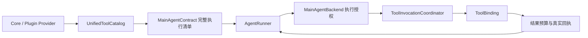

# Tool Kernel 当前合同

Tool Kernel 分开管理工具目录、固定声明与执行授权。主 Agent 的真实入口见
[主 Agent 执行与恢复](main-agent-runtime.md)，共同约束见
[开发架构约束](development-contract.md)。旧 Planner 不参与主 Agent 工具选择。

## 声明与目录

`ToolProvider` 提供 `CapabilityDescriptor`，其中的 `ToolBinding` 连接实际实现。
`UnifiedToolCatalog` 负责目录，`MainAgentContract.definitions()` 在部署初始化时收集
主工具注册表与已批准插件，加入工作控制、子任务和 short_state，
按名称排序并冻结完整名称、说明和参数 schema。重名声明直接报错。
所有入口共用一份声明与 revision。平台、App/ACP、SELF、插件和工作者的真实
actor、Conversation、设备来源及委托在执行处核验，不为选择声明查询入口或建立个人工具副本。

`definitions()` 返回的冻结清单就是 Provider 直接声明、各执行处核验的同一份合同
（内置 27 项，见下文“工具面”）。
普通聊天、主动触发、自动化、插件主调用和持久续跑共用本部署合同。
它不是按每条消息或每个用户生成的白名单。工具合同变更需重启并开启明确的新链。
`read_chat(around=…)` 以内部事件 ID 定位实际目标会话账本；`target.operation_id` 未给 around
时使用原回执锚点，其他目标需明确内部编号。声明变更随部署生成新的合同 revision，不沿用旧请求链。
Provider 原生工具还有独立的协议和配置合同，不能只检查函数工具就声称整个请求相同。
长期记忆的主 Agent 读取声明是统一 `search_memory`，按 `fact_id` 读取单条事实（原 `read_memory` 已并入，evidence 视图已删除；结果附本会话可见的证据 `{event_id, excerpt}` 与 `evidence_hidden` 计数，见[检索合同](memory-v2-retrieval.md#按编号读取的证据)），省略 `query` 时在同一授权范围列出记忆；
写入为 `save_memory` 与 `edit_memory(action=correct|invalidate)`。旧三个 `get_*_memories` 执行入口已退出；已存回执只按原 call_id 读取，未知调用不取得重跑资格。插件只获 Person 或 Group 读权限时
仍可使用 `search_memory`，后端按该次批准的 scope 限制候选和显式目标。

Capability Runtime 的执行集合不是模型声明的真源，也不能在请求链中添加 schema 或扩大权限。
能力目录不另建 FTS 搜索、别名配置或 schema 成本索引。
Runner 请求只使用固定合同；后端刷新执行目录，不再生成按轮的动态工具声明。
`MainAgentContract` 冻结完整工具清单时一次编译参数 schema，并持有只读的
`CapabilitySchemaView`；同部署各激活复用该视图。每次激活仍从当前目录、角色和 grants
计算实际执行集合，不缓存授权。schema 隔离属于该固定合同，同名工具的新合同独立编译。
目录构造后不存在另一次“开启”状态；真实 SDK aliases、use_when、tags 和批准指纹保留。
参数 schema 由现有 JSON Schema 库按其声明方言编译并核验，不因固定深度、节点数、
正则长度或重复量词启发式隔离可编译的工具。真实编译错误仍沿原隔离回执返回；
本地 `$ref` 按 schema 自身资源作用域解析，标准本地 Registry 不提供远程检索。
`examples`、`const` 等普通 JSON 资料不被当作 schema 或提升成根 `$defs`。

`send` 的正文在原位置写 `@名字`，也可在 `@` 后留横向空白。
名称取最长实际命中，同一 Account 的历史观察只算一个收件账号；按名字不选发送账号自己，
只有它叫这个名字时正文保留普通 `@名字`。真同名默认选择目标
Conversation 中最近真实发言的账号，按原消息时间及内部事件 ID 排序；均无记录时按
Account ID 稳定选择。指定账号可使用目录提供的 `@{account:UUID}`，不另传提及数组。
该默认只选择正文中的收件账号，不用于选择 Person、发送入口或执行授权。
未知名称或不可用的引用保留原文和 `@`。收件账号不因名字观察所属的旧归属阶段而失去
提及资格；actor、来源和实际发送入口继续各核原授权。

Main、SDK 消息与通知沿同一准备边界，先解析账号与原生布局，再接纳原操作。
正文只查实际可能命中的名字及账号；只有去重后仍真同名时才批查候选最近发言。
查询使用名字与真实消息索引，在写事务外完成；不补查平台或维护另一份活动表。
同次发送的重复提及、拆条及原回执恢复复用已准备结果。原工具请求、位置快照、
所选账号和发送回执各保原事实，不在恢复或 ACK 时重新选择最近发言者。

## 调用与效果

插件 binding 冻结批准 manifest、registration 元数据、输入/输出 schema 和 handler 的
合同指纹。派发前及异步 scope 等待后复核；同名工具热更新不能在旧 READ 或旧 schema 下
执行。变更后健康状态提示 `restart_required`，部署重启并在合法新链冻结新合同；禁用与
撤权立即生效。同合同重启不改变指纹，目录刷新不替换已提交的 Provider 声明。

执行时由后端依据真实 actor、来源、当前权限、委托、工具状态与工作预算核验。
`set_short_note` 与绑定工具共用执行前的来源、租约和新输入复核及效果闸门；
工具关闭时不写短记录。
目录可见或 schema 已声明不等于可以执行；插件批准和工具运行状态仍可阻止调用，
不需要为了拒绝执行而修改模型已提交的前缀。

同一模型响应中符合 `parallel_safe` 的读取可并行；修改、发送和不确定效果按现有
执行围栏处理，工具结果按原 call 顺序追加。工具自身的失败是它的失败结果；调用之后
的收尾（回执、结果来源围栏、渲染、journal）抛出且没有记为该调用回执时中止整轮，并行
段与串行一致：第一个失败取消段内其余调用，抛出该调用自己的异常（不包成
`ExceptionGroup`），调用内部抛出的 `CancelledError` 同样中止整轮；整轮在等待该段时被取消
（含 Work 租约心跳失败、截止时间）时取消优先传出，由取消方在自己的范围内处理，即使同一
窗口内另有调用失败，与串行中被取消的在途调用一致。
普通执行不设每段模型/工具限额；只有根 Work 预算中明确写入的有限额度在每次请求和 T2
处执行，重启不重新发放。模型最终正文不自动投递，发送走 `send`。

模型看到的成功结果直接是业务数据，失败为 `{"ok": false, "error", "message"}`，可能已产生效果时
另带 `"status": "unknown"`（见[结果预算与 Artifact](tool-results.md)）。结果预算器保留必要 ID、URL、
状态与错误，较大的完整结果可保存为 artifact。typed outcome 中的 `mutation_committed` 与投递成功、
失败、未知状态按真实回执解释；它们不是自然语言
“已经完成”的替代品。工作区、工具结果等 artifact 的保留期由各自存储合同决定。

## 执行回执与恢复

`read_result` 不扣业务工具次数，但照常提交 T2 的 `dispatch_started=true` 与 T3 原回执，
`budget_admitted=false` 表示免扣费而非未执行。根预算累计并在每次调用的 T2 执行，
不存在固定次数的执行限制。

Social 在父操作首次持久准备时，把 `social:<operation_id>` 与原 effect 的
`invocation.original_domain_ref` 原子关联；分片、文件与附言保留各自确定性身份。
实际 claim 再核对原 Work 的 lease、generation、状态与现行来源/目标/路由权限。
长 Host operation ID 只在 Social 存储表示中完整 SHA256，不能用该表示重建业务所有权。
工具汇总丢失时，原 effect 查询按这个关联读取计划数量和逐片回执；缺失、executing 或
unknown 的片不能被另一成功片覆盖。查询本身不派发，未知效果保留原事实；它不成为其他调用或 Work 完成的全局否决。

内部 `ToolInvocationContext.invocation_key` 传递 Host 的 `InvocationIdentity.operation_id`，
Provider 原 call ID 与 Social/Memory/native 各自实体 ID 保留原合同和编码。

Work 中的 Agent 记忆写把 `memory:<mutation_id>` 与原 effect 在领域提交交易中关联，
按可信原 event/initiative 的来源、当前授权和持久回执执行；不另设单次写配额。
插件在异步 scope 等待后再次检查当前定义与批准状态；已派发的未知写入不重放。
领域提交已完成而 Work T3 缺结果时，Memory 按原绑定 mutation 和调用指纹读回原 outcome；
原生 steer/respond/cancel/detach 按既有请求 hash、原 Work/action/actor 读取 operation。
两者复用领域投影，reader 不写、不联网、不重新派发。已保存完整结果仍优先返回原件。

宿主决定并发：只读调用受 `max_parallel_calls` 约束，发送、修改、记忆写和控制为屏障。
历史未知不阻止新的独立调用；原调用本身处于未知时继续保留恢复边界。
单项能力不允许或不再授权时，该项如实拒绝，后续独立调用各自核验；不把单项拒绝扩大为整个 Work 撤权。
真实当前目标取消/失败、全局来源或租约失效、工具关闭与资源拒绝仍按原事实停止旧来源的新效果。
完整结果超出预算时保存为授权 artifact，模型只得预览。

一轮工具结果已配对保存但模型尚未看到时，新业务激活保留这一轮原调用 ID、effect key 和详细回执，
与当前聊天一起呈现；不复制旧聊天、Provider 签名或 reasoning。
已观察的旧工具往返可退出，必要累积发现与中间值由有来源的 note（`manage_task(action=update, note=…)`）接续。
`get_tasks` 只读查询可与业务工具同批；会改变生命周期的控制按原执行顺序和控制屏障处理。

工具图片通过 Host 私有 `ToolExecutionResult.images` 交给 Runner，文字 `model_payload()`
不复制像素。预算后的 `MediaResultText` 携带图片而仍以字符串保存公开回执。历史/工作区
来源由真实事件或冻结文件版本授权；其余没有句柄的工具图片（不分 Provider，含
`view_file(device)`）先归档到原执行有权读取的私有工具 artifact，已有句柄的（`read_result`）不再归档；
归档失败报告图片未读，不能抹去已经发生的外部修改。`read_result` 对图片 Artifact
仅在原 handle 的读取授权内返回像素，通用文字/JSON 读取不开放原始 Base64。

Runner 按原 call 顺序配齐整批回执，再追加有 call_id 的 Host 原生媒体观察；并行完成先后
不改变输入顺序。同批别名、缓存命中与 Work 断点恢复保留原媒体，而不是共享图片队列。
下一实际派发前核验本次实际携带图片的来源仍有效；重读工具声明或内容 hash 不代替权限。
组装请求时超出帧/字节上限的最旧观察（含续写载荷中的）改为带 call_id 与句柄的文字，容量按
替换后实际发送的图片检查；新结果与入站图合计仍超限或模型无图片能力时返回明确未读，不调用
额外视觉模型或改变已冻结工具清单（见[结果预算](tool-results.md#工具图像与长循环)）。
工作区新增 path 与媒体语义变更会改变主合同 revision，部署时旧链不能沿用旧声明继续。

只有明确 cacheable 的只读工具参与新同批别名与跨批缓存复用；非缓存历史工具即使同参数
也分别执行。已保存的旧 alias 仍按原回执恢复，不因当前 schema 变化重读或重扣。
只读同批别名与跨批缓存复用在代表调用执行前，将确切原 effect/call_key 关系保存到原 response
的 pending 检查点。恢复仅跟随同 Work、同原链、参数签名一致且明确只读的 accepted 回执，
保留原别名 call_id 配对及媒体；不新增效果、预算或重读。代表调用尚未 accepted 时，未知或
未派发状态仍如实保留，不能把缺失回执当成复用成功。缓存索引是本次激活中的派生引用，
不是另一个执行账本；签名仅核对参数，不替代原内部执行 ID 和来源授权。
短效果键只解析 Host 的前两段，Provider ID 可包含冒号；长 ID 的散列键核对原持久
Invocation 的 owner、原链、序号与完整 ID。长短键之间的别名复用使用当前 journal 的
可信链身份，不解析当前别名的散列文本，也不借用其他 Work 或未来调用。

插件自有媒体 handle 仍服从其独立委托/owner 边界，通用图片通道不授予
任意跨插件读取权。插件工具须在本次显式返回
`media_artifacts` 才交给主 Agent；Host 按真实插件/工具和原 manifest、委托、TTL/hash 核验。
私有副本不能绕过原句柄删除、过期或插件禁用。图片未读不改变已接受的外部效果回执。

等待 owned pending 执行沿同一 WorkControl 和 owned_run 查询；external run 不取得该 Work 所属身份。
unknown 保留原调用事实，不全局禁止完成和其他新调用。

完整结果存档或展示失败不抹掉已经确认的操作。原效果回执与fallback已持久化时，沿该
实际结果继续，不以异常必须为OSError另判整项失败；未确认效果与取消仍按原事实处理。

## 代码定位

参数拒绝从本次冻结 schema 用一句中文说明哪个参数、期望什么（缺少的必填参数、类型、取值、
单键对象应给的键、多余参数名），不回显参数值或原异常正文；保持原严格校验。未声明的名字
（包括已改名的旧工具名）返回 `tool_not_declared`／`unknown_capability` 并说明只调用当前声明的工具，
不经历史映射改派。领域未分类的异常返回 `tool_failed`（被新输入接替为 `superseded`），说明是否可能
已产生效果，不再把异常类名当错误码。确定派发前拒绝在 typed outcome 中标记 `executed=false`、
`mutation_committed=false`，实际执行次数与原 admission/已付尝试预算分别计量，不笼统退款。
这些反馈在本次调用内生成，不为格式化结果重新查来源、取得 writer 或写错误账本。
生命周期控制（`get_tasks`、`manage_task`、`wait`、`start_subtask`、`message_task`）的直调
和恢复重派都经 `AgentRunner._execute_control_call`：先核声明、执行后端许可与
`get_tasks` 的执行处读取授权（拒绝不写回执），再在原 effect 边界内按同一冻结合同的
`schema_view` 校验参数，失败与业务工具同形（`tool_input_validation_failed` 加一句说明，
`executed=false`），控制不计业务工具的调用次数预算；结果大小不例外，与业务工具一样经
`AgentToolBackend.render_result` 的结果预算和 artifact 预览，回执保存同一有界文本
（见[结果预算与 Artifact](tool-results.md#预算)）。已有回执的调用按原回执返回，不再校验或重派；
同一合同下未派发的原调用恢复时按当前 schema 校验。`WorkControl` 与子任务工具只核当前事实
（当前任务、归属、id 是否存在、时间可解析且带时区、`seconds` 有限、目标非空白）和 schema
无法表达的跨字段规则（start 需要 goal、resume 需要 id）；Host 接纳 `admit_goal` 不经 schema，
保留自己的目标检查。

命令结果的模型投影为 `{id, status, output, exit_code, next_cursor}` 等实际字段，读取成功本身
不加 `ok`；观察到的进程成败另以 `process.succeeded` 表示，typed 数据保留原 run_id、request_id、
completion 与 pending。短结果、artifact/最小摘要和原持久效果回执保持同一事实。工具成功取得
失败进程的结果不证明任务成功；非零退出也不证明此前没有写文件或其他局部效果。
未知和运行中不猜成功，成功探测不代替实际测试验收。

- `services/main_agent_contract.py`：冻结主 Agent 声明与合同 revision。
- `services/agent_runner.py`：真实请求历史、预算、工具循环与 continuation。
- `services/main_agent_backend.py`：执行授权、工具回执与业务效果围栏。
- `capabilities/`：descriptor、catalog、policy、binding、协调器和结果预算。
- `tool_results/`、`plugin_host/`：共享结果存储与插件执行适配；不建立第二套 Yuki 主循环。

持久 Work 在结果预算之前从类型化执行结果保存 `ok/status/run_id/pending/uncertain/error_code`
和副作用事实。同一原调用是否可重派、原 run 的查询和结算使用持久效果回执，展示摘要与
最近64条视图不授予重放资格。后续独立操作沿原授权执行，业务结束沿 Agent 的原决定提交。
模型回执按 UTF-8 字节留出元数据余量；正文归档失败仍保留已知执行事实，并禁止重复执行。

只读调用保留观察到的进程 `pending/status/uncertain`，但读取本身不取得该执行的所有权，
也不成为 Work 的未完成副作用；读取失败仍如实展示。原所属执行是否仍活动按真实 run/租约读取，历史未知修改和缺字段不作为全局业务否决。后续查询不能覆盖原操作的 `mutation_committed`，包括未知值。
沙箱派发后确认丢失、按原请求 ID 回查仍未知时，工具返回类型化失败与 `uncertain=true`，
保留原请求、来源与已计预算，不盲目重派该调用；其他独立操作不受历史未知全局阻断。
原请求的可信终态晚到时，按原 `request_id` 与 `effect_key` 核对所属来源后补齐执行事实，
无需重新提交。终态子任务的晚到回执只结算已发执行，不复活任务或重新授予预算。
附件保存与表情收藏共用私有 `workspace_copy`，直接从只读媒体缓存复制到最终文件；artifact 与本人电脑文件写入环境用私有流 `workspace_write`，同一原请求回执。
执行前查询原请求回执；原复制成功后不再检查源或覆盖用户后续修改，确认中断保留原未知。
普通文件覆盖不要求目标 CAS。旧 checkout 与导入迁移入口退役，原持久回执不重写。

超大完整结果复用工具 artifact 文件存储，单对象最多 64 MiB、总登记容量默认 512 MiB。
活动 Work 及仍活动 root 的 child 结果不受显示缓存 TTL 清理；终态至少保留七天，
隐私删除释放其拥有的结果。清理先标记删除围栏、再删除文件、最后清理元数据，可恢复中断。
普通文件读写、搜索和目录操作交给终端；不再声明八项通用工作区接口或公开 artifact CRUD。

主合同版本 12 明确退出 MCP 声明，即使旧部署没有启用 MCP 工具也建立新的合同边界。旧任务复用原 journal、预算及效果回执，不重派原调用。

通用 OneBot 操作不另写无人读取的诊断表 `agent_actions`；0117 删除该旧表。授权、Work effect 与实际发送回执继续由各自执行链保存。

WorkspaceStore 在 owner 打开时原子升级独立 manifest，永久保留不可变发布及原来源，旧 artifact expires_at 在该升级中退出；普通事务不再查 schema 或归一化到期时间。媒体、short_state、下载及实际引用清理各沿自身寿命。删除单文件200MiB、总量512MiB及1000对象的经验配额，沿真实磁盘与传输结果处理。私有工具结果库仍是独立来源和保留合同。

## 共同账本历史与原生平台操作

统一 `read_chat` 读取 Yuki 实际参与并已入账、当前来源获准读取的跨平台 canonical 原账本。
内部目标只选择真实查询范围，不猜主动路由；每条结果标明原 Conversation、平台和作者。
  不带 target 与筛选时浏览当前 Conversation；带 query、author、has、platform、scope、since 或 until
  时检索所有当前获准的已入账 Conversation，条件与内部 target 取交集，无交集为空，不强制逐级发现。
  `find_contacts` 一并定位人物／群主体、当前可联系入口与真实历史 Conversation（原 find_conversations 已并入），
  沿同一读取范围分页，不继承当前发送资格。旧 accepted 回执不改名重派。
Person、Space 或 Binding 对应多个入口时直接合查，`around` 按内部事件 ID 定位原会话，`context` 给邻文条数。
sources 提供可读会话名与目录，结果跨多个会话时事件才带 conversation_id，不合并自动上下文。
`target.operation_id` 沿原发送回执定位真实出站会话及原锚点。
委托 `read_target_id` 核原 owner，执行继续核 actor、委托、插件批准、keeper 与隐私。
`/ai new` 的 starts_after 只限制自动上下文，不限制显式查找永久原记录；原 generation 失效仍停止旧执行。
结果标明 coverage=observed，不冒充完整平台历史；平台离线不阻止账本读取。

默认模型已退役任意 OneBot action 与戳一戳。原始 segments、历史真实工具结果、已付请求和
旧回执保留，不因退役重写冻结内容或重派旧调用。新 read call 经当前授权读取事实，不以另一
call 的同参结果代替。原 call 和历史 readonly alias 仍读自己的真实持久回执，不增加缓存失效总线。

共同 Social 管内部目标、授权、预算、原操作 claim、账本与回执，并在平台布局前把图片与
文字拆成各自的消息（引用和 @ 留在第一条）。GatewayProvider 的
原生操作接口负责文字/文件布局、参数、引用和响应。纯 plan_send 不执行网络请求，
每项各有实际派发和持久回执；平台适配器不能内部多次发送却只返回一个成功。
详见[平台适配与升级](platform-adapters.md)。

## 合并转发读取

`read_chat(around=E)` 的锚点事件 E 自身带 forward segment 时，结果另附 `forwards`：每个外层
forward 按原位置（`segment`）一组，给出第一层节点的作者名、时间、正文、附件与 `nested_forwards`
计数。只展开锚点，邻文、浏览与检索结果不请求远端；锚点不在获准范围时不请求。内层 forward 不递归。
读取沿 E 的 `ingress_presence_id` 解析原接收连接，由该连接 Provider 的原生操作
`PlatformSocialOperations.read_forward` 执行（SnowLuma 声明 `forward_read` 能力，固定使用
`get_forward_msg`）；不按平台判断、不换账号、不探测。原 Presence 停用或离线为
`forward_presence_unavailable`，连接不声明该能力为 `forward_unsupported`，原生失败或响应中没有
节点列表为 `forward_read_failed`，缺定位为 `forward_locator_missing`。同一调用内相同定位只读一次、
不同定位并行，空列表是成功的空组。部分失败保留成功组；全部失败时工具结果为该首个错误，仍带
events 与各组状态。取消原样传播。

内层图片、视频、文件、语音不下载、不读取，作为 E 下的观察附件槽登记（与未入账引用附件同一
`source_snapshot_json` 机制，序号接在 E 已有槽位之后）。同一原件按 `attachment_origin` 的平台句柄
（file／file_id／media_id，不含每次重签的 `url`）复用原槽位与序号；尚未缓存的槽位就地保存最新观察
到的 segment（新签名 URL），已缓存或已过期的槽位保留原 segment。结果按 read_chat
现行附件形状给 `attachment` 序号；模型用 `view_file(event_id=E, attachment=N)` 按需读取，下载沿原接收
连接与 24 小时缓存。写槽位在网络读取之后的短 writer 中只核 E 本身仍是 keeper；E 已被清退返回
`history_source_changed`。结果不带图片、平台定位或账号号码，完整投影沿共同预算／artifact 链处理，
不另设节点、正文或递归上限；`source_event_ids` 与读取前取得的隐私代次照常交给发布围栏。
原 call 的已存回执按原调用键读取，不重新请求转发。

## 跨入口读取与发送

`read_chat` 的 Binding、Person、Space 和 Conversation 选择共用真实读取授权，
不按当前入口为 App/ACP、QQ 或其他平台另设全历史资格。读取保原入口来源，不修改公共历史、
generation、FrozenFragments 或 Main session；平台离线、旧路由与上下文重置不代替授权拒绝读取。
分页、搜索及原回执的细节见[聊天记录读取](chat-history.md)。

send 的 `target` 只给一个内部 ID：person_id、space_id，或用 conversation_id／binding_id 明确入口。
从群里发往 person_id 使用人物默认主动路由；在该人物的普通私聊里给同一 person_id，
则沿当前私聊入口回复。默认路由暂停不代表该人物所有入口不可用；指定平台先用
find_contacts 查找实际 Conversation／Binding，再明确选择，不由发送失败自动换平台补发。
从 App/ACP 只给 person_id 时返回原 binding_required 与可选绑定；
省略目标时仍回复当前个人 Conversation。显式选择不修改主动路由，沿原 Provider 能力与发送权限，
在派发事务复核绑定、Presence 和连接。结果 uncertain 不重发；出站记到真实目标入口，
SocialOperation 的 source_conversation_id 仍是原主会话。明确发往另一 Conversation 不冒用本入口回复证明；
本入口原回复及其冷恢复继续核原入站事件。文件说明沿同一绑定投递。

## 工具面（2026-11-07 一次切换；2026-11-09 增 computer／browser，合同版本 36；2026-11-14 computer 增自己电脑的 wake／sleep／snapshot／restore，合同版本 37；2026-11-15 computer 增 scale、zoom、elements／element、修饰键、三击／中键、repeat 与自己电脑的 paste，合同版本 38）

内置 27 个模型工具（工具合同 41）：会话 `send`、`recall_message`、`read_chat`、`find_contacts`、`get_members`；
记忆 `search_memory`、`save_memory`、`edit_memory`、`set_short_note`；网络 `web_search`、`read_webpage`；
文件 `view_file`、`copy_file`、`read_result`；电脑 `run_command`、`read_command`、`control_command`、
`get_environment`、`computer`、`browser`；工作 `get_tasks`、`manage_task`、`start_subtask`、`message_task`、`wait`；安排
`get_schedules`、`manage_schedule`。本机编码 Agent 是子任务工具的执行者，没有单独的工具。共同约定：
`target` 为恰含一个内部 ID 的对象（记忆另允许 `{"self": true}`），分页为 `limit` + 不透明 `cursor`
与结果 `next_cursor`，时间为带时区的 `since`／`until`（until 不含），`device` 一律表示源电脑。
旧名不并行保留；联网工具随部署的 web 配置声明。`environment_service`、`get_my_capabilities`、
`time_get_current` 已不再提供给模型（环境服务 RPC 与权限目录本身保留；当前时间见运行资料）。

工具的能力 namespace 与 effect 写在声明本身（`ChatTool.namespace`／`effect`），Core 与自动化
provider 直接读取，不另设按名字的元数据表；插件领域授权（`_require_plugin_domain`）按这些
namespace 与原参数语义判断，切换未收紧也未放宽权限。

## 精简后的领域入口

Main 固定合同保持每项固定名称、schema和顺序，各入口共用一份冻结声明。
按实际装配收集工具，批准插件纳入同一合同；工具数量不作运行准入条件。

- `run_command`／`read_command`／`control_command` 共用原 run/回执；run_command 可选 `device` 选择本人电脑，省略继续使用 Manager。read/control 以 `id`（run_command 返回的 id）认原目标，不因当前目录或实例变化切换设备。模型参数在工具边界翻成 Manager wire 参数（device→device_id、id→run_id、cursor 字符串→整数），RPC 方法与任务行不变。普通本机 Shell 不要求 Work；完整访问仅由本机开关授予。control 的 input 发送原样 text；read 的 wait_seconds 只观察，默认不等待，原终态 completion 与游标同时保留。环境默认无强制期限，显式期限按事实执行。`get_environment(device?)` 查看环境或本机状态。
- `computer(action, x?, y?, x2?, y2?, dx?, dy?, text?, repeat?, scale?, region?, element?, window?, display?, snapshot?, device?)` 看和操作屏幕（合同版本 38 见 [Computer Use 任务书](Computer-Use任务书-2026-11-15.md) §7：`x,y` 是本次截图像素，`scale=1000` 时为 0–1000，越界 `coordinate_out_of_range`；`zoom`、`elements` 与 `screenshot`、`resume` 同为读动作；点击类／`drag`／`scroll` 的 `text` 是按住的修饰键；输入回显 `point`、`scale`、`route`、`hit`（投递前实际落点的命中测试），全屏截图回显 `cursor`；`element`（含 `drag` 的起点）隐含其所属窗口，省略 `window` 时按该窗口执行；前台 `type`／`key` 给 `x,y` 时先在该处点击；`device_not_supported` 附 `cause`；给 `device` 时 `LocalDeviceService` 按连接器 `device_capabilities.computer.features` 对照本次用到的新能力，缺少即 `connector_outdated` 且不发出。`paste`、`wake`、`sleep`、`snapshot`、`restore` 只作用于 Yuki 自己的电脑，给 `device` 时 Bot 返回 `device_not_supported`／`own_computer_only`；`wake`、`sleep`、`snapshot`、`restore`：Manager 在进驱动前分派到环境生命周期，`snapshot`／`restore` 按调用键登记到快照／还原记录并在 worker 中执行，给 `device` 时 Bot 直接返回 `device_not_supported`，见[自己的电脑任务书](Yuki自己的电脑任务书-2026-11-14.md)），`browser(action, url?, node?, text?, tab?, device?)` 按页面节点操作 Yuki 专用浏览器；两者 `namespace="sandbox.run"`、`effect="write_state"`、不缓存，参数按[任务书](Yuki-统一ComputerUse与BrowserUse任务书-2026-11-09.md) §5.1 一次冻结。省略 `device` 时操作 Yuki 环境；给出 `device` 时由 `LocalDeviceService.screen_action` 以调用键为命令 ID 发给该电脑的连接器（`computer`／`browser` 资源，协议仍为 4），只按既有“设备归属本人”核验，输入在连接器 journal 中同键返回原回执、中断为 `unknown`，截图经设备文件传输的读／释放循环取回，旧连接器的 `invalid_resource` 报为 `device_not_supported`；`computer` 给出 `window`（取自截图结果的 `windows[].id`）时由连接器只截该窗口、在后台投递（macOS 无障碍动作优先、盖章 post-to-pid 后备，Windows 只用 UI Automation 模式），送不到时 `device_not_supported` 而不改用前台，服务端不另做判断（[3b 记录](../operations/computer-3b-20261110.md)）；本人叫停、权限与锁屏等见[本机连接器 · 屏幕与 Yuki 专用浏览器](../operations/local-agent-connector.zh-CN.md#屏幕与-yuki-专用浏览器)。Yuki 环境一侧，Bot 经 Manager RPC `computer_action`／`browser_action`（不设 bot 侧截止，Manager 自身有界等待）请求；Manager 按环境串行，输入类先写 `environment_mutations` 待定行、在进程内按调用键取 agent 租约，经 runtime 挂载把请求交给桌面服务托管的长驻驱动（`yuki_computer.py serve`，浏览器部分为共享 `yuki_agent_connector/cdp.py`），执行后写结果、`finally` 释放租约；同键重试返回原结果，只有待定行报 `unknown` 且不再执行；读类动作（截图、快照、沙箱 `resume`）不写待定行。图像由环境或连接器按当前显示几何与部署 `computer.screenshot_max_dimension`／`computer.screenshot_max_pixels`（`COMPUTER_SCREENSHOT_*`，默认 1568／115 万像素，可热改，与聊天图片的 `vision_*` 分开；`computer` 与 `browser` 的截图都用它）直接产出最终尺寸，`x,y` 即该图坐标；OpenAI 预设的 Chat Completions 与 Responses 给这类 `source="tool"` 图带 `detail:"original"`，Gemini 的 part 级 `mediaResolution` 只在 Profile 方言选项 `tool_image_media_resolution` 设定时发送；Bot 把它作为 `source="tool"` 的工具结果像素交给模型（归档为私有工具产物，结果带 `media_artifact_handle`），不再缩放或重压缩。细节见[持久环境桌面](../operations/desktop-computer.zh-CN.md)。
- 本机编码 Agent 经子任务工具使用（合同 40，[第二阶段任务书](Yuki-外部Agent委派与协作第二阶段任务书-2026-11-18.md) §4.2）：`start_subtask(goal, …, executor={agent, device?}, session?, cwd?, relationship=delegate|observe|takeover, scope?, notify_turn_end?, fork?)` 创建委派或观察记录并派发原生输入或观察（会话在别处活着时设备返回 `session_live_elsewhere`，用户同意后 `fork=true` 分叉出新会话；`session` 给目录列出的内部会话 ID，或在给出 `agent` 时给该 Agent 下的原生会话 ID，记录一律保存内部 ID）；`message_task(id, text, mode=queue|steer)` 追加输入，`message_task(id, reply_to=permission_id, answer, text)` 回答一个原生请求；`manage_task(action=cancel|resume|release, id)` 取消原生回合、在同一会话继续或只结束拥有关系；`get_tasks(id)` 读卡片与时间线，`get_tasks(agents={device?, agent?, session?}, history?, cursor?)` 浏览设备、Agent（含声明能力与各设备正在运行的委派）、会话与历史；`wait(for=[{run: 委派 ID}])` 沿子 Work 等待。声明不出现厂商名，不读设备在线状态或能力；可用动作只在执行处按当前连接的实时声明核验（不支持时 `unsupported_action`，带范围而连接器未声明 `scope` 时 `connector_outdated`），观察记录的输入、回答与原生控制一律 `observe_only`。

公开 device／agent／session／execution_id／operation_id 均为内部 ID；native ID 仅是适配器引用，不用于重建人物归属。确认丢失保持原关联，不以 resume、fork 或新 prompt 冒充恢复；原生能力缺失照实返回，不隐式取消重启。回答、纠偏和管理操作记录本次真实 actor 与独立稳定调用键。执行处核当前 Person 与设备授予；operator、平台超管和聊天 token 不自动获得电脑控制权。

- `view_file`、`send(file)` 与 `copy_file` 共用原设备文件桥：`device` 一律指源电脑，`copy_file` 的目标电脑为 `to_device`（来源三选一：path（可带 `device`）、artifact_id、event_id+attachment；任一来源都可写入 Yuki 环境或本人电脑）；view_file 是私有观察，send 内部 publish 才冻结不可变交付。普通文件操作及apt/pip/npm使用环境内管理员终端，不再提供environment_packages包装。
- `get_schedules(id?, history?, limit?, cursor?)` 提供全局安全摘要（列出全部状态）与获准的完整定义/发生历史；get/history 按真实 owner/超管授权。`manage_schedule(action=create/update/pause/resume/cancel/run_now, id?, goal?, trigger?, name?, max_runs?)` 沿原 owner、版本、创建键与调度回执；name 与 max_runs 缺省保留、null 清除，创建回执带 `confirmation=persisted` 与真实 `id`。
- `read_chat` 读取真实获准的原账本集合；无筛选默认当前入口，有筛选默认全部获准入口，around 按内部事件 ID 定位原会话。时间用 since/until（带时区，until 不含），邻文用 context；内部目标解析与共享读取内核统一，入口授权认各自真实来源。
- `search_memory(fact_id=…)` 保原 scope 与观察事实；`message_task` 保原父子 ID、ask/reply_to、运行中补充，`manage_task(action=resume, text=…)` 恢复子任务时可附新要求。

退役名称不接收新调用，也不注册新执行别名；旧已接受call/result_ref、参数hash、原ID、预算、unknown及原Provider输入继续只读恢复。工具声明变化只在合法新链生效。
`execute_code` 与 `lookup_tools` 随 Code Mode 在合同 41 删除（#573）；已结算的 `code_composition` 效果回执保留原行，经通用回执路径读取。

按工具名读取原回执与历史（效果证据、Work 步骤投影、owned run 归类、`process_receipt`、SELF 自省输入）统一经 `runtime/effect_outcomes.py` 的只读 `RECORDED_TOOL_NAMES` 解析：2026-11-07 切换前的旧名（如 `task_control → manage_task`、`query_chat_history → read_chat`、`terminal_exec → run_command`）映射到承接其语义的现役工具；拆分的工具映射到承载 action 的那个，读取处仍按原 action 区分。原记录保留原名，新调用不经它解析，旧名调用按未声明工具拒绝、不改派。没有后继的退役名（`use_coding_agent`、`get_coding_agents`（合同 40 退役，部署前已登记的操作沿原 run 结算）、`local_device`、`run_python`、`environment_service`、`get_my_capabilities`、`time_get_current`）不是别名，按各自原事实读取。终端与环境工具经 `sandbox/client.py` 的 `MODEL_TOOL_RPC_METHODS` 得到 Manager RPC 方法；RPC 方法名与任务行 `{"tool": method}` 是 Manager wire 合同，不随模型工具改名。

Host 自身不经模型工具名调用核心工具：插件主调用与持久 Host 调用接纳自己的目标时调用
`WorkControl.admit_goal`，与模型 `manage_task(action=start)` 共用同一 writer、预算计费与来源核验，
但不产生模型结果文本或 effect 回执；接纳失败（来源失效、目标为空、写入失败）按原异常抛给
Host 调用方。插件 `group.list_members` 调用 `SocialService.group_members`，与模型
`get_members` 共用同一 Space 目录读取，权限与群范围仍在插件门面核验。
Host 内部依据读 typed outcome 而非模型结果文本，见[结果预算与 Artifact](tool-results.md#模型可见文本与内部读取)。
