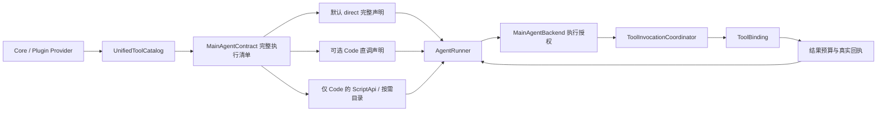

# Tool Kernel 当前合同

Tool Kernel 分开管理工具目录、固定声明与执行授权。主 Agent 的真实入口见
[主 Agent 执行与恢复](main-agent-runtime.md)，共同约束见
[开发架构约束](development-contract.md)。旧 Planner 不参与主 Agent 工具选择。

## 声明与目录

`ToolProvider` 提供 `CapabilityDescriptor`，其中的 `ToolBinding` 连接实际实现。
`UnifiedToolCatalog` 负责目录，`MainAgentContract.definitions()` 在部署初始化时收集
主工具注册表与已批准插件，加入工作控制、子任务和 short_state；启用 Code 时再加入编排与只读目录工具，
按名称排序并冻结完整名称、说明和参数 schema。重名声明直接报错。
所有入口共用一份声明、revision 与 Code 投影。平台、App/ACP、SELF、插件和工作者的真实
actor、Conversation、设备来源及委托在执行处核验，不为选择声明查询入口或建立个人工具副本。

`definitions()` 保留完整执行清单。默认 direct 模式的 `model_definitions()` 返回
部署内冻结的完整工具清单，不加载 Code 引擎。显式启用 Code 时才使用固定直调集合：聊天、
生命周期、记忆与历史、基础工作区、时间、终端与环境状态、联网、`execute_code` 和
`lookup_tools`；服务管理、自动化和管理等其余能力经脚本调用。包安装直接在同一终端执行。两个模式分别
冻结声明；普通聊天、主动触发、自动化、插件主调用和持久续跑共用本部署合同。
它不是按每条消息或每个用户生成的白名单。工具合同变更需重启并开启明确的新链。
`query_chat_history(view=around)` 以内部 `event_id` 定位实际目标会话账本；原 operation 目标未传
event_id 时使用原回执锚点，其他目标需明确内部编号。声明变更随部署生成新的合同 revision，不沿用旧请求链。
Provider 原生工具还有独立的协议和配置合同，不能只检查函数工具就声称整个请求相同。
长期记忆的主 Agent 声明是统一 `search_memory`，详情统一为 `read_memory(view=fact/evidence)`，证据读取不记作已读事实；旧三个
`get_*_memories` 执行入口已退出；已存回执只按原 call_id 读取，未知调用不取得重跑资格。插件只获 Person 或 Group 读权限时
仍可使用 `search_memory`，后端按该次批准的 scope 限制候选和显式目标。

`lookup_tools(query=...)` 搜索名称/说明或分页列出简短目录；`name` 精确读取单项原参数
schema、脚本调用名及本轮直调可见性。搜索不返回全部 schema，详情不会注册新工具。
查询只读启动时冻结的 API，不加载或升级插件，不接触业务资源或取得执行授权；工作者
查询本部署相同的完整执行合同。`lookup_tools` 可与业务调用同批，仍按原调用顺序、
执行权限及效果屏障处理。查询结果按原 call_id 配对保存，但不计业务效果或业务调用额度；查询自身仍受模型请求、输入容量及原 Work journal 合同约束。
Capability Runtime 的执行集合不是模型声明的真源，也不能在请求链中添加 schema 或扩大权限。
能力目录不另建 FTS 搜索、别名配置或 schema 成本索引；工具查询统一使用冻结合同上的 `lookup_tools`。
Runner 请求只使用固定合同；后端刷新执行目录，不再生成按轮的动态工具声明。
`MainAgentContract` 冻结完整工具清单时一次编译参数 schema，并持有只读的
`CapabilitySchemaView`；同部署各激活复用该视图。每次激活仍从当前目录、角色和 grants
计算实际执行集合，不缓存授权。schema 隔离属于该固定合同，同名工具的新合同独立编译。
目录构造后不存在另一次“开启”状态；真实 SDK aliases、use_when、tags 和批准指纹保留。
参数 schema 由现有 JSON Schema 库按其声明方言编译并核验，不因固定深度、节点数、
正则长度或重复量词启发式隔离可编译的工具。真实编译错误仍沿原隔离回执返回；
本地 `$ref` 按 schema 自身资源作用域解析，标准本地 Registry 不提供远程检索。
`examples`、`const` 等普通 JSON 资料不被当作 schema 或提升成根 `$defs`。

`send` schema 5 的正文在原位置写 `@名字`，也可在 `@` 后留横向空白。
名称取最长实际命中，同一 Account 的历史观察只算一个收件账号。真同名默认选择目标
Conversation 中最近真实发言的账号，按原消息时间及内部事件 ID 排序；均无记录时按
Account ID 稳定选择。指定账号可使用目录提供的 `@{account:UUID}`，不另传提及数组。
该默认只选择正文中的收件账号，不用于选择 Person、发送入口或执行授权。
未知名称或不可用的引用保留原文和 `@`。收件账号不因名字观察所属的旧归属阶段而失去
提及资格；actor、来源和实际发送入口继续各核原授权。

Main、SDK 消息与通知沿同一准备边界，先解析账号与原生布局，再接纳原操作。
正文只查实际可能命中的名字及账号；只有去重后仍真同名时才批查候选最近发言。
查询使用名字与真实消息索引，在写事务外完成；不补查平台或维护另一份活动表。
同次发送的重复提及、拆条及原回执恢复复用已准备结果。原工具请求、位置快照、
所选账号和发送回执各保原事实，不在恢复或 ACK 时重新选择最近发言者。

## 调用与效果

插件 binding 冻结批准 manifest、registration 元数据、输入/输出 schema 和 handler 的
合同指纹。派发前及异步 scope 等待后复核；同名工具热更新不能在旧 READ 或旧 schema 下
执行。变更后健康状态提示 `restart_required`，部署重启并在合法新链冻结新合同；禁用与
撤权立即生效。同合同重启不改变指纹，目录刷新不替换已提交的 Provider 声明。

执行时由后端依据真实 actor、来源、当前权限、委托、工具状态与工作预算核验。
`update_short_state` 与绑定工具共用执行前的来源、租约和新输入复核及效果闸门；
工具关闭时不写短记录。
目录可见或 schema 已声明不等于可以执行；插件批准和工具运行状态仍可阻止调用，
不需要为了拒绝执行而修改模型已提交的前缀。

同一模型响应中符合 `parallel_safe` 的读取可并行；修改、发送和不确定效果按现有
执行围栏处理，工具结果按原 call 顺序追加。每段模型/工具限额与根任务累计预算分别
执行，分段或重启不重新发放根预算。模型最终正文不自动投递，发送走 `send`。

结果预算器保留必要 ID、URL、状态与错误，较大的完整结果可保存为 artifact。
`mutation_committed` 与投递成功、失败、未知状态按真实回执解释；它们不是自然语言
“已经完成”的替代品。工作区、工具结果等 artifact 的保留期由各自存储合同决定。

## 可选代码组合 `execute_code`

默认部署为 direct：不包含 Monty binding、worker 或 launcher，主 Agent 直接使用部署内固定完整工具清单。启用 Code 必须显式选择 codemode 镜像及配置；以下组合政策只用于已启用 Code 的固定合同。

Code 模式冻结清单包含固定的 `execute_code` 和 `lookup_tools`（`yuki.codemode.api.v2`）。
`terminal_exec`、`terminal_read`、`terminal_control`、`environment_status`、`external_agent` 常驻固定直调视图；
服务登记经 Code Mode；安装和普通文件读写直接走同一管理员终端。direct 模式声明部署内固定完整工具清单，不生成 ScriptApi 或加载 worker；模式变更只在合法新链应用。直调复用同一 Manager、来源权限、
原 request/run ID 和未知结果恢复，不建立宿主执行通道，也不自动重提 pending 命令。
脚本里的 `await yuki_<工具名>({参数})` 是同一 canonical 工具的调用语法，由
`codemode/api_projection.py` 从冻结声明确定性投影：参数 schema 为原件，名称编码可逆，
不增加业务别名或权限；`execute_code` 和只读目录自身不投影，未知名称在沙箱内即 NameError。
模型只能直接调用当前直调视图中的工具；Code Mode 子调用按完整 API 核验名称和原 schema，
再进入同一执行后端。目录结果不使隐藏工具获得直接调用资格。完整执行清单、直调政策和
工作者子集都纳入 revision；隐藏工具 schema 变更同样改变恢复合同，旧链不暗改。
未配置或不可用的 native worker 如实返回不可用，隐藏能力不能借此改走未声明的直接工具。

`execute_code` 要求已接纳的 Work，否则返回 `accept_work_before_execution`；短聊与单次
发送仍走直接工具。外层调用是 `kind=code_composition` 父 effect，不计业务工具次数；每个
子调用是带 `parent_operation_id/child_ordinal/engine_call_id/feed_index` 的显式 Invocation，
身份为 `<父 operation>/c<序号>`，与参数无关。子调用经 T1 `publish_code_boundary`
（快照、父 checkpoint、子意图同事务）后，走与直接调用相同的 InvocationService →
WorkSession T2/T3 → `MainAgentBackend.execute_call`，拒绝理由与直接调用逐字一致；
VM 只收到已保存的原回执视图（`ToolReceiptView`）。

`read_tool_artifact` 在直调与子调用中均不扣业务工具次数，但照常提交 T2 的
`dispatch_started=true` 与 T3 原回执，`budget_admitted=false` 表示免扣费而非未执行。
Code Mode 的累计 suspension、内存、并发、快照和时间限制继续生效且不因恢复重置。
业务次数来自配置 `agent.max_tool_calls`（默认 32），达到段额度时恢复原 composition；
根预算仍累计，不存在固定 18 次的执行限制。

启用 Code 时，主 Agent 与工作者共享 `CODE_MODE_POLICY`：有效 Work 内多个步骤已知、无需模型逐步
解释新证据时，默认用 Code Mode 编排批量读取、过滤汇总、确定性循环、串行操作与原回执
检查。脚本内部核验回执并聚合，最后只返回必要结果、摘要、ID 和证据引用；完整子工具
回执仍留在原 effect，不重复追加给模型。普通聊天与交付、接纳前澄清、语义判断及生命周期控制
使用本轮已直接声明的工具；单个独立操作也按该声明选择，未直接声明的工具仍经目录和
`execute_code` 调用，并保留已接纳 Work 的前提。不机械包装每个直接工具。
pending 保留原 run_id，使用现有等待和恢复，不在脚本里忙轮询；未知效果不重做。
已知读、算、写和读回校验尽量在同一程序按目标顺序完成，只读并发有界分批，避免一次
gather 超过宿主队列。指引不硬编码当前部署的可调队列或并发数量。
有依赖或副作用顺序的步骤逐步 await，不用并发预读或统一后写绕开顺序要求；
stdout 同样是模型可见结果，不打印全量中间原文。Code Mode 不可用或程序失败时先
核对原回执，只允许当前授权且本轮已声明的工具接续确认未派发的剩余步骤；权限拒绝、未知或 pending
效果不能通过切换工具绕过或重做。
数值判断、字段分支和下一路径选择按已知规则在脚本内执行，需要理解新内容时再交回模型。
其他工具失败不证明 Code Mode 不可用。是否向人反馈按实际影响和原任务约定判断，
不因切换调用方式额外发言。脚本函数使用目录返回的精确 `script_name`，不按原工具名自行拼接。
这是静态编排指引，不按任务文本路由或改变参数 schema、执行授权、预算及并发围栏。
工具说明变化自然产生新 manifest revision；旧快照仍须匹配原合同，不放宽恢复检查。

Social 在父操作首次持久准备时，把 `social:<operation_id>` 与原 effect 的
`invocation.original_domain_ref` 原子关联；分片、文件与附言保留各自确定性身份。
实际 claim 再核对原 Work 的 lease、generation、状态与现行来源/目标/路由权限。
长 Host operation ID 只在 Social 存储表示中完整 SHA256，不能用该表示重建业务所有权。
工具汇总丢失时，原 effect 查询按这个关联读取计划数量和逐片回执；缺失、executing 或
unknown 的片不能被另一成功片覆盖。查询本身不派发，未知效果保留原事实；它不成为其他调用或 Work 完成的全局否决。

内部 `ToolInvocationContext.invocation_key` 传递 Host 的 `InvocationIdentity.operation_id`，
Provider 原 call ID 与 Social/Memory/native 各自实体 ID 保留原合同和编码。

Work 中的 Agent 记忆写把 `memory:<mutation_id>` 与原 effect 在领域提交交易中关联，
按可信原 event/initiative 的来源、当前授权和持久回执执行；不另设单次写配额。
插件在异步 scope 等待后再次检查当前定义与批准状态；已派发的未知写入不重放。
领域提交已完成而 Work T3 缺结果时，Memory 按原绑定 mutation 和调用指纹读回原 outcome；
原生 steer/respond/cancel/detach 按既有请求 hash、原 Work/action/actor 读取 operation。
两者复用领域投影，reader 不写、不联网、不重新派发。已保存完整结果仍优先返回原件。
Code 子调用在 T2 后恢复时认实际回执：已确认结果继续原程序，实际未知保留原停止语义，
不因 `prepared` 字面状态否定原提交。控制被接纳不等于目标原生任务完成。

宿主而非脚本决定并发：只读子调用受 `max_parallel_calls` 约束，发送、修改、记忆写和控制为
屏障；同一响应的 `execute_code` 和直接调用沿原顺序执行。普通 complete、wait、need_input 与交接返回原控制回执，程序继续执行仍获准的语句，原批次和程序收拢后由共同 writer 结算；取消另一个目标不停止当前程序。
记忆写不强制停止脚本，历史未知不阻止新的独立调用。原调用本身处于未知时继续保留恢复边界。
单项能力不允许或不再授权时，该项如实拒绝，程序可处理其回执，后续独立调用各自核验；不把单项拒绝扩大为整个 Work 撤权。真实当前目标取消/失败、全局来源或租约失效、工具关闭与资源拒绝仍按原事实停止旧来源的新效果，脚本不能通过 `try/except` 取得失效授权。段工具额度用尽且程序仍未结束时外层 call 保持未配对，下一段由原 Work 从同一快照续跑；
已配对的 partial 永不恢复 VM。程序完整结果超出预算时保存为授权 artifact，模型只得预览。

程序恰好在段末结束（或报错）时，外层结果已配对，但模型尚未看到。新业务激活保留
这一轮原调用 ID、effect key 和详细回执，作为 `work_unobserved_tool_round` 工作证据，
与当前聊天一起呈现；不复制旧聊天、Provider 签名或 reasoning。直接工具同样适用。
已观察的旧工具往返可退出，必要累积发现与中间值由有来源的 context_note 接续。
段额度用尽后，在原模型预算内允许一次保留当前工作上下文的请求，用于保存累计 note
或在目标核验后 complete；业务剩余额度仍为零。模型预算不足时由原未观察回执兜底。

wrapper 返回字典，用 `r['ok']`/`r['data']`，不用 `r.ok`。并发前先 `import asyncio`；
Monty 内置模块（例如 asyncio、math）可用，宿主 Python 包、文件系统、网络及环境变量
不开放。固定声明说明与原生 worker 能力一致，不因任务切换工具 schema。

等待队列超限以 `code_limit_wait_queue` 配对代码结果，丢弃该 VM；模型可根据回执改为
较小的分批程序。已执行子调用仍按原身份保留回执，未派发子调用结算为未执行，不能把
资源拒绝变成整个 Work 的裸异常暂停。`task_control` 只读查询可与业务工具同批；
会改变生命周期的控制按原执行顺序和控制屏障处理。

工具图片通过 Host 私有 `ToolExecutionResult.images` 交给 Runner，文字 `model_payload()`
不复制像素。预算后的 `MediaResultText` 携带图片而仍以字符串保存公开回执。历史/工作区
来源由真实事件或冻结文件版本授权；工具图片先归档到原执行有权读取的私有工具 artifact，
归档失败报告图片未读，不能抹去已经发生的外部修改。`read_tool_artifact` 的 `image` 操作
仅在原 handle 的读取授权内返回像素，通用文字/JSON 操作不开放原始 Base64。

Runner 按原 call 顺序配齐整批回执，再追加有 call_id 的 Host 原生媒体观察；并行完成先后
不改变输入顺序。同批别名、缓存命中与 Work 断点恢复保留原媒体，而不是共享图片队列。
下一实际派发前核验来源仍有效；重读工具声明或内容 hash 不代替权限。图片累计容量按原
主请求检查，能力/容量不足返回明确未读，不调用额外视觉模型或改变已冻结工具清单。
工作区新增 path 与媒体语义变更会改变主合同 revision，部署时旧链不能沿用旧声明继续。

只有明确 cacheable 的只读工具参与新同批别名与跨批缓存复用；非缓存历史工具即使同参数
也分别执行。已保存的旧 alias 仍按原回执恢复，不因当前 schema 变化重读或重扣。
只读同批别名与跨批缓存复用在代表调用执行前，将确切原 effect/call_key 关系保存到原 response
的 pending 检查点。恢复仅跟随同 Work、同原链、参数签名一致且明确只读的 accepted 回执，
保留原别名 call_id 配对及媒体；不新增效果、预算或重读。代表调用尚未 accepted 时，未知或
未派发状态仍如实保留，不能把缺失回执当成复用成功。缓存索引是本次激活中的派生引用，
不是另一个执行账本；签名仅核对参数，不替代原内部执行 ID 和来源授权。
短效果键只解析 Host 的前两段，Provider ID 可包含冒号；长 ID 的散列键核对原持久
Invocation 的 owner、原链、序号与完整 ID。长短键之间的别名复用使用当前 journal 的
可信链身份，不解析当前别名的散列文本，也不借用其他 Work、未来调用或组合子调用。

插件自有媒体 handle 仍服从其独立委托/owner 边界，通用图片通道不授予
任意跨插件读取权。插件工具须在本次显式返回
`media_artifacts` 才交给主 Agent；Host 按真实插件/工具和原 manifest、委托、TTL/hash 核验。
私有副本不能绕过原句柄删除、过期或插件禁用。图片未读不改变已接受的外部效果回执。

Code Mode 恢复先读取原 accepted 控制及业务回执；普通生命周期提案和单项能力拒绝不制造新的 VM 停止决定，也不重做控制。旧回执中已保存的 `code_stop` 仍是旧 VM 已关闭的事实，不复活该 VM 或重放其剩余调用。新版 API 只在合法新链应用，不兼容的未完成快照返回 `snapshot_unavailable` 并保留原回执、来源与预算；已配对原件保持不变。等待 owned pending
执行沿同一 WorkControl 和 owned_run 查询；external run 不取得该 Work 所属身份。unknown 保留原调用事实，不全局禁止完成和其他新调用。
累计 stdout 与截断标记通过同一 snapshot owner/privacy/引用发布和 GC 持久化；旧边界
若仅有输出计数而无文本，标记缺失，不重新 print。父结果按
当前有效结果字符预算整理展示：显式 token 预算按四倍换算覆盖 agent 字符预算；两种执行模式共用来源。
保留真实执行身份的必要JSON不因仍超软目标而拒绝。
大 operations 返回数量、截断标记与原 composition 引用，完整子回执不裁剪。
空 stdout 不因 operations 截断而标记截断。

完整结果存档或展示失败不抹掉已经确认的操作。原效果回执与fallback已持久化时，沿该
实际结果继续，不以异常必须为OSError另判整项失败；未确认效果与取消仍按原事实处理。

所有 pending composition 原父调用配对并保存后，在下一模型派发前复用 business rebase，
携带当前获准公共历史、任务线索、必要媒体及未被模型观察的原父结果。未决协议、Provider
pause 与压缩尚未完成时不提前换链；媒体、来源与 CAS 在原派发边界继续复核。

## 代码定位

参数拒绝从本次冻结 schema 提供实际字段路径、校验类别和期望摘要，多余字段指出实际字段名，
不回显参数值或原异常正文；保持原严格校验。确定派发前拒绝标记 `executed=false`、
`mutation_committed=false`，实际执行次数与原 admission/已付尝试预算分别计量，不笼统退款。
这些反馈在本次调用内生成，不为格式化结果重新查来源、取得 writer 或写错误账本。

终端结果的顶层 `ok` 表示调用/查询成功，`process` 保留原进程状态、退出码、pending 和
已知成功/失败；短结果、artifact/最小摘要和原持久效果回执保持同一事实。工具成功取得
失败进程的结果不证明任务成功；非零退出也不证明此前没有写文件或其他局部效果。
未知和运行中不猜成功，成功探测不代替实际测试验收。

- `services/main_agent_contract.py`：冻结主 Agent 声明与合同 revision。
- `services/agent_runner.py`：真实请求历史、预算、工具循环与 continuation。
- `services/main_agent_backend.py`：执行授权、工具回执与业务效果围栏。
- `capabilities/`：descriptor、catalog、policy、binding、协调器和结果预算。
- `tool_results/`、`plugin_host/`：共享结果存储与插件执行适配；不建立第二套 Yuki 主循环。
- `codemode/`：`execute_code` 声明、API 投影、Monty 驱动与组合控制门。

持久 Work 在结果预算之前从类型化执行结果保存 `ok/status/run_id/pending/uncertain/error_code`
和副作用事实。同一原调用是否可重派、原 run 的查询和结算使用持久效果回执，展示摘要与
最近64条视图不授予重放资格。后续独立操作沿原授权执行，业务结束沿 Agent 的原决定提交。
模型回执按 UTF-8 字节留出元数据余量；正文归档失败仍保留已知执行事实，并禁止重复执行。

只读调用保留观察到的进程 `pending/status/uncertain`，但读取本身不取得该执行的所有权，
也不成为 Work 的未完成副作用；读取失败仍如实展示。原所属执行是否仍活动按真实 run/租约读取，历史未知修改和缺字段不作为全局业务否决。后续查询不能覆盖原操作的 `mutation_committed`，包括未知值。
沙箱派发后确认丢失、按原请求 ID 回查仍未知时，工具返回类型化失败与 `uncertain=true`，
保留原请求、来源与已计预算，不盲目重派该调用；其他独立操作不受历史未知全局阻断。
原请求的可信终态晚到时，按原 `request_id` 与 `effect_key` 核对所属来源后补齐执行事实，
无需重新提交。终态子任务的晚到回执只结算已发执行，不复活任务或重新授予预算。
附件保存与表情收藏共用私有 `workspace_copy`，直接从只读媒体缓存复制到最终文件。
执行前查询原请求回执；原复制成功后不再检查源或覆盖用户后续修改，确认中断保留原未知。
普通文件覆盖不要求目标 CAS。旧 checkout 与导入迁移入口退役，原持久回执不重写。

超大完整结果复用工具 artifact 文件存储，单对象最多 64 MiB、总登记容量默认 512 MiB。
活动 Work 及仍活动 root 的 child 结果不受显示缓存 TTL 清理；终态至少保留七天，
隐私删除释放其拥有的结果。清理先标记删除围栏、再删除文件、最后清理元数据，可恢复中断。
普通文件读写、搜索和目录操作交给终端；不再声明八项通用工作区接口或公开 artifact CRUD。

主合同版本 12 明确退出 MCP 声明，即使旧部署没有启用 MCP 工具也建立新的合同边界。旧任务复用原 journal、预算及效果回执，不重派原调用。

通用 OneBot 操作不另写无人读取的诊断表 `agent_actions`；0117 删除该旧表。授权、Work effect 与实际发送回执继续由各自执行链保存。

WorkspaceStore 在 owner 打开时原子升级独立 manifest，永久保留不可变发布及原来源，旧 artifact expires_at 在该升级中退出；普通事务不再查 schema 或归一化到期时间。媒体、short_state、下载及实际引用清理各沿自身寿命。删除单文件200MiB、总量512MiB及1000对象的经验配额，沿真实磁盘与传输结果处理。私有工具结果库仍是独立来源和保留合同。

## 共同账本历史与原生平台操作

统一 `query_chat_history(view=recent/search/around)` 读取 Yuki 实际参与并已入账、当前来源获准读取的
跨平台 canonical 原账本。内部目标只选择真实查询范围，不猜主动路由；每条结果标明原 Conversation、平台和作者。
  recent 默认当前 Conversation，显式 source 时浏览该来源集合；search 未给 target 时检索所有当前获准的已入账 Conversation。
  source 的平台与 private/group 条件可选，与内部 target 取交集，无交集为空，不强制逐级发现。
  find_contacts 定位人物／群主体；find_conversations 按真实 Conversation 平铺来源、话题和原阶段状态，
  沿同一读取范围分页，不继承当前发送资格。两份完整 schema 仍在部署时一次冻结，旧 accepted 回执不改名重派。
Person、Space 或 Binding 对应多个入口时直接合查，around 未给 target 时按内部 event_id 定位原会话。
sources 提供可读会话名与目录，每条事件保 conversation_id、platform、scope、thread_id，不合并自动上下文。
`event_id` 定位实际范围内原事件；`operation_id` 沿原发送回执定位真实出站会话及原锚点。
委托 `read_target_id` 核原 owner，执行继续核 actor、委托、插件批准、keeper 与隐私。
`/ai new` 的 starts_after 只限制自动上下文，不限制显式查找永久原记录；原 generation 失效仍停止旧执行。
结果标明 coverage=observed，不冒充完整平台历史；平台离线不阻止账本读取。

默认模型已退役任意 OneBot action、戳一戳和远端/raw 转发历史展开。原始 segments、
历史真实工具结果、已付请求和旧回执保留，不因退役重写冻结内容或重派旧调用。
新 read call 经当前授权读取事实，不以另一 call 的同参结果代替。原 call 和历史
readonly alias 仍读自己的真实持久回执，不增加缓存失效总线。

共同 Social 管内部目标、授权、预算、原操作 claim、账本与回执。GatewayProvider 的
原生操作接口负责文字/媒体布局、参数、引用和响应。纯 plan_send 不执行网络请求，
每项各有实际派发和持久回执；平台适配器不能内部多次发送却只返回一个成功。
详见[平台适配与升级](platform-adapters.md)。

## 跨入口读取与发送

`query_chat_history` 的 Binding、Person、Space 和 Conversation 选择共用真实读取授权，
不按当前入口为 App/ACP、QQ 或其他平台另设全历史资格。读取保原入口来源，不修改公共历史、
generation、FrozenFragments 或 Main session；平台离线、旧路由与上下文重置不代替授权拒绝读取。
分页、搜索及原回执的细节见[聊天记录读取](chat-history.md)。

send 的 person target 可带 conversation_id 或 binding_id 明确入口，同时提供时 Conversation 优先。
从 App/ACP 显式指定 person 目标缺少明确入口时返回原 binding_required 与可选绑定；
省略目标时仍回复当前个人 Conversation。显式选择不修改主动路由，沿原 Provider 能力与发送权限，
在派发事务复核绑定、Presence 和连接。结果 uncertain 不重发；出站记到真实目标入口，
SocialOperation 的 source_conversation_id 仍是原主会话。明确发往另一 Conversation 不冒用本入口回复证明；
本入口原回复及其冷恢复继续核原入站事件。文件说明沿同一绑定投递。

## 精简后的领域入口

Main 固定合同保持每项固定名称、schema和顺序，各入口共用一份冻结声明及 Code 投影。
direct 与可选 Code 模式各按实际装配收集工具，批准插件纳入同一合同；工具数量不作运行准入条件。

- `terminal_exec/read/control` 共用原 run/回执；exec 可选 device_id 选择本人电脑，省略继续使用 Manager。后续 read/control 认原目标，不因当前目录或实例变化切换设备。普通本机 Shell 不要求 Work；完整访问仅由本机开关授予。control的input发送原样text；read的wait_seconds只观察，默认不等待，原终态completion与游标同时保留。环境默认无强制期限，显式期限按事实执行。
- `external_agent(action=list/get/watch/prompt/steer/queue/respond/cancel/detach)` 调用本人已授权设备上的原生 Agent。list／get 查询目录、原操作、状态和必要历史，无需 Work；prompt／queue 沿原 Work 登记新操作，watch 只登记监督。steer 追加到指定活跃执行；respond 回答原问题，cancel 精确取消原操作，detach 仅结束监督，不关闭用户会话或 daemon。cancel 接纳不等于执行已取消；原 cancel 仍待确认时，读取同 instance/session/native execution 已持久的原执行或监督终态，保留原控制操作 ID。detached 不是原执行终态；自然完成仍报告完成，不改称取消。新调用无 close、peer_id 或服务器 agent_id 别名，不让模型拼接启动程序、环境或 owner endpoint。

公开 device_id／instance_id／session_id／execution_id／operation_id／run_id 均为内部 ID；native ID 仅是适配器引用，不用于重建人物归属。run_id 认 Work 等待，execution_id 认原生执行映射。确认丢失保持原关联，不以 resume、fork 或新 prompt 冒充恢复；原生能力缺失照实返回，不隐式取消重启。原问题回答、纠偏和管理操作记录本次真实 actor 与独立稳定调用键，不复用原 prompt 键。

`prompt/queue/watch` 先由 `task_control(action=accept)` 接纳 Work。`respond/detach` 必须引用原 `operation_id` 或其 `run_id`；`execution_id` 只定位原生执行，不能替代监督操作。`respond.permission_id` 使用服务器 `permission/question` 事件顶层 ID，选项与回答沿原问题。`request_id` 参数仅保留 `get` 查证的兼容别名，新写调用身份仍由 Host 生成。已知缺参或前置 Work 未接纳通过原工具结果返回明确领域错误与修正说明，不泛化为无信息的 `ValueError`，也不把任意底层异常原样公开。固定声明及字段说明变化由现有完整声明哈希自然产生新 manifest revision，不放宽旧链恢复合同。

声明、说明和顺序在部署冻结，direct／Code Mode／Script API 共用；设备目录和实际能力变化只影响查询结果。执行处核当前 Person 与设备授予；operator、平台超管和聊天 token 不自动获得电脑控制权。重要问题和进度沿原 Work 私有输入，交付仍走 send／Social。旧 ACP close／peer／prompt 回执按原事实读取，不接收新调用别名。

- `workspace_inspect`、`send(path)` 和附件保存可选 device_id，共用原设备文件桥；inspect 是私有观察，send 内部 publish 才冻结不可变交付。普通文件操作及apt/pip/npm使用环境内管理员终端，不再提供environment_packages包装。
- `automation_query(view=list/get/history)` 提供全局安全摘要与获准的完整定义/发生历史；list 支持真实生命周期/all，list/history 使用实际 limit 和数字 offset cursor。get/history 按真实 owner/超管授权。`automation_manage(action=create/update/pause/resume/cancel/run_now)` 沿原 owner、版本、创建键与调度回执；完整 task 仅 goal/trigger 必填、name 可选，max_runs 缺省/null/整数按创建与更新合同贯通。
- `query_chat_history(view=recent/search/around)` 读取真实获准的原账本集合；recent 默认当前入口，search 默认全部获准入口，around 按内部 event_id 定位原会话。search 使用 start_at/end_at，around 使用 before/after 条数；内部目标解析与共享读取内核统一，入口授权认各自真实来源。
- `read_memory(view=fact/evidence)` 保原scope与观察事实；`subagent_control(action=message)` 保原父子ID、ask/reply_to、运行中补充和resume区别。

退役名称不接收新调用，也不注册新执行别名；旧已接受call/result_ref、参数hash、原ID、预算、unknown及原Provider输入继续只读恢复。工具声明变化只在合法新链生效。
