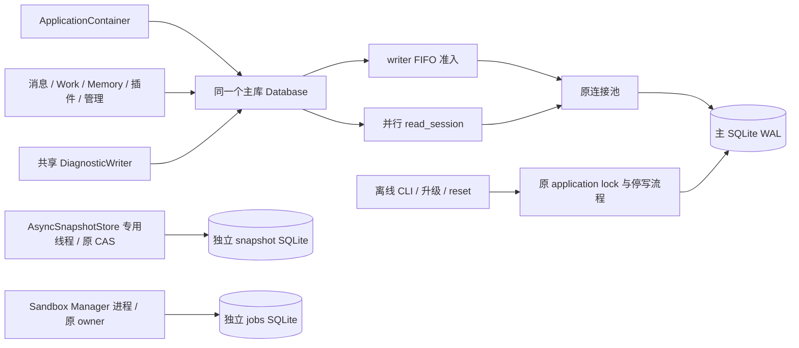

# SQLite统一写入实施记录

源码起点：`c2ce7da66ab54efe192993b9615df48266a62137`。分支
`codex/sqlite-writer-runtime-20261023`。完整范围认[任务书](../architecture/Yuki-SQLite统一写入与短事务重构任务书-2026-10-22.md)。

状态：产品实现与 R1/R2/R3 全范围复审完成，最终产品快照为 `d23a487d`。
最终全仓 Ruff、mypy 与依赖锁检查通过；44 轮性能确认与真实 512 MiB 对照已完成。
Linux CI 的 93 项 Native 已通过；integration 首次 831 passed、2 处旧测试调用失败，迁移后定向 23 项通过，最终全量待合流重跑。
未合并、未部署。任务逐项落点见[交付对照](sqlite-writer-acceptance-20261023.md)，测量见[性能报告](sqlite-writer-performance-20261023.md)。

## 分工

- 主审：Database/driver、optional_session、CommitHints、SQLite diagnostics、装配/健康/生命周期、
  tool_results/Codemode、Automation全链、Self repository、全局测试与性能、共同文档、最终PR。
- A：[身份/入账/控制面实施](sqlite-writer-implementation-a-20261023.md)，包含People、route、
  canonical/projection、App/配置和独立库，Automation已交主审。
- B：[Memory实施](sqlite-writer-implementation-b-20261023.md)，包含mutation/Dream/Rebuild/
  Embedding/quality、Self control与quiet调度合流；Self initiative由A完成，repository由主审完成。
- C：[Work/Social/插件/Services实施](sqlite-writer-implementation-c-20261023.md)。

## 公共入口当前变化

Database拥有FIFO准入，writer在checkout/BEGIN之前等待；read_session不排队、不自动commit，
只对自己创建的reader关闭autoflush。optional_session复用供给session，owned write进入统一入口。
正常连接池继续复用，业务仍在原协程执行。公开sessions别名、apply_snapshot_write、Memory apply_evidence_write及其first-write重试机制已删除。
SQLite checkout 不再逐次执行 pre_ping；实际 acquisition 由 owned reader/writer 持有，取消时等原 driver 收尾。
不是给读取排队，也不在每次读前加新的业务 BEGIN。原显式一致读保留。

aiosqlite 0.22.1的stop返回实际worker退出future，SQLAlchemy强制退出会丢掉该future。
SQLiteConnection保留同一次close-and-stop完成，公共writer等其结束；正常写不关闭连接。
SQLAlchemy flush取消还可能被内部rollback错误替代，公共边界保原异常链中的真实取消。

错误分类保原异常，使用实际phase、rollback/commit确认，公开committed三态与uncertain/
retryable查询。未知不因BUSY代码变成未提交。根commit成功且owner释放后同步发布原hint，
删HintSession；live span通知保留。SQLiteDiagnostics删holders/first-write/物理ID和全部
观察用dialect/raw_connection包装，只保SQL与公共owner阶段的内存计时。

健康分别说明读可用和writer是否接纳。大生成JSON清单可由基线源码重建，不进入PR；
保审查结论、生成脚本和材料校验记录。

## 已执行的公共验证

最终公共 owner 组共 47 passed：database_writer、database_acquisition_cancellation、schema_guard_startup、
diagnostic_writer、offline_database_owners、database_lifecycle_ownership、automation_unknown_commit。
文件 WAL 与真实线程 barrier 覆盖 FIFO/排队取消、并行读、autoflush、根提交 hint、连接取得/BEGIN/SQL/
flush/commit/rollback/物理关闭的取消及重复取消、外部 BUSY、commit ACK 丢失、连接复用和应用资源所有权。
最终局部 eager 调度改动也在该组内；A 独立复读并补跑 4 项既有取消/ACK 回归通过。

最终 `ruff check .`、`mypy src --platform linux`（646 source files）、`uv lock --check --offline`、
`git diff --check` 均通过。R3 最后删除的两个文件是无消费者的 GroupAdminService 和合入 Memory 的泛型
job_claim helper。此前逐域验证见各报告，重叠用例不累计为一轮全仓结果。

## 剩余交付

- 按用户后续授权合流 #494 历史来源优化与 #497 本地 Agent 连接，保原来源、paid、writer 与生命周期合同。
- 在最终合流源码上完成约 2.5 GiB 历史组及质量/完整 CI，保留本次全部 48+44 轮与资源对照。
- 合并全部三个 PR 后按 Bot-only 流程备份、替换、核验和清理，并连接本机 Codex；实际结果分项记录。

## 实现后的三轮复审

每轮在同一全范围清单上轮转。D 域包含装配、Schema/操作材料和独立资源，不以修改文件清单缩小范围。
表中 A/B/C 是原实现域；root 的公共边界、Automation、SELF repository 和 WorkWait 作为交叉审查项显式保留。

| 轮次 | 原 A 域 | Memory 与 SELF | 原 C 域 | 公共边界与全局 |
| --- | --- | --- | --- | --- |
| R1 | [C 审查](sqlite-writer-review-r1-c-20261023.md) | [A 审查](sqlite-writer-review-r1-a-20261023.md) | [B 审查](sqlite-writer-review-r1-b-20261023.md) | [root 审查](sqlite-writer-review-r1-root-20261023.md) |
| R2 | [B 审查](sqlite-writer-review-r2-b-20261023.md) | [root 审查](sqlite-writer-review-r2-root-20261023.md) | [A 审查](sqlite-writer-review-r2-a-20261023.md) | [C 审查](sqlite-writer-review-r2-c-20261023.md) |
| R3 | [A 审查](sqlite-writer-review-r3-a-20261023.md) | [C 审查](sqlite-writer-review-r3-c-20261023.md) | [root 与 supplemental](sqlite-writer-review-r3-root-20261023.md) | [B 审查](sqlite-writer-review-r3-b-20261023.md) |

R1 期间全量 Windows unit 分段检查与 integration 发现的问题、实际修复和复验见各报告，不将分段数字
相加称作一次全绿。本机 WSL Debian 已准备独立 Python 3.12 环境，Windows 缺 fcntl 的三份媒体回归
在 Linux 补跑 32 项通过；最终全量与 native CI 另记。R1 修正后，全仓 Ruff、mypy 648 源码和 lock 校验通过。
性能脚本已完成新旧 checkout 的真实逻辑与测量方法冒烟，正式 paired 结论另记。R2 全仓 Ruff、mypy 648 源码通过。

## 实际资源与提交所有权

Protocol/Artifact 的大文件准备和外部调用先结束，再进入所属 writer；GC 沿原标记、释放、文件处理、确认顺序。
独立 manifest 的短原子发布仍使用自己的同步 owner，不并入主库 FIFO。直接注入的 Database 由调用者关闭，
ApplicationContainer.create 创建的 Database 由应用生命周期关闭；启动前置初始化也进入同一生命周期回滚。
